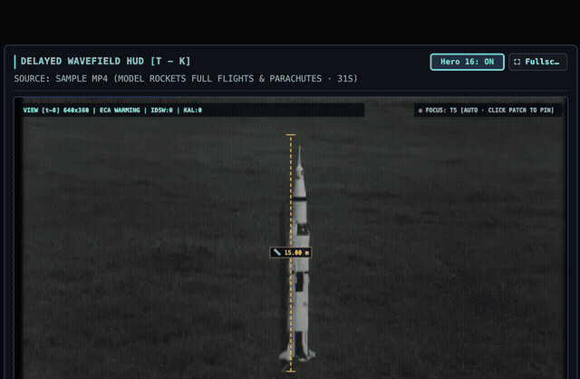
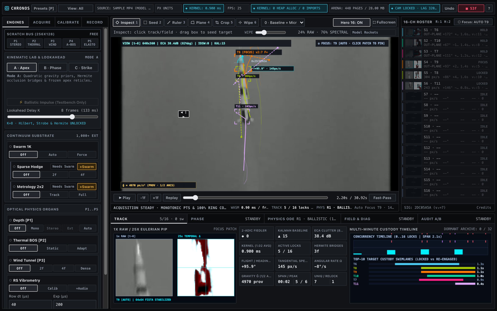
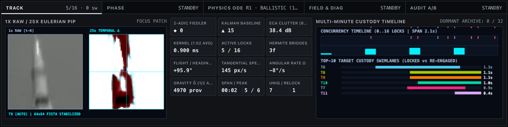
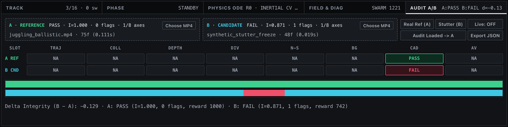

# CHRONOS-SPECTRAL

[](https://steph4n-gh.github.io/chronos-spectral/)
[](https://github.com/steph4n-gh/chronos-spectral/actions/workflows/ci.yml)
[](./LICENSE)

**[Launch Optical Physics Instrument ->](https://steph4n-gh.github.io/chronos-spectral/)** · **[Open Preset Bench (`?view=deck`) ->](https://steph4n-gh.github.io/chronos-spectral/?view=deck)** · **[Architecture & Math](./docs/ARCHITECTURE_AND_MATH.md)** · **[UI & Telemetry Guide](./docs/UI_TELEMETRY_GUIDE.md)** · **[Acquisition & Failure Modes](./docs/ACQUISITION_AND_FAILURE_MODES.md)** · **[Verification & Benchmarks](./docs/VERIFICATION_AND_BENCHMARKS.md)**

CHRONOS-SPECTRAL turns raw video pixels into occlusion-bridged trajectories, symbolic differential equations, `64x36` continuum and Hodge flow decompositions, `256x128` Background-Oriented Schlieren (BOS) refraction fields, rolling-shutter vibrometry maps, zero-ML monocular and stereo depth estimates, pocket wind-tunnel lift and pressure fields, kHz optical elastography maps, and deterministic 8-axis physics integrity audits inside one zero-allocation kernel. It solves tracking, phase estimation, and physical system identification from classical signal processing and variational mechanics instead of trained neural networks.

The entire kernel compiles from one zero-dependency `#![no_std]` Rust codebase into a `2.79 MiB` (`2,927,068 B`) WebAssembly binary (`wasm32-unknown-unknown` `+simd128`) pinned to a fixed `28.00 MiB` (`448`-page, `29,360,128 B`) linear memory arena (`Arena = 29,080,704 B`, `dualStaticEnd = 29,168,704 B`), with `101` exports, `0` host imports, `0` runtime heap allocations, `0` `memory.grow` ops, `0` indirect calls, `0` `MaybeUninit` blocks, and `6` `unsafe` tokens inside the continuum module (one SIMD128 `k`-NN candidate scan). The same source compiles natively with bit-identical output across ARM NEON, x86-64 SSE2/SSSE3/SSE4.1, and portable scalar backends, exposing a multi-instance Rust SDK, a C11/C++11 ABI (`ABI 4`), a parallel `chronos` CLI (with native `1280x720` `hires-720p`), and the zero-dependency Python `chronos-audit` verifier.

## Live demonstrations

> **Try it live in your browser (zero install, zero upload):** Open the **[CHRONOS-SPECTRAL Optical Physics Instrument](https://steph4n-gh.github.io/chronos-spectral/)** to drop any local MP4 or WebM onto the viewport (`0` bytes leave your device), attach a live webcam or stream, run an isolated **Audit A/B** physics check, or load any of `53` one-click physics recipes (`[P]`) with **Load** or **Settings Only**.

<table>
  <tr>
    <td width="50%" align="center">
      <br />
      <strong>Starling Murmuration Swarm (1,452 peak targets, 1.89 ms median HD)</strong><br />
      Real-camera <code>640x360</code> footage with Hero-16 reticles toggled off (<code>Hero 16: OFF</code>), isolating micro-track velocity stems and the <code>64x36</code> Eulerian speed field.
    </td>
    <td width="50%" align="center">
      <br />
      <strong>Model Rockets: Ignition, Separation, and Parachutes</strong><br />
      Single-core non-causal tracking across pad exhaust, stage separation, bounded Hermite cloud bridges, apogee rollover, and twin canopy deployment.
    </td>
  </tr>
  <tr>
    <td width="50%" align="center">
      <br />
      <strong>Controlled-Tripod BOS Schlieren Thermal Plume (<code>256x128</code>)</strong><br />
      Resolves sub-pixel refractive displacement <code>|eps|</code> and inhomogeneous Neumann Poisson potential <code>Phi</code> from clear convection over a 16-frame static tripod reference.
    </td>
    <td width="50%" align="center">
      <br />
      <strong><code>64x36</code> Mesh Hodge Coexact Decomposition (<code>vortex_swarm_1200</code>)</strong><br />
      Separates solenoidal circulation (<code>curl* psi</code>) from exact gradient flow (<code>grad phi</code>) and harmonic circulation carriers (<code>beta_1</code>) on a consistent discrete 2-complex.
    </td>
  </tr>
</table>

*All four animations and the panel screenshots below are captured directly from headless Chromium running the `OffscreenCanvas` WebGL2/2D instrument (`node scripts/capture_docs_media.mjs`).*

## Why this exists and what makes it unique

Most video perception stacks fall into two camps: neural detectors (`YOLO`/`SAM` paired with `ByteTrack`) that fail outside their training distribution and require gigabytes of VRAM, or classical causal filters (`OpenCV` optical flow + Kalman) that smooth away sharp impacts, lag during phase estimation, and swap IDs whenever identical objects cross behind clutter. CHRONOS-SPECTRAL occupies a third space: a deterministic visual physics instrument in `2.79 MiB` of portable WebAssembly and native SIMD Rust.

| Capability | Neural Detector + Sort (`YOLO`/`SAM`) | Classical Causal (`OpenCV` + Kalman) | CHRONOS-SPECTRAL (`v3.5.0`) |
| :--- | :--- | :--- | :--- |
| Object taxonomy and training | Requires labeled classes and weights | Class-agnostic blobs | Zero ML, zero weights: arbitrary unknown targets on frame 1 |
| Auto-exposure and camera motion | Vulnerable without domain augmentation | Thresholding breaks on exposure steps | 6/8-DoF Huber-IRLS ego-motion + orthogonal Rank-2 ECA (`36-64 dB` suppression) |
| Crossing identical targets | Re-ID struggles on indistinguishable objects | Spatial proximity causes ID swaps | Shifted Lanczos Fiedler partitioning + `i32.clz` Haar-Morton `v2` affinity |
| Opaque occlusions and sharp impacts | Interpolates offline; Kalman rounds corners | Causal drift; corners smear across hits | `12`-frame lookahead (`t - K`): backward re-tracking, bounded Hermite bridges, 2-pass IRL1 FISTA |
| Dense `1,000-3,072` swarm association | Slow without server GPUs | `O(N^2)` distance checks bottle at `< 300` | `16`-bit Morton radix sort + `3x3` `u16` CSR (`21.94x` speedup) + `epsilon`-Auction (`< 1.9 ms` at `1,452` targets) |
| Continuum, Schlieren, depth, fluid, and elastography | None | Separate offline libraries | `64x36` continuum/Hodge/RS-Welch/wind/depth, `256x128` BOS/stereo/acoustic-BOS, `8`-axis physics integrity audit SDK |
| Runtime footprint | `50 MB - 4 GB` weights + CUDA/ONNX | Variable C++ heap and OS threads | `2.79 MiB` Wasm, `28.00 MiB` (`448`-page) fixed static arena, `0` imports, `0` heap allocs |

Five architectural decisions produce these guarantees:

1. **Deliberate `12`-frame non-causal lookahead (`t - K`):** Holding `0..11` future frames (`0..183 ms` at `60 fps`) inside `Arena.rgba_ring` lets the tracker inspect pixels after an occlusion clears, walk backward through buffered frames to recover missed detections, pin gaps with tangent-bounded cubic Hermite splines (`src/fista.rs`), keep corners sharp during collisions or rocket ignition via 2-pass IRL1 Dual Projected-FISTA, and run a centered `15`-tap FIR Hilbert filter with zero group delay.
2. **Pixels to physical laws and discrete exterior calculus:** Trajectories and dense micro-tracks feed weak-form STRidge/AICc symbolic ODE discovery (`src/physics_id.rs`), four-branch occluded collision conservation (`UNIQUE`, `AMBIGUOUS`, `VIOLATED`), `64x36` Eulerian vorticity and FTLE ridges (`src/continuum_physics.rs`), SSOR-PCG `64x36` Hodge `2`-complex decompositions (`src/hodge.rs`), DEC pocket wind-tunnel pressure/lift/viscosity inversion (`src/wind_tunnel.rs`), and kHz optical elastography with Poynting power flow (`src/elastography.rs`).
3. **Fail-closed metrology and explicit provenance:** Native `1:1` ROI metadata (`D4` orientation, scan direction, monotonic PTS), `160x160` Fovea PTZ slew, `2x2` track covariance with looming suppression (`src/soa_tracks.rs`), `256x128` BOS Schlieren (`src/bos.rs`), `64x36` RS Welch vibrometry (`src/vibrometry.rs`), and zero-ML depth (`src/depth.rs`) refuse invalid geometry, pure camera yaw, tripod shocks, exposure nulls (`|H(f)| < 0.05`), 3D fluid divergence, or clock skew instead of emitting fabricated measurements.
4. **Hard-real-time `#![no_std]` determinism and native bit-parity:** Every buffer lives at compile-time fixed offsets (`wasm-objdump` verified: `101` exports, `0` imports, `0` `memory.grow`, `13,536 / 16,384 B` max shadow stack). Five high-resolution organs share the `256x128` BOS scratch bus (`P1..P5`) under deterministic priority arbitration. Native NEON, SSE, and scalar builds replay recorded Wasm kernel sessions bit for bit with `0` mismatches.
5. **Zero-ML physics integrity auditing:** The `chronos-audit/1` engine (`native/capi/src/audit.rs`, `native/python/chronos_audit.py`, and the browser **Audit A/B** tab) scores real or generated videos across `8` physical laws with explicit `NA` applicability gating and anti-gaming RLVR reward scoring (`-1000` on blank or static decoys).

## Standalone modules and native SDK worth reusing

Every subsystem is factored with narrow dependencies under the [Apache License 2.0](./LICENSE), so you can extract individual algorithms or link the native library without adopting the browser UI:

| Need in your project | Reusable module | What it implements |
| :--- | :--- | :--- |
| Track `1,000-3,072` featureless points in `< 2 ms` on CPU with directional uncertainty | [src/soa_tracks.rs](./src/soa_tracks.rs) | Lock-free Structure-of-Arrays pipeline: `16`-bit Morton Z-order radix sort, `3x3` `u16` CSR pruning (`21.94x` speedup), fixed-point `epsilon`-Auction, `8x8` Huber IC-LK refinement, `2x2` track covariance, looming-suppressed LOO residuals, and Auto-Hero promotion. |
| Turn sparse point velocities into vorticity, FTLE ridges, rigid bodies, or vibration maps | [src/continuum_physics.rs](./src/continuum_physics.rs) | Safe Rust outside `6` `unsafe` tokens in one SIMD128 `k`-NN scan: `k=6` spatial graph strain, Procrustes `SE(2)` clustering (`32` bodies, unwrapped $\omega$), `64x36` Eulerian gradients, 2-bank Cauchy-Green FTLE, modal PLL resonators ($R_2$), and validity masking. |
| Decompose noisy discrete vector fields into exact, coexact, and harmonic parts | [src/hodge.rs](./src/hodge.rs) | Bounded `64x36` discrete Hodge `2`-complex `(V=2304, E=4508, F=2205)` over one positive `W_1` edge metric, SSOR-preconditioned PCG, enclosed-hole vs open-port flood filling ($\beta_1$), and `UNCONV` gating. |
| Extract `256x128` sub-pixel refraction fields from stationary tripod BOS footage | [src/bos.rs](./src/bos.rs) | `256x128` affine Lucas-Kanade displacement against a `16`-frame reference, curl check, radix-2 DCT-II/III fast inhomogeneous Neumann Poisson solver, and quiet gauge-ROI referencing. |
| Recover structural vibration modes from calibrated rolling-shutter video + audio | [src/vibrometry.rs](./src/vibrometry.rs) | `D4` scan-time inversion, `32` bands on a `64x36` grid, `2,048`-point Welch FFT (`128` bins), exposure sinc compensation (`EXPOSURE_NULL` guard), `K >= 8` Bonferroni coherence, and fail-closed `CLOCK_SKEW` / `NO_PTS` / `AXIS_TRANSPOSED` refusals. |
| Estimate zero-ML depth, FoE/TTC, or calibrated `256x128` stereo disparity | [src/depth.rs](./src/depth.rs) | `8`-frame OLS monocular motion parallax with 3-DoF Huber-IRLS pure-rotation refusal, RANSAC FoE and `1/r(t)` optical looming TTC, `256x128` ZNCC+IC-LK stereo disparity, and consume-once external depth-plane provenance firewall. |
| Recover optical pressure, lift/drag, and viscosity from planar fluid flow | [src/wind_tunnel.rs](./src/wind_tunnel.rs) | `64x36` DEC pressure Poisson on active Hodge complexes, dual contour + control-volume $C_L/C_D$ vs Kutta-Joukowski, weak-form STRidge viscosity $\nu$, and dense-LK Mode `3` `READY_FIELD_ONLY` fallback. |
| Measure kHz plate/tissue wave speed, crack sinks, or `-18 dB` lock-in acoustic BOS | [src/elastography.rs](./src/elastography.rs) | Multi-tone `2M x 2M` Cholesky rolling-shutter demodulator, wrap-free Poynting wavevectors, dispersion classifier (`KIRCHHOFF_PLATE` vs `MEMBRANE_SHEAR`), Hodge power-flow exciter/crack localization, and `256x128` lock-in acoustic BOS. |
| Discover governing ODEs or score occluded collision conservation | [src/physics_id.rs](./src/physics_id.rs) | Weak-form STRidge + AICc model selection across `9` regimes, `f64` Jacobi Taubin circle fitting, AGM elliptic pendulum period $K(m)$, `4D` Rosenstein Lyapunov divergence, Kuramoto sync, and four-branch occluded collision conservation. |
| Smooth noisy position tracks without smearing collisions or launches | [src/fista.rs](./src/fista.rs) | Constant-time 2-pass IRL1 Dual Projected-FISTA trend filter with tangent-bounded cubic Hermite bridges, clamping guards, and exact convex duality gap $P(X) - D(u)$. |
| Register panning/homography cameras and cancel exposure flicker with SIMD128 | [src/ego_motion.rs](./src/ego_motion.rs), [src/simd_ops.rs](./src/simd_ops.rs), [src/simd/](./src/simd/mod.rs) | Portable Wasm SIMD128 / ARM NEON / x86-64 SSE / scalar vector layer, 6/8-DoF Huber-IRLS ego-motion with RANSAC fallback, Rank-2 ECA (`36-64 dB`), Catmull-Rom pan advection, and `i32.clz` Haar-Morton wavelets. |
| Embed multi-instance tracking or 8-axis physics auditing in Rust, C/C++, or Python | [src/native.rs](./src/native.rs), [native/capi/](./native/capi/src/lib.rs), [native/include/chronos.h](./native/include/chronos.h), [native/python/](./native/python/chronos_audit.py), [native/cli/main.rs](./native/cli/main.rs) | Thread-safe heap-allocated `ChronosEngine` (including `hires-720p`), C11/C++11 ABI `4`, zero-copy NumPy field views, parallel `chronos` CLI, and zero-dependency `chronos-audit` 8-axis physics integrity verifier. |
| Build a zero-framework, zero-CLS browser optical instrument | [web/index.html](./web/index.html), [web/ui/](./web/ui/main.js), [web/worker.js](./web/worker.js), [scripts/dev_server.mjs](./scripts/dev_server.mjs) | Precision-graphite 4-tab rack + 5-meter scope bay (`194,400`-state verified FSM, `CLS = 0.000000`), `OffscreenCanvas` WebGL2 compositor, Worker WebCodecs fast-pass, lazy Audit A/B worker, and SSRF-hardened fMP4 MSE live relay. |

## Quickstart

Prerequisites: Rust (`rust-toolchain.toml` pins `1.99.0` with `wasm32-unknown-unknown`), Node.js (`v22+`), and `python3`. Install `wabt` (`wasm-objdump`), `ffmpeg`, and Google Chrome for the full MP4 calibration and headless Chrome E2E verification suites.

### Browser instrument and full verification

Compile `web/chronos_spectral.wasm`, run all offline verification gates (`--check`), and launch the local server at `http://127.0.0.1:8080` (serving the v3.5.0 Optical Physics Instrument at `/`, `?preset=<key>` deep-links, and backward-compatible `/?view=deck` or `/deck.html`):

```bash
./build.sh
```

Run the offline verification pipeline without starting a server (release build, `wasm-objdump` static audit, mathematical counterexample `Gates A-P`, `5x2` SD/HD pillar benchmark, `Gate Q`, Wave-1/Wave-2/v3.2-v3.4 gates `I0-I10n`, `Gate X` C-ABI fuzz, `Gate S` SIMD conformance, `Gate N` native/wasm bit-parity across `8` scenarios, and `Gate UI` over `194,400` states):

```bash
./build.sh --check
```

Run only the build, static audit, `Gate S`, `Gate I10n`, `Gate N`, and `Gate UI` (what the macOS arm64 CI job runs to prove the native NEON backend; requires no Chrome):

```bash
./build.sh --native-check
```

Run the complete verification pipeline (`--check`, Gate `I6` Chrome physical captures, SD/HD MP4 CLEAR-MOT calibration gates, and headless Chrome CDP `Steps 1-14`):

```bash
./build.sh --e2e
```

### Native CLI, C ABI v4, and Python `chronos-audit` SDK

Build the multi-instance native shared library (`libchronos_capi`), parallel `chronos` CLI, and run the zero-dependency Python 8-axis physics integrity auditor:

```bash
# Build native C ABI v4 shared library (and optionally add --features hires-720p)
cargo build --release --manifest-path native/capi/Cargo.toml --target host-tuple --target-dir native/target

# Build native multi-worker CLI (supports --sd, --hd, --720p, --jobs N, --ndjson, rtsp://)
cargo build --release --manifest-path native/Cargo.toml --target host-tuple --bin chronos --features hires-720p

# Audit any local MP4 or compare two clips across 8 physical laws (zero ML weights)
python3 native/python/chronos_audit.py audit web/samples/juggling_ballistic.mp4 --profile standard
python3 native/python/chronos_audit.py compare web/samples/wind_lifting_cylinder_cp.mp4 web/samples/real_karman_mri_cylinder.mp4 --profile dense_fluid
```

## Optical Physics Instrument tour



Every status annunciator, rack control, pointer tool, overlay mode, scope bay tab, and exported ABI buffer is documented with Retina screenshots in the **[UI and Telemetry Guide](./docs/UI_TELEMETRY_GUIDE.md)**.

<table>
  <tr>
    <td width="50%" align="center">
      <br />
      <strong>Scope Bay: Track, Split PiP &amp; Custody Timeline</strong><br />
      Stabilized <code>64x64</code> raw patch beside its <code>25x</code> temporal contrast delta, swap/kinematic KPIs, and multi-minute target custody swimlanes.
    </td>
    <td width="50%" align="center">
      <br />
      <strong>Scope Bay: In-Situ Physics ODE &amp; Conservation</strong><br />
      Discovers weak-form symbolic ODEs, exact AGM elliptic periods, Jacobi Taubin curvature, phase/energy traces, and occluded collision conservation.
    </td>
  </tr>
  <tr>
    <td width="50%" align="center">
      <br />
      <strong>Scope Bay: Continuum, <code>64x36</code> Hodge &amp; Expert Diagnostics</strong><br />
      Separates kernel latency from pipeline overhead and exposes click-to-inspect micro-tracks, vorticity/FTLE peaks, <code>SE(2)</code> rigid bodies, and all <code>19</code> organ readouts.
    </td>
    <td width="50%" align="center">
      <br />
      <strong>Scope Bay: Isolated 8-Axis Physics Integrity Audit A/B</strong><br />
      Lazy Wasm worker compares Slot A and Slot B across <code>8</code> physical laws with clickable per-frame severity timelines, delta integrity, and JSON export.
    </td>
  </tr>
</table>

## Certified performance and accuracy

Numbers below come from deterministic Node + V8 harnesses on an Apple M4 Pro (`CHRONOS_CI_BUDGET_SCALE = 1.00`, `640x360` HD unless noted) on the `v3.5.0` binary (`2,927,068 B`). Full methodology, native-vs-wasm timings, ablations, dual-mode standby overhead proofs, and standalone CLI commands live in **[Verification and Benchmarks](./docs/VERIFICATION_AND_BENCHMARKS.md)**.

### High-density swarm and continuum performance (`Gate Q`)

Evaluated headless via `scripts/benchmark_1000.mjs --gate` with zero ground-truth hints passed to Wasm (`21/21` Gate Q checks passing):

| Suite / Scenario | Peak / P10 Confirmed | Accuracy and Physics Verification | Mean / p50 Kernel | p95 Kernel |
| :--- | :--- | :--- | :--- | :--- |
| `Q1: vortex_swarm_1200` | `1,209` / `1,200` | `HOTA 99.9%`, `IDSW 1`, vorticity Pearson `r = 0.9953`, `ftleCells = 1,910` (`64x36`) | `1.53 ms` / `1.50 ms` | `1.82 ms` |
| `Q2: murmuration_1200` | `1,219` / `1,208` | `HOTA 99.8%`, `IDSW 0`, `3/3` `SE(2)` bodies (`joint 100% / 96% / 97%`) | `1.80 ms` / `1.84 ms` | `2.17 ms` |
| `Q3: modal_beam_1152` | `1,145` / `1,140` | `3.000 Hz` (median `2.999 Hz`), coh `0.977`, `R_2 = 0.951`, `|Delta phi - pi| = 0.039` rad | `1.65 ms` / `1.71 ms` | `1.90 ms` |
| `Q4: starling_murmuration_1000.mp4` | `1,452` / `1,127` | Real `30 fps` H.264 flock (`movingDarkFeat1to1Prec = 67.0%`, `parityErr = 0`) | `1.88 ms` / `1.89 ms` | `2.25 ms` |
| `SWEEP: N = 1,536` | `1,536` / `1,474` | `Recall 100.0%`, `MOTA 100.0%`, `RMSE 0.059 px`, `HOTA 100.0%` | `1.43 ms` / `1.40 ms` | `1.88 ms` |

Running the standalone Q2 association ablation (`node scripts/benchmark_1000.mjs --only=Q2,ABLATION`) measures a **`21.94x` speedup** from 16-bit Morton Z-order sorting + `3x3` CSR neighborhood indexing (`13.631 ms` JS Nearest-Greedy down to `0.621 ms` JS Morton-CSR+Greedy), while the full SIMD128 Wasm pipeline (Morton-CSR + integer `epsilon`-Auction + `8x8` Huber IC-LK) lifts accuracy from `96.9%` Recall / `0.178 px` RMSE / `121` IDSW (`94.7%` HOTA) to **`100.0%` Recall / `0.04 px` RMSE / `0` IDSW (`99.8%` HOTA)**.

### Real-camera physics and occlusion calibration clips

`scripts/calibrate_mp4.mjs` checks CLEAR-MOT trajectories, negative non-periodic gates, SD/HD gravity scaling, and physical invariants across compressed open-licensed H.264 clips:

| Sample clip | Mathematical proof target | SD (`320x180`) Recall / RMSE | HD (`640x360`) Recall / RMSE | Verified HD physics proof |
| :--- | :--- | :--- | :--- | :--- |
| [juggling_ballistic.mp4](./web/samples/juggling_ballistic.mp4) (`25 fps`) | Mode A multi-arc `g_hat` and flight angle | `75.9%` / `9.30 px` | `77.6%` / `15.18 px` | `6`-arc Auto-`g` (`1.7%` SD/HD `2x` err), `0` false Hz |
| [roundabout_occlusion.mp4](./web/samples/roundabout_occlusion.mp4) (`24 fps`) | Mode A gantry bridge + homography `H` | `94.0%` / `9.99 px` | `93.0%` / `18.22 px` | `9f` Hermite bridges, `0` false pivots, `0` false Hz |
| [galileo_pendulum_peg.mp4](./web/samples/galileo_pendulum_peg.mp4) (`30 fps`) | Kasa virtual pivot and swing angle | `100.0%` / `7.81 px` | `100.0%` / `3.20 px` | `61f` synchronized virtual pivot (`0` IDSW) |
| [harmonic_metronome_phase.mp4](./web/samples/harmonic_metronome_phase.mp4) (`30 fps`) | Mode B Nikko `96 BPM` (`0.80 Hz`) + pivot | `89.0%` / `14.05 px` | `96.0%` / `24.64 px` | `108f` `0.82 Hz` lock (`SD 0.80 Hz`) + `110f` pivot |
| [carom_billiards_impulses.mp4](./web/samples/carom_billiards_impulses.mp4) (`30 fps`) | Mode C deflection, `v+/v-`, and `H` | `92.6%` / `9.54 px` | `93.3%` / `19.80 px` | `30` L1 strikes + `117.3 deg` (`SD 27.2 deg`) scatter (`0` false Hz) |

In paired sparse-mode parity testing across all 13 non-swarm calibration clips (`52/52` SD/HD checks, `624` length-preselected trials, `467,448` warm frames), enabling `Auto-Density` swarm probing imposes `< 1 microsecond` (`0.00067 ms`) pooled upper-95th-percentile overhead with `0` output mismatches against `Swarm: Off`.

## Documentation map

| Document | Diataxis type | What it covers |
| :--- | :--- | :--- |
| [Architecture and Math](./docs/ARCHITECTURE_AND_MATH.md) | Explanation | `448`-page Arena layout (`29,080,704 B`), 6/8-DoF ego-motion, Rank-2 ECA, `12`-frame lookahead, bounded Hermite + IRL1 FISTA, `i32.clz` Haar-Morton, Lanczos Fiedler, `3,072`-slot Morton-CSR Auction, `64x36` continuum & Hodge, `256x128` BOS scratch bus (`P1..P5`), RS vibrometry, zero-ML depth & stereo, pocket wind tunnel, kHz elastography, native SDK, and 8-axis physics audit. |
| [UI and Telemetry Guide](./docs/UI_TELEMETRY_GUIDE.md) | Reference | Region-by-region manual for the v3.5.0 Optical Physics Instrument with `17` Retina screenshots, verified `194,400`-state FSM, shared BOS scratch bus, `53`-recipe Presets Drawer, Audit A/B bench, `56`-column export schema, and complete Wasm + Native C ABI appendices. |
| [Acquisition and Failure Modes](./docs/ACQUISITION_AND_FAILURE_MODES.md) | Explanation and Reference | Mandatory acquisition profiles, `1:1` native ROI vs codec quantization floors, pinhole perspective bounds, tripod BOS, rolling-shutter/Hodge/conservation guards, monocular/stereo depth refusals, pocket wind-tunnel divergence and dense-LK caps, elastography aliasing/mutex guards, and 8-axis audit `NA` semantics. |
| [Verification and Benchmarks](./docs/VERIFICATION_AND_BENCHMARKS.md) | How-to and Reference | CLI verification recipes (`--check`, `--native-check`, `--e2e`, `gate_i*.mjs`, `verify_ui_fsm.mjs`, `calibrate_mp4.mjs`, `benchmark_1000.mjs`, `capture_docs_media.mjs`), `v3.5.0` static binary audit, Gates `A-Q`, `I0-I10n`, `X`, `S`, `N`, `UI`, Chrome CDP Steps `1-14`, CSTRACE parity, Miri shards, CI architecture, and native-vs-wasm benchmark records. |

## Repository layout

- [LICENSE](./LICENSE) and [NOTICE](./NOTICE): Apache License 2.0 terms for code, scripts, docs, and `web/chronos_spectral.wasm`, plus Section 4(d) notice separating standalone media clips.
- [Cargo.toml](./Cargo.toml), [rust-toolchain.toml](./rust-toolchain.toml), and [.cargo/config.toml](./.cargo/config.toml): Zero-dependency `cdylib` Wasm build pinned to Rust `1.99.0` (`opt-level = 3`, fat LTO, `panic = "abort"`, `+simd128`, `16 KiB` stack, `initial-memory = max-memory = 448` pages).
- [src/](./src/lib.rs): Core `#![no_std]` kernel (`lib.rs`, `ego_motion.rs`, `fista.rs`, `lanczos.rs`, `physics_id.rs`, `soa_tracks.rs`, `continuum_physics.rs`, `bos.rs`, `hodge.rs`, `vibrometry.rs`, `depth.rs`, `wind_tunnel.rs`, `elastography.rs`, `simd_ops.rs`, `simd/{mod,scalar,neon,sse,conformance}.rs`, and native-only `native.rs`).
- [native/](./native/Cargo.toml): Multi-instance native Rust library (`native/Cargo.toml`), parallel `chronos` CLI (`native/cli/main.rs`), CSTRACE bit-parity replay driver (`native/replay/`), C11/C++11 ABI v4 crate and header (`native/capi/`, `native/include/chronos.h`), zero-dependency Python bindings + `chronos-audit` 8-axis verifier (`native/python/`), and native/Miri test suites (`native/tests/`).
- [web/](./web/): Unified v3.5.0 precision-graphite Optical Physics Instrument ([web/index.html](./web/index.html), [web/deck.html](./web/deck.html), [web/styles/](./web/styles/), [web/ui/](./web/ui/) with verified `194,400`-state FSM and `53` recipes), Worker + WebGL2 + WebCodecs compositor ([web/worker.js](./web/worker.js)), prebuilt `web/chronos_spectral.wasm`, and `41` sample MP4 clips ([web/samples/ATTRIBUTION.md](./web/samples/ATTRIBUTION.md)).
- [scripts/](./scripts/): Build/audit pipeline ([build.sh](./build.sh)), math/metrology/depth/wind/elasto/audit gates (`gate_i*.mjs`, `gate_abi_fuzz.mjs`, `gate_simd_conformance.mjs`, `gate_native_parity.mjs`), UI FSM and contract checks (`verify_ui_fsm.mjs`, `check_ui_contract.mjs`), Chrome CDP E2E (`e2e_browser.mjs`), calibration and swarm benchmarks (`calibrate_mp4.mjs`, `benchmark_1000.mjs`), local HTTP 206 / fMP4 relay (`dev_server.mjs`), and docs media generator (`capture_docs_media.mjs`).
- [.github/workflows/](./.github/workflows/ci.yml): Blocking CI over Wasm SIMD128 + Chrome E2E (Linux x86-64 SSE), Apple Silicon NEON (`--native-check`), and Linux x86-64 scalar parity (`ci.yml`); separate non-blocking 6-shard Stacked-Borrows Miri workflow (`miri.yml`); and automatic GitHub Pages static deployment of `web/` after blocking CI passes (`pages.yml`).

## Scope limits

- Behind a 100% opaque occluder where visibility weight `w_k = 0`, two pixel-identical targets that exchange velocities produce identical boundary observations to targets that pass straight through. Distinguishing hidden identical swaps requires distinct appearance signatures or non-crossing priors; equal-mass symmetric impacts report `AMBIGUOUS` rather than fabricating a unique branch.
- Monocular projective imagery cannot separate constant-3D-velocity radial approach ($x = f X / Z$) from line-of-sight 3D acceleration without metric scale priors; pure camera yaw refuses depth (`REFUSED_PURE_ROTATION`) rather than guessing scale.
- Controlled-tripod BOS requires an unperturbed reference interval over a textured background without rotational roll, scale breathing, or handheld shock, and reports gauge-referenced optical path gradients ($\Phi$, $\boldsymbol{\varepsilon}$) rather than uncalibrated gas density or temperature.
- Rolling-shutter vibrometry, kHz elastography, and audio-optical Welch coupling require calibrated `dt_row_us`, exposure $T_e$, monotonic timestamps, `1:1` native scan alignment, and synchronized clocks; out-of-spec acquisition, shutter nulls (`|H(f)| < 0.05`), spatial aliasing, or clock drift refuse cleanly.
- Pocket wind-tunnel pressure/lift/drag requires quasi-2D divergence-free planar PIV flow around an enclosed void ($\beta_1 \ge 1$); dense-LK Mode `3` caps at `READY_FIELD_ONLY` with zero $C_p$/$C_L$/$C_D$.
- Six Dual Projected-FISTA iterations run in bounded constant time per frame and export an explicit convex duality gap $P(X) - D(u)$ instead of iterating to machine precision.
- Real-camera MP4 files exercise the identical `<video>` / WebCodecs to RGBA to Wasm SIMD128 execution path as live camera feeds, deterministically testing H.264 compression and auto-exposure drift, but offline files do not measure physical camera-to-display photon latency on human subjects.

## License and attribution

All software source code, build and verification scripts, text documentation, and compiled WebAssembly artifacts (`web/chronos_spectral.wasm`) are licensed under the **[Apache License, Version 2.0](./LICENSE)** (see [NOTICE](./NOTICE)).

The `41` standalone demonstration, benchmark, and physical validation MP4 clips under [web/samples/](./web/samples/), together with derived demonstration GIFs and video-frame screenshots under `docs/assets/demos/` and `docs/assets/panels/`, retain their respective Creative Commons (`CC0 1.0`, `CC BY 2.0/3.0/4.0`, `CC BY-SA 3.0 nl / 3.0 / 4.0`), U.S. Government Public Domain, and Apache-2.0 terms documented in [web/samples/ATTRIBUTION.md](./web/samples/ATTRIBUTION.md).
