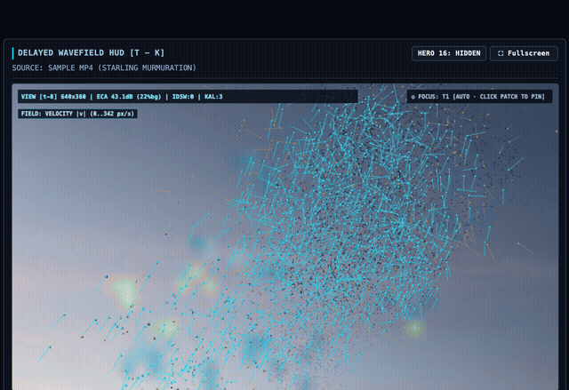
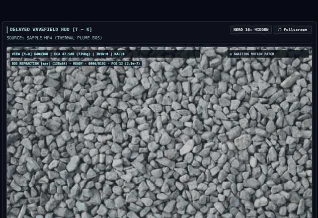
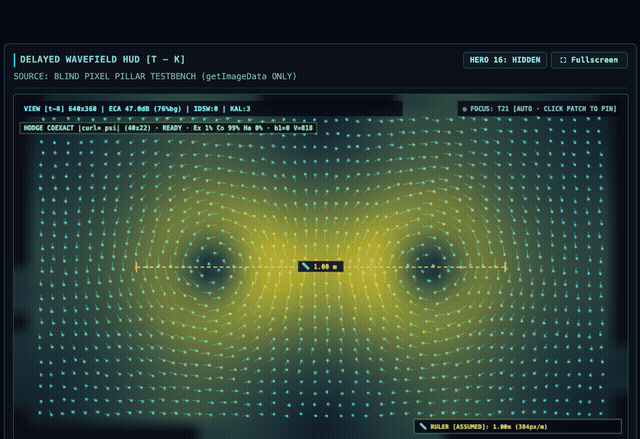
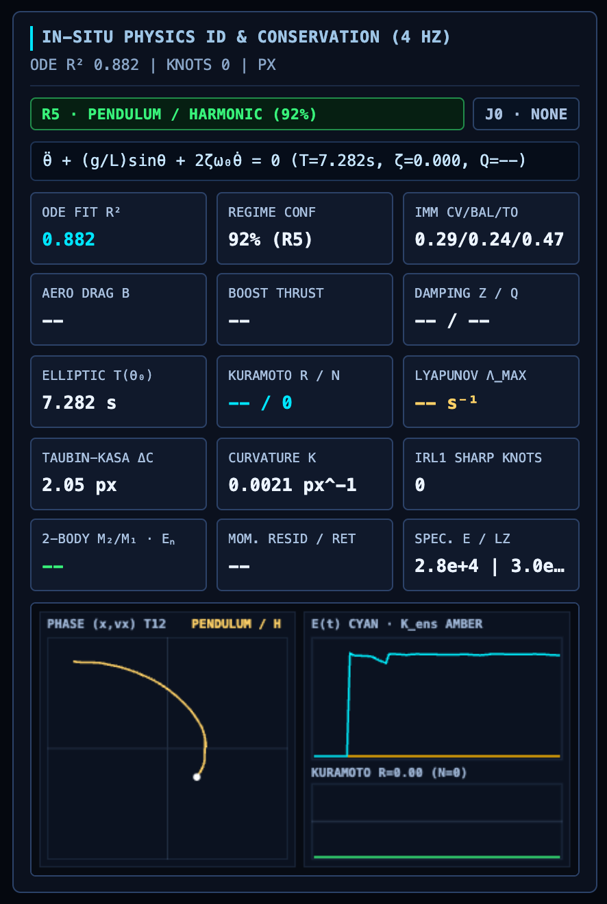
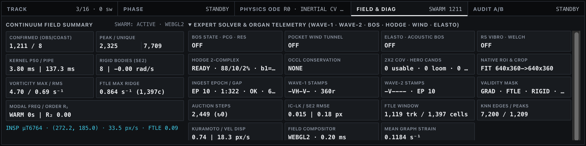

# CHRONOS-SPECTRAL

[](https://steph4n-gh.github.io/chronos-spectral/)
[](https://github.com/steph4n-gh/chronos-spectral/actions/workflows/ci.yml)
[](./LICENSE)

**[Launch Interactive Split-Wipe Showcase ->](https://steph4n-gh.github.io/chronos-spectral/)** · **[Open Full 15-Panel Command Deck ->](https://steph4n-gh.github.io/chronos-spectral/?view=deck)** · **[Architecture & Math](./docs/ARCHITECTURE_AND_MATH.md)** · **[UI & Telemetry Guide](./docs/UI_TELEMETRY_GUIDE.md)** · **[Acquisition & Failure Modes](./docs/ACQUISITION_AND_FAILURE_MODES.md)** · **[Benchmarks](./docs/VERIFICATION_AND_BENCHMARKS.md)**

CHRONOS-SPECTRAL turns raw video pixels directly into occlusion-bridged trajectories, symbolic differential equations, continuum flow decompositions, Background-Oriented Schlieren (BOS) refraction fields, and rolling-shutter vibrometry maps inside one zero-allocation WebAssembly kernel. It solves tracking, phase estimation, and physical system identification from classical signal processing and variational mechanics rather than trained neural networks.

Everything compiles into one `2.36 MiB` (`2,474,879 B`) `#![no_std]` Rust WebAssembly (`wasm32-unknown-unknown` `+simd128`) binary pinned to a fixed `28.00 MB` (`448`-page) linear memory arena (`Arena = 22,644,848 B`, `dualStaticEnd = 22,704,064 B`). The kernel has `76` exports (`memory` and `75` functions, one of them a test hook), zero host imports, zero runtime heap allocations, zero `memory.grow` ops, zero indirect calls, zero `MaybeUninit` blocks, and only `6` `unsafe` tokens inside the continuum physics module (one SIMD128 `k`-NN candidate scan).

## Live demonstrations

> **Try it live in your browser (zero install, zero upload):** Open the **[Interactive Split-Wipe Showcase](https://steph4n-gh.github.io/chronos-spectral/)** to drag the `t - K` raw-vs-spectral split-wipe across `1,400+` starlings, solid-motor model rockets, and thermal BOS plumes, drop any local MP4 onto the canvas (`0` bytes leave your device), or switch into the **[Full 15-Panel Command Deck](https://steph4n-gh.github.io/chronos-spectral/?view=deck)**.

<table>
  <tr>
    <td width="50%" align="center">
      <br />
      <strong>Starling Murmuration Swarm (1,453 peak targets, 1.72 ms median HD)</strong><br />
      Real-camera <code>640x360</code> footage with single-object reticles toggled off (<code>HERO 16: HIDDEN</code>), isolating micro-track velocity stems and the bilinear <code>40x22</code> Eulerian speed field.
    </td>
    <td width="50%" align="center">
      <br />
      <strong>Model Rockets: Ignition, Separation, and Parachutes</strong><br />
      Single-core non-causal tracking across pad exhaust, stage separation, Hermite cloud bridges, apogee rollover, and twin canopy deployment.
    </td>
  </tr>
  <tr>
    <td width="50%" align="center">
      <br />
      <strong>Controlled-Tripod BOS Schlieren Thermal Plume (<code>128x64</code>)</strong><br />
      Resolves sub-pixel refractive displacement <code>|eps|</code> and inhomogeneous Neumann Poisson potential <code>Phi</code> from clear convection over a 16-frame static tripod reference.
    </td>
    <td width="50%" align="center">
      <br />
      <strong><code>40x22</code> Mesh Hodge Coexact Decomposition (<code>vortex_swarm_1200</code>)</strong><br />
      Separates solenoidal circulation (<code>curl* psi</code>) from exact gradient flow (<code>grad phi</code>) and harmonic circulation carriers (<code>beta_1</code>) on a consistent discrete 2-complex.
    </td>
  </tr>
</table>

*All four animations are captured directly from headless Chromium running the `OffscreenCanvas` WebGL2/2D Command Deck (`node scripts/capture_docs_media.mjs`).*

## Why this exists and what makes it unique

Most video perception stacks split into two camps: heavy neural detectors (`YOLO`/`SAM` paired with `ByteTrack`) that fail outside their training distribution and demand gigabytes of VRAM, or classical causal filters (`OpenCV` optical flow + Kalman) that smooth away sharp impacts, lag during phase estimation, and swap IDs whenever identical objects cross behind clutter. CHRONOS-SPECTRAL occupies the third quadrant: a deterministic visual physics instrument in `2.36 MiB` of portable WebAssembly.

| Capability | Neural Detector + Sort (`YOLO`/`SAM`) | Classical Causal (`OpenCV` + Kalman) | CHRONOS-SPECTRAL (`v3.1.0`) |
| :--- | :--- | :--- | :--- |
| Object taxonomy and training | Requires labeled classes and weights | Class-agnostic blobs | Zero ML, zero weights: arbitrary unknown targets on frame 1 |
| Auto-exposure and camera flicker | Vulnerable without domain augmentation | Thresholding breaks on exposure steps | Orthogonal Rank-2 ECA subspace (`36-64 dB` background suppression) |
| Crossing identical targets | Re-ID struggles on indistinguishable objects | Spatial proximity causes ID swaps | Fiedler spectral partitioning + `i32.clz` Haar-Morton `v2` affinity |
| Opaque occlusions and sharp impacts | Interpolates offline; Kalman rounds corners | Causal drift; corners smear across hits | `12`-frame lookahead (`t - K`): backward re-tracking, Hermite bridges, 2-pass IRL1 FISTA |
| Dense `1,000+` swarm association | Slow without server GPUs | `O(N^2)` distance checks bottle at `< 300` | `16`-bit Morton radix sort + `3x3` CSR (`21.94x` speedup) + `epsilon`-Auction (`< 1.8 ms`) |
| Continuum, Schlieren, and RS physics | None | Separate offline libraries | `2x2` track covariance, `128x64` BOS Neumann Poisson, `40x22` Hodge 2-complex, RS + Welch audio coherence, four-branch occluded collision conservation |
| Runtime footprint | `50 MB - 4 GB` weights + CUDA/ONNX | Variable C++ heap and OS threads | `2.36 MiB` Wasm, `28.00 MB` (`448`-page) fixed static arena, `0` imports, `0` heap allocs |

Five architectural decisions create that difference:

1. **Deliberate `12`-frame non-causal lookahead (`t - K`):** By holding `0..11` future frames (`0..183 ms` at `60 fps`) inside `Arena.rgba_ring`, the tracker inspects pixels *after* an occlusion clears, walks backward through buffered frames to recover missed detections, pins irreducible gaps with cubic Hermite splines, preserves sharp corners during collisions or rocket ignition via 2-pass Iteratively Reweighted L1 (IRL1) Dual Projected-FISTA, and runs a symmetric centered 15-tap FIR Hilbert filter with zero group delay.
2. **From pixels to physical laws and discrete exterior calculus:** Trajectory histories and dense micro-tracks feed compact-support weak-form quadrature (`phi(u) = (1 - u^2)^p`) and STRidge/AICc sparse regression (`src/physics_id.rs`), four-branch occluded collision conservation (`UNIQUE`, `AMBIGUOUS`, `VIOLATED`), `40x22` Eulerian vorticity and FTLE ridges (`src/continuum_physics.rs`), and an orthogonal exact/coexact/harmonic `40x22` Hodge 2-complex decomposition (`src/hodge.rs`).
3. **Calibrated acquisition and fail-closed metrology:** Native `1:1` ROI metadata (`D4` orientation, scan direction, monotonic PTS) and per-track `2x2` inverse-Hessian covariance paired with looming-suppressed leave-one-out residuals (`src/soa_tracks.rs`) prevent pinhole foreshortening decoys. Controlled-tripod `128x64` BOS Schlieren (`src/bos.rs`) and `K >= 8` Bonferroni-corrected rolling-shutter Welch vibrometry (`src/vibrometry.rs`) refuse invalid geometry, tripod shocks, exposure nulls (`|H(f)| < 0.05`), or camera-microphone clock skew instead of emitting uncalibrated numbers.
4. **Hard-real-time `#![no_std]` determinism:** Every pixel ring, pyramid, track slot, BOS grid, Hodge solver, vibrometry Welch buffer, and continuum field occupies fixed offsets computed at compile time. Nothing allocates or calls back into the host operating system (`wasm-objdump` verified: `0` imports, `0` `memory.grow`, max shadow stack `13,776 / 16,384 B`).
5. **Honest measurement provenance (`SURVEYED` vs `ASSUMED` vs `OUT OF PLANE`):** Pixel kinematics stay strictly in pixel units until explicit calibration. Built-in clip presets carry explicit `ASSUMED` tags, 2-point rulers and 4-point DLT homographies transform vectors via the analytical perspective Jacobian `J_H`, camera pans suspend ground-plane calibration, and projective depth near the horizon (`w < 0.14`) refuses to extrapolate unbounded metric speeds.

## Standalone modules worth reusing

Each subsystem is factored with narrow dependencies under the [Apache License 2.0](./LICENSE), so you can extract individual algorithms without adopting the whole browser deck:

| Need in your project | Reusable module | What it implements and why extract it |
| :--- | :--- | :--- |
| Track `1,000-1,536` featureless points in `< 2 ms` on CPU with directional uncertainty | [src/soa_tracks.rs](./src/soa_tracks.rs) | Lock-free Structure-of-Arrays pipeline: `16`-bit Morton Z-order radix sort, `3x3` CSR pruning (`21.94x` speedup), fixed-point `epsilon`-Auction, `8x8` Huber IC-LK refinement, `2x2` track covariance `(c_xx, c_xy, c_yy)`, and looming-suppressed leave-one-out flow residuals. |
| Turn sparse point velocities into fluid vorticity, FTLE ridges, rigid bodies, or vibration mode maps | [src/continuum_physics.rs](./src/continuum_physics.rs) | Safe Rust outside one SIMD128 `k`-NN scan (`6` `unsafe` tokens confined to one SIMD128 `k`-NN candidate scan): `k=6` spatial graph strain, Procrustes `SO(2)`/`SE(2)` connected-component clustering (`32` bodies, unwrapped `omega` rad/s), `40x22` Eulerian velocity gradient/curl/divergence, 2-bank Cauchy-Green FTLE, modal PLL resonators with nematic order `R_2`, and per-subsystem validity masking. |
| Decompose noisy discrete vector fields into curl-free, divergence-free, and topological circulation parts | [src/hodge.rs](./src/hodge.rs) | Bounded `40x22` discrete Hodge `2`-complex (`(V, E, F) <= (880, 1698, 819)`) using one consistent positive edge metric `W_1`, Jacobi-PCG `grad phi` and `curl* psi` solves, enclosed-hole vs open-port flood filling (`beta_1`), and `UNCONV` convergence gating. |
| Extract sub-pixel refraction fields from stationary tripod Background-Oriented Schlieren footage | [src/bos.rs](./src/bos.rs) | `128x64` affine Lucas-Kanade optical displacement against a `16`-frame static tripod reference, curl consistency check, inhomogeneous Neumann Poisson solver (`Delta phi = div(eps)` with boundary flux), and unperturbed gauge-ROI referencing. |
| Recover structural vibration modes from calibrated rolling-shutter video + microphone audio | [src/vibrometry.rs](./src/vibrometry.rs) | `D4` scan-time inversion, optical Nyquist aliasing guard, exposure sinc amplitude compensation `H(f)` with `EXPOSURE_NULL` (`0x40`) protection, `K >= 8` Bonferroni-corrected Welch coherence, and fail-closed `CLOCK_SKEW` / `NO_PTS` / `AXIS_TRANSPOSED` refusals. |
| Discover governing ODEs or score occluded collision conservation on noisy time series | [src/physics_id.rs](./src/physics_id.rs) | Weak-form STRidge + AICc model selection across `9` physical regimes, cyclic Jacobi Taubin vs Kasa circle fitting, `f64` AGM pendulum elliptic integral `K(m)`, staggered `4D` Rosenstein Lyapunov divergence, Kuramoto order `R`, and four-branch (`UNIQUE` / `AMBIGUOUS` / `VIOLATED`) occluded collision conservation. |
| Smooth noisy position signals without smearing step impacts or turns | `solve_noncausal_fista_irl1_target` in [src/lib.rs](./src/lib.rs) | Constant-time (`6`-iteration) Dual Projected-FISTA solver for weighted L1 second-difference trend filtering (`12`-sample window), computing an exact convex duality gap `P(X) - D(u)` and branching to IRL1 knot reweighting when sharp corners exist. |
| Suppress camera flicker and track fast targets under pan/exposure changes with SIMD128 | [src/simd_ops.rs](./src/simd_ops.rs) & [src/lib.rs](./src/lib.rs) | `v128` kernels (`0` `MaybeUninit`): orthogonal Rank-2 ECA background subspace projection (`36-64 dB`), Catmull-Rom sub-pixel background pan advection, radial de-slipped templates, and `i32.clz` Haar-Morton binary-prefix signatures. |
| Build a zero-framework, zero-GC real-time browser instrument panel | [web/worker.js](./web/worker.js), [web/index.html](./web/index.html), [scripts/dev_server.mjs](./scripts/dev_server.mjs) | `OffscreenCanvas` WebGL2/Canvas2D field compositor, `DeckUiFsm` reducer (`CLS = 0.000000`), SSRF-hardened FFmpeg fragmented-MP4 `MediaSource` live relay, `18,000 x 56` typed recorder, WebAudio phase synthesis, and capture/callback audio-video clock-skew guard. |

## Quickstart

Prerequisites: Rust toolchain with `wasm32-unknown-unknown`, `node` (`v22+`), and `python3`. Install `wabt` (`wasm-objdump`), `ffmpeg`, and Google Chrome to run the full MP4 calibration and headless Chrome E2E verification suites.

Compile `web/chronos_spectral.wasm`, run all offline verification gates (`--check`), and start the local server at `http://127.0.0.1:8080` (serving the interactive Split-Wipe Showcase at `/`, with the full 15-panel Command Deck at `/?view=deck` or `/deck.html`):

```bash
./build.sh
```

Run release build, `wasm-objdump` opcode/import/shadow-stack audit, mathematical counterexample gates (`Gates A-P`), Wave-1 gates (`I0`, `I4`, `I5`, `I1`), Wave-2 gates (`I2`, `I3`, `I5b`), the `5x2` interleaved SD/HD pillar benchmark, `Gate Q` (`21/21` swarm and continuum checks), `Gate X` (adversarial C-ABI fuzz: random exports with hostile arguments, pixels and staging buffers, `0` traps), and `Gate S` (SIMD layer conformance: Wasm SIMD128 in V8 vs the portable scalar reference, plus the native host suite), and `Gate N` (native/wasm whole-kernel parity) without launching a server:

```bash
./build.sh --check
```

Run only the build, the static audit, `Gate S` and `Gate N`, which is what the macOS arm64 CI job runs to prove the native NEON backend (it needs no Chrome, and no `ffmpeg` unless you want Gate N's real-MP4 scenario):

```bash
./build.sh --native-check
```

Run the complete verification pipeline (`--check`, Gate `I6` physical capture fixtures, SD/HD MP4 CLEAR-MOT and physics calibration gates, and headless Chrome CDP Steps `1-10e` covering the full Command Deck, Showcase Split-Wipe surface, live fMP4 `MediaSource` camera-cut recovery, Wave-1/Wave-2 HUD overlays, and native + mocked webcam/WebAudio clock-skew gating):

```bash
./build.sh --e2e
```

## Command Deck tour


Every visual scope, HUD overlay, KPI state transition, and exported column is documented with high-DPI screenshots of each panel in the **[UI and Telemetry Guide](./docs/UI_TELEMETRY_GUIDE.md)**.

<table>
  <tr>
    <td width="50%" align="center">
      <br />
      <strong>Split <code>1x</code> Raw / <code>25x</code> Eulerian Audit &amp; Primary KPIs</strong><br />
      Target-locked <code>64x64</code> stabilized patch next to its <code>25x</code> temporal-contrast delta and binary-prefix signature (<code>v_2 = 10</code>).
    </td>
    <td width="50%" align="center">
      <br />
      <strong>Hilbert Quadrature Scope</strong><br />
      Auto-scaled polar orbit paired with 15-tap centered FIR quadrature waveforms (<code>f = 0.76 Hz</code>, coherence <code>76%</code>) gated on turnaround crossings.
    </td>
  </tr>
  <tr>
    <td width="50%" align="center">
      <br />
      <strong>In-Situ Physics ID &amp; Conservation</strong><br />
      Discovers symbolic governing ODEs, exact AGM elliptic periods, Jacobi Taubin curvature, phase/energy conservation traces, and four-branch occluded collision checks.
    </td>
    <td width="50%" align="center">
      <br />
      <strong>Continuum, Hodge &amp; Swarm Diagnostics</strong><br />
      Separates kernel latency from pipeline overhead, exposes click-to-inspect micro-tracks, vorticity/FTLE peaks, <code>SE(2)</code> rigid bodies, and <code>40x22</code> Hodge exact/coexact/harmonic energy splits.
    </td>
  </tr>
</table>

## Certified performance and accuracy

Numbers below come from deterministic Node + V8/Chrome harnesses on an Apple M4 Pro (`CHRONOS_CI_BUDGET_SCALE = 1.00`, `640x360` HD unless noted). Full methodology, ablations, dual-mode standby overhead proofs, and standalone CLI commands live in **[Verification and Benchmarks](./docs/VERIFICATION_AND_BENCHMARKS.md)**.

### High-density swarm and continuum performance (`Gate Q`)

Evaluated headless via `scripts/benchmark_1000.mjs --gate` with zero ground-truth hints passed to Wasm (`21/21` Gate Q checks passing):

| Suite / Scenario | Peak / P10 Confirmed | Accuracy and Physics Verification | Mean / p50 Kernel | p95 Kernel |
| :--- | :--- | :--- | :--- | :--- |
| `Q1: vortex_swarm_1200` | `1,207` / `1,200` | `HOTA 99.9%`, `IDSW 0`, vorticity Pearson `r = 0.9957`, `ftleCells = 657` | `1.56 ms` / `1.48 ms` | `2.02 ms` |
| `Q2: murmuration_1200` | `1,219` / `1,208` | `HOTA 99.8%`, `IDSW 0`, `3/3` `SE(2)` bodies (`joint 100% / 96% / 94%`) | `1.61 ms` / `1.65 ms` | `1.97 ms` |
| `Q3: modal_beam_1152` | `1,143` / `1,135` | `3.000 Hz` (median `2.999 Hz`), coh `0.977`, `R_2 = 0.953`, `|Delta phi - pi| = 0.039` rad | `1.42 ms` / `1.44 ms` | `1.64 ms` |
| `Q4: starling_murmuration_1000.mp4` | `1,453` / `1,032` | Real `30 fps` H.264 flock (`movingDarkFeat1to1Prec = 70.3%`, `parityErr = 0`) | `1.76 ms` / `1.72 ms` | `2.12 ms` |
| `SWEEP: N = 1,536` | `1,536` / `1,473` | `Recall 100.0%`, `MOTA 100.0%`, `RMSE 0.059 px`, `HOTA 100.0%` | `1.45 ms` / `1.48 ms` at `1,536` | `1.81 ms` |

Running the standalone Q2 association ablation (`node scripts/benchmark_1000.mjs --only=Q2,ABLATION`) measures a **`21.94x` speedup** from 16-bit Morton Z-order sorting + `3x3` CSR neighborhood indexing (`13.631 ms` JS Nearest-Greedy down to `0.621 ms` JS Morton-CSR+Greedy), while the full SIMD128 Wasm pipeline (Morton-CSR + integer `epsilon`-Auction + `8x8` Huber IC-LK) lifts accuracy from `96.9%` Recall / `0.178 px` RMSE / `121` IDSW (`94.7%` HOTA) to **`100.0%` Recall / `0.039 px` RMSE / `0` IDSW (`99.8%` HOTA)** in `1.703 ms` median compute.

### Real-camera physics and occlusion calibration clips

`scripts/calibrate_mp4.mjs` checks CLEAR-MOT trajectories, negative non-periodic gates, SD/HD gravity scaling, and physical invariants across compressed open-licensed H.264 clips:

| Sample clip | Mathematical proof target | SD (`320x180`) Recall / RMSE | HD (`640x360`) Recall / RMSE | Verified HD physics proof |
| :--- | :--- | :--- | :--- | :--- |
| [juggling_ballistic.mp4](./web/samples/juggling_ballistic.mp4) (`25 fps`) | Mode A multi-arc `g_hat` and flight angle | `75.9%` / `9.30 px` | `77.6%` / `15.18 px` | `6`-arc Auto-`g` (`1.7%` SD/HD `2x` err), `0` false Hz |
| [roundabout_occlusion.mp4](./web/samples/roundabout_occlusion.mp4) (`24 fps`) | Mode A gantry bridge + homography `H` | `94.0%` / `9.99 px` | `93.0%` / `18.22 px` | `9f` Hermite bridges, `0` false pivots, `0` false Hz |
| [galileo_pendulum_peg.mp4](./web/samples/galileo_pendulum_peg.mp4) (`30 fps`) | Kasa virtual pivot and swing angle | `100.0%` / `7.81 px` | `100.0%` / `3.20 px` | `61f` synchronized virtual pivot (`0` IDSW) |
| [harmonic_metronome_phase.mp4](./web/samples/harmonic_metronome_phase.mp4) (`30 fps`) | Mode B Nikko `96 BPM` (`0.80 Hz`) + pivot | `89.0%` / `14.05 px` | `96.0%` / `24.64 px` | `108f` `0.82 Hz` lock (`SD 0.80 Hz`) + `110f` pivot |
| [carom_billiards_impulses.mp4](./web/samples/carom_billiards_impulses.mp4) (`30 fps`) | Mode C deflection, `v+/v-`, and `H` | `92.6%` / `9.54 px` | `93.3%` / `19.80 px` | `30` L1 strikes + `117.3 deg` (`SD 27.2 deg`) scatter (`0` false Hz) |

In paired sparse-mode parity testing across all 13 non-swarm sample clips (`52/52` SD/HD checks, `624` length-preselected trials, `467,448` warm frames), enabling `Auto-Density` swarm probing imposes only `0.00067 ms` (`< 1 microsecond`) pooled upper-95th-percentile overhead with `0` output mismatches against `Swarm: Off`.

## Documentation map

| Document | Diataxis type | What it covers |
| :--- | :--- | :--- |
| [Architecture and Math](./docs/ARCHITECTURE_AND_MATH.md) | Explanation | `448`-page Arena memory map (`28.00 MB`), ECA subspace math, `12`-frame lookahead, IRL1 FISTA, `i32.clz` Haar-Morton, Lanczos Fiedler, Morton-CSR Auction, weak-form STRidge/AICc, continuum mechanics, Wave-1 (`2x2` covariance + BOS), Wave-2 (`40x22` Hodge + RS vibrometry), and homography rectification. |
| [UI and Telemetry Guide](./docs/UI_TELEMETRY_GUIDE.md) | Reference | Panel-by-panel manual with all 15 individual deck screenshots, `DeckUiFsm` states, dynamic KPI transitions, calibration rules, WebAudio synthesis, C-ABI memory offsets (`telemetry[0..1567]`, `swarm_telem[0..63]`, `wave1_telem[0..191]`, `wave2_telem[0..63]`), and `56`-column CSV/JSON export schema. |
| [Acquisition and Failure Modes](./docs/ACQUISITION_AND_FAILURE_MODES.md) | Explanation and Reference | Mandatory acquisition profiles, `1:1` native ROI vs codec quantization floors, pinhole perspective ambiguity, controlled-tripod BOS bounds, semi-synthetic validation/failure fixtures, and Wave-2 rolling-shutter / Hodge / occluded conservation guards. |
| [Verification and Benchmarks](./docs/VERIFICATION_AND_BENCHMARKS.md) | How-to and Reference | CLI verification recipes (`--check`, `--e2e`, `gate_i*.mjs`, `calibrate_mp4.mjs`, `benchmark_1000.mjs`, `capture_docs_media.mjs`), static binary audit gates, Gates `A-Q` plus `I0-I6`, full extended-clip tables, dual-mode parity proof, and Q2 ablation metrics. |

## Repository layout

- [LICENSE](./LICENSE) and [NOTICE](./NOTICE): Apache License 2.0 terms for code, build/test scripts, docs, and `web/chronos_spectral.wasm`, plus Section 4(d) attribution notice separating standalone media clips.
- [Cargo.toml](./Cargo.toml) and [.cargo/config.toml](./.cargo/config.toml): Zero-dependency `cdylib` build (`opt-level = 3`, fat LTO, `panic = "abort"`, `+simd128`, `16 KiB` stack, `initial-memory = max-memory = 448` Wasm pages).
- [src/lib.rs](./src/lib.rs): `Arena` definition, C-ABI entrypoints, `100%` frame-ring ingest and `D4` ROI geometry, pixel-domain camera-cut/pan detector, 4-mode IMM + Jonker-Volgenant `16x64` matcher, backward `rgba_ring` re-tracking + Hermite bridges, `32`-slot Dormant Re-ID archive, Lanczos Fiedler eigensolver, and Dual Projected-FISTA + multi-arc consensus Auto-`g`.
- [src/soa_tracks.rs](./src/soa_tracks.rs): `1,536`-slot `MicroTrackSoA`, SIMD128 micro-peak extraction, `16`-bit Morton Z-order radix sort, sparse `CSR`, integer `Q`-scaled Bertsekas `epsilon`-Auction + `8x8` Huber IC-LK, `2x2` track covariance, looming-suppressed LOO residuals, and Auto-Hero promotion candidates.
- [src/continuum_physics.rs](./src/continuum_physics.rs): Near-zero-`unsafe` (`6` tokens in one SIMD128 `k`-NN scan) `k`-NN strain, `SE(2)` rigid-body clustering, `40x22` Eulerian velocity gradients, 2-bank Cauchy-Green FTLE, modal accelerometers (`R_2`), and validity masking.
- [src/bos.rs](./src/bos.rs): Controlled-tripod `128x64` Background-Oriented Schlieren (`BOS`) optical flow, curl check, and Jacobi-PCG inhomogeneous Neumann Poisson solver.
- [src/hodge.rs](./src/hodge.rs): Bounded `40x22` discrete Hodge `2`-complex (`grad phi`, `curl* psi`, harmonic components, boundary flood filling for enclosed holes vs open ports, and wake occupancy hypotheses).
- [src/vibrometry.rs](./src/vibrometry.rs): Calibrated rolling-shutter vibrometry (`D4` scan inversion, sinc exposure equalization and `EXPOSURE_NULL` guard, optical Nyquist check, `K >= 8` Bonferroni Welch audio coherence, and fail-closed clock/PTS/axis masks).
- [src/physics_id.rs](./src/physics_id.rs): Weak-form STRidge/AICc symbolic ODE discovery, `f64` Jacobi Taubin circle fitting, AGM elliptic pendulum period, Rosenstein `4D` Lyapunov divergence, Kuramoto synchronization, two-body collision conservation, and four-branch occluded pair ambiguity evaluation.
- [src/simd_ops.rs](./src/simd_ops.rs): `v128` SIMD kernels (`0` `MaybeUninit`) for RGBA unpacking, row-luma ingest reductions, Rank-2 ECA projection, sub-pixel Catmull-Rom pan advection, Shi-Tomasi cornerness, `i32.clz` Haar-Morton wavelets, zero-mean gain-invariant patch SAD, and IC-LK refinement.
- [web/](./web/): Interactive Split-Wipe Showcase and Command Deck UI ([web/index.html](./web/index.html), [web/deck.html](./web/deck.html)), Worker + WebGL2 field compositor ([web/worker.js](./web/worker.js)), prebuilt `web/chronos_spectral.wasm`, and `17` H.264 MP4 clips (`14` open-licensed real-camera clips + `3` semi-synthetic Wave-1 physical fixtures, [web/samples/ATTRIBUTION.md](./web/samples/ATTRIBUTION.md)).
- [scripts/](./scripts/): Static/math/E2E gates ([build.sh](./build.sh), [scripts/e2e_browser.mjs](./scripts/e2e_browser.mjs), [scripts/calibrate_mp4.mjs](./scripts/calibrate_mp4.mjs), [scripts/benchmark_1000.mjs](./scripts/benchmark_1000.mjs), and `scripts/gate_i*.mjs` Wave-1/Wave-2 suites), HTTP 206 / fMP4 live relay server ([scripts/dev_server.mjs](./scripts/dev_server.mjs)), and documentation media generator ([scripts/capture_docs_media.mjs](./scripts/capture_docs_media.mjs)).
- [.github/workflows/ci.yml](./.github/workflows/ci.yml) and [.github/workflows/pages.yml](./.github/workflows/pages.yml): CI over all three native SIMD backends (SSE, NEON, scalar) on Linux x86_64 and macOS arm64, plus automatic GitHub Pages static deployment of [web/](./web/) for public builds. Linux x86_64 runs the full `./build.sh --e2e` pipeline against the committed Wasm (native Gates S and N on the SSE backend). macOS arm64 runs `./build.sh --native-check` (build, static audit, Gates S and N on the NEON backend). The scalar reference backend runs the native suites and Gate N with `simd-force-scalar` on both Linux x86_64 and macOS arm64. A non-blocking Miri job covers the SIMD layer tests and a short kernel run. Pages deploys only when every blocking job passed ([details](./docs/VERIFICATION_AND_BENCHMARKS.md#continuous-integration)).

## Scope limits

- Behind a 100% opaque occluder where visibility weight `w_k = 0`, two pixel-identical targets that exchange velocities produce identical boundary observations to targets that pass straight through. Distinguishing hidden identical swaps requires distinct appearance signatures or non-crossing priors; equal-mass symmetric impacts report `AMBIGUOUS` rather than fabricating a unique branch.
- Monocular projective imagery cannot separate constant-3D-velocity radial approach (`x = f X / Z`) from line-of-sight 3D acceleration without metric scale priors; looming filters bound false alarms within declared acquisition regimes.
- Controlled-tripod BOS requires an unperturbed reference interval over a textured background without rotational roll, scale breathing, or handheld shock, and reports gauge-referenced optical path gradients (`phi`, `eps`) rather than uncalibrated absolute density or temperature.
- Rolling-shutter vibrometry and audio-optical Welch coupling require calibrated `dt_row_us`, exposure `T_e`, monotonic timestamps, `1:1` native scan alignment, and synchronized audio/video clocks; out-of-spec acquisition, shutter nulls (`|H(f)| < 0.05`), or clock drift refuse attribution cleanly.
- Six Dual Projected-FISTA iterations run in bounded constant time per frame and export an explicit upper-bound duality gap `P(X) - D(u)` instead of iterating to machine precision.
- Real-camera MP4 files exercise the identical `<video>` to `createImageBitmap` to `OffscreenCanvas` RGBA to Wasm SIMD128 execution path as live `getUserMedia` feeds, deterministically testing H.264 compression and camera auto-exposure drift, but offline files do not measure physical camera-to-display photon latency on human subjects.
- Mode B strobe cues fire at forward-predicted quadrature phase offsets. Confirming biological tremor attenuation requires external closed-loop physiological measurement.

## License and attribution

All software source code, build and verification scripts, text documentation, and compiled WebAssembly artifacts (`web/chronos_spectral.wasm`) are licensed under the **[Apache License, Version 2.0](./LICENSE)** (see [NOTICE](./NOTICE)).

Standalone demonstration, benchmark, and physical validation MP4 clips under [web/samples/](./web/samples/), together with derived demonstration GIFs and video-frame screenshots under `docs/assets/demos/` and `docs/assets/panels/`, retain their respective Creative Commons (`CC0 1.0`, `CC BY 2.0/3.0/4.0`, `CC BY-SA 3.0 nl / 3.0 / 4.0`) and U.S. Government Public Domain terms and attributions documented in [web/samples/ATTRIBUTION.md](./web/samples/ATTRIBUTION.md).
