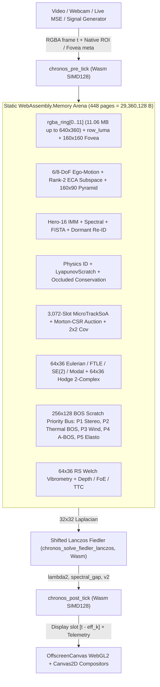

# Architecture and mathematical foundations

CHRONOS-SPECTRAL solves real-time multi-target tracking, continuum flow analysis, Background-Oriented Schlieren (`BOS`) refraction recovery, discrete Hodge flow decomposition, rolling-shutter vibrometry, zero-ML depth and time-to-contact estimation, pocket wind-tunnel aerodynamics, kHz optical elastography, and symbolic governing-equation discovery using bounded numerical linear algebra, signal processing, and `#![no_std]` Rust SIMD128 kernels inside a fixed `28.00 MiB` linear memory arena.

## 1. End-to-end execution and static arena architecture

All compute state lives in one static aligned struct (`Arena` in [src/lib.rs](../src/lib.rs)), compiled to `wasm32-unknown-unknown` with `+simd128` (`2,927,068 B` / `2.79 MiB` in `v3.5.0`, `734` functions, `107,869` SIMD128 instructions, `8` `i32.clz` instructions, `75` `f32.copysign` instructions, `101` exports, `0` imports, `0` `memory.grow` ops, `0` `call_indirect` ops, `0` call cycles, and `13,536 B` verified max call-graph stack depth below the `16,384 B` shadow stack reserve). The same Rust source compiles natively with zero external dependencies across ARM NEON (`src/simd/neon.rs`), x86-64 SSE2/SSSE3/SSE4.1 (`src/simd/sse.rs`), and the portable scalar reference (`src/simd/scalar.rs`).

Static checks in [build.sh](../build.sh) and [src/lib.rs](../src/lib.rs) pin `sizeof(Arena)` (`29,080,704 B <= 29,100,000 B`), static `.rodata` end (`88,000 B`, locking `ARENA` and every region getter to its ABI-v2 address), and static data end `dualStaticEnd` (`29,168,704 B <= 29,294,592 B`) inside `448` Wasm pages (`29,360,128 B`) with `0` runtime heap allocations. Major subsystems partition linear memory cleanly:

| Arena section | Resident structs and buffers | Purpose |
| :--- | :--- | :--- |
| Pixel, Pyramid & Fovea Buffers | `rgba_ring[0..11]` (`11.06 MB`), `row_luma`, `luma`, `chroma_rg`, `chroma_by`, `bg_luma`, `eca_res`, `160x90` pyramids, `FoveaState` (`160x160`) | Non-causal `12`-frame pixel storage, unconditional ingest logging, Native `1:1` ROI metadata, lazy-chroma `1:1` Fovea tile, and subspace decomposition across SD (`320x180`), HD (`640x360`), and native `hires-720p` (`1280x720`). |
| Ego-Motion Estimator | `EgoMotionState` ([src/ego_motion.rs](../src/ego_motion.rs)) | Coarse-to-fine `6`-DoF affine and `8`-DoF projective homography registration with Huber-IRLS and `12x9` RANSAC fallback. |
| Hero-16 Tracker | `targets[0..16]`, `kalman[0..16]`, `dormant[0..32]`, `jv_cost[16][64]`, `all_pip_rgba[16]` | Full-physics non-causal tracking for up to `16` concurrent targets, multi-hypothesis split/merge + occlusion-freeze hysteresis, and `32`-slot `1,200`-frame Re-ID vault. |
| Spectral Assignment | `laplacian[32x32]`, `fiedler_vec[32]`, `jacobi_mat`, `lanczos_scratch` ([src/lanczos.rs](../src/lanczos.rs)) | Pre-assignment graph connectivity partitioning via in-kernel `31`-step Shifted Lanczos. |
| In-Situ Physics ID | `imm[0..16]`, `ode_states[0..16]`, `pend_states[0..16]`, `lyap_scratch`, `collision_state`, `conservation_state` ([src/physics_id.rs](../src/physics_id.rs)) | Weak-form STRidge/AICc ODE identification, nonlinear pendulum periods, chaos divergence, and four-branch occluded collision conservation. |
| Micro-Swarm Tracker | `micro_swarm: MicroTrackSoA` (`3,072` tracks, `4,096` fine peaks, `8,192` raw peaks) + CSR / Auction / IC-LK + `2x2` covariance ([src/soa_tracks.rs](../src/soa_tracks.rs)) | High-density tracking with `u16` CSR reverse-adjacency, `2`-check confirmation hysteresis, `4.35*q` spatial de-dup, `2x2` directional uncertainty, looming-filtered LOO residuals, and Auto-Hero promotion. |
| Continuum & Hodge Solvers | `continuum: ContinuumState` ([src/continuum_physics.rs](../src/continuum_physics.rs)), `hodge: HodgeState` ([src/hodge.rs](../src/hodge.rs)) | `k=6` spatial graph strain, `32` `SE(2)` rigid bodies, `64x36` (`2,304`-cell) vorticity/divergence/FTLE, modal resonance fields, and `64x36` discrete Hodge `2`-complex `(V=2304, E=4508, F=2205)` with SSOR-PCG. |
| Shared `256x128` BOS Scratch Bus | `bos: BosState` ([src/bos.rs](../src/bos.rs)), `depth: DepthState` ([src/depth.rs](../src/depth.rs)), `wind: WindTunnelState` ([src/wind_tunnel.rs](../src/wind_tunnel.rs)), `elasto: ElastoState` ([src/elastography.rs](../src/elastography.rs)) | Priority-arbitrated `256x128` (`32,768`-node) solver scratch supporting `P1` Stereo BOS, `P2` Thermal BOS, `P3` Pocket Wind Tunnel, `P4` Lock-In Acoustic BOS, and `P5` kHz Surface Elastography with `0` extra arena memory. |
| Rolling-Shutter Vibrometry | `vibro: VibroState` ([src/vibrometry.rs](../src/vibrometry.rs)) | `64x36` vibrometry grid, `32` spatial bands, `2,048`-point Welch FFT (`128` bins), `i16 Q13` row displacement history, and `4,096`-sample mono audio staging. |

## 2. Optical conditioning: ego-motion, Rank-2 ECA, and Fovea PTZ

Before detecting motion peaks, [src/simd_ops.rs](../src/simd_ops.rs) unpacks each RGBA frame into normalized planar `luma`, `chroma_rg`, and `chroma_by`, builds the `160x90` box pyramid (`rgba_to_planar_and_pool160_simd128`), and estimates global camera motion via [src/ego_motion.rs](../src/ego_motion.rs):

1. **Camera pan, homography, and cut gating:** Whole-frame registration runs coarse tile matching, `6`-DoF affine and `8`-DoF projective homography warps with Huber-IRLS, and a `12x9` RANSAC fallback (`cam_motion_state`: `0` locked, `1` PTZ pan, `2` scene cut). On a hard cut, ECA background subspace, streaks, tracks, stereo references, and continuity priors reset automatically.
2. **Sub-pixel background advection:** During continuous camera pans, `advect_bg_subpixel_simd128` shifts `bg_luma` and `bg_stat_streak` through an 8-row L1D ring buffer using sub-pixel Catmull-Rom interpolation with overlap-safe border clamping (`pan_streak_and_eca_fused_subpx_simd128`).
3. **Orthogonal Rank-2 Extensive Cancellation Algorithm (ECA):** Instead of threshold differencing `|I - B|`, `eca_subspace_project_masked_simd128` projects incoming static-background pixels orthogonally onto $X = [b - \bar{b}\mathbf{1},\, \mathbf{1}]$ in `f64x2` accumulators. Because $\mathbf{1}$ spans global exposure gain and bias steps, camera auto-exposure pumps cancel orthogonally in one pass (`> 64 dB` attenuation on synthetic clutter, `36-46 dB` on H.264 video). Unverified moving pixels adapt at `0.15x` speed so hovering targets do not bleed into the background model.
4. **Dual-resolution `1:1` Fovea and virtual PTZ ROI slew:** `FoveaState` ([src/lib.rs](../src/lib.rs)) provides a `160x160` lazy-chroma `1:1` native-sensor tile (`chronos_get_fovea_rgba_ptr`, `chronos_get_fovea_req_ptr`, `chronos_commit_fovea_tile`). Setting `INGEST_FLAG_ROI_SLEW` lets the host slew the crop window across a higher-resolution source (such as `1280x720` via Worker WebCodecs fast-pass decode) without resetting tracker or BOS geometry.

## 3. Non-causal lookahead, bounded Hermite bridges, and Dual Projected-FISTA

`Arena.rgba_ring` stores the most recent `12` full frames (`frame_idx % 12`), while the renderer displays delayed slot `(frame_idx + 12 - eff_k) % 12` for user-selected lookahead `K` in `0..11`. Holding future frames inside `[t - K + 1 .. t]` enables three operations unavailable to causal filters ([src/fista.rs](../src/fista.rs), [src/lib.rs](../src/lib.rs)):

1. **Backward `rgba_ring` gap re-tracking (`backtrack_gap_in_rgba_ring`):** Whenever a track completes `M-of-N` confirmation or re-emerges from an occlusion (`ring_vis == 0`), the kernel unpacks localized historical ROIs (`roi_luma`, `roi_rg`, `roi_by`) across buffered ring frames `t - 1 .. t - K` and scores sub-pixel template residuals to recover missed observations behind glare or transient noise.
2. **Bounded Hermite occlusion bridges and extrapolation guards:** Irreducible `0`-visibility spans strictly shorter than `K` frames are pinned at visible entry and exit tangents using cubic Hermite splines. `clamp_hermite_tangent` ([src/fista.rs](../src/fista.rs)) bounds the endpoint lever arm `dt * ||v||` relative to chord length and ballistic gravity (`0.55 * |g| * dt^2`) so high-impulse exits or near-zero-chord re-entries never produce cubic overshoot spikes while preserving parabolic apex arcs. Leading/trailing unpinned extrapolations are similarly clamped to local velocity envelopes.
3. **2-pass IRL1 Dual Projected-FISTA (`solve_noncausal_fista_target`):** Across each `12`-frame window, the kernel solves the weighted second-difference L1 trend-filtering problem with Barzilai-Borwein / Gershgorin Lipschitz step bounds and O'Donoghue gradient restart:

$$\min_{X \in \mathbb{R}^{12}} \frac{1}{2} \sum_{k=0}^{11} w_k (X_k - Y_k)^2 + \lambda_{\text{eff}} \sum_{j=0}^{9} w^{\text{IRL1}}_j \|(D_2 X)_j\|_2$$

where $w_k$ drops to `0` on occluded frames (`ring_vis == 0`) and $\lambda_{\text{eff}} = \lambda \cdot s$ scales with resolution factor $s \in \{1, 2, 4\}$ (`SD`, `HD`, native `720p`) to preserve curvature across resolutions. Pass 1 runs `2` block-coordinate warm-start sweeps plus `6` restarted FISTA steps over `SO(2)`-invariant dual disks $\|(u_{x,j}, u_{y,j})\|_2 \le \lambda_j$, short-circuiting when $\min_j w^{\text{IRL1}}_j > 0.48$. When sharp acceleration knots exist (billiard strikes, rocket burnout, parachute opening, pendulum peg impacts), Pass 2 attenuates local knot weights so corners remain sharp, exporting the certified convex duality gap $P(X) - D(u) \ge 0$ (`telemetry[25]`) and sharp-knot count (`telemetry[1280 + m*16 + 3]`).

## 4. Hero-16 multi-target association and spectral identity

For the `16` full-physics Hero slots (`S1..S16` in [src/lib.rs](../src/lib.rs)):

- **Radial de-slipped P-N dual-anchor templates:** `capture_template_scaled` weights pixels by radial Gaussian times ECA mask (`sum = 1.0`, suppressing outer corners `> 12x`). `apply_radial_deslip_weights` dampens outer 1D gradients perpendicular to the radial spoke axis so pendulum rods and rail tracks do not pull lock off center. Each track pairs an updating foreground model with an immutable birth anchor evaluated via zero-mean gain-invariant L1/SAD kernels (`sad_patch_zm_score_simd128`, `weighted_anchor_zm_l1_simd128`) so rocket exhaust flares or night-sky firework bursts do not bleach lock.
- **2-adic Haar-Morton ultrametric signatures (`padic_ultrametric_val`):** Each `16x16` (`SD`), `2x2`-pooled `32x32` (`HD`), or `4x4`-pooled `64x64` (`720p`) patch maps to a `32`-bit code: bit `31` gates opponent chroma confidence, bits `30..27` encode opponent `R-G` / `B-Y` thermometer polarity with a `0.055` deadzone, bits `23..16` store 2D Haar quadrant bits, and bits `15..0` pack Morton-interleaved sub-block signs. Comparing two codes via `(sig_a ^ sig_b).leading_zeros()` compiles to one `i32.clz` instruction and defines an exact ultrametric $d_2(A, C) \le \max(d_2(A, B), d_2(B, C))$.
- **4-mode Interacting Multiple Model (IMM) & split/merge hysteresis:** Couples Constant Velocity (CV), Ballistic-Drag (Verlet integration with gravity clamped to `[150s, 3600s]` `px/s^2`), Coordinated Turn (CTRV with 4th-order Taylor expansion for $|\psi| < 10^{-2}$), and pan-advected Oscillatory hypotheses, guarded by multi-hypothesis split/merge and occlusion-freeze hysteresis.
- **Shifted Lanczos Fiedler graph partitioning:** Before global assignment, Wasm constructs a `32x32` Laplacian over active `16` tracks and up to `16` peaks, and [src/lanczos.rs](../src/lanczos.rs) (`chronos_solve_fiedler_lanczos`) runs `31`-step Shifted Lanczos orthogonalized iterations in-kernel to return $\lambda_2$, spectral gap $\Delta\lambda = \lambda_3 - \lambda_2$, and Fiedler partition vector $v_2$. Adding $\gamma_{\text{eff}} (v_m - v_{16+p})^2$ to the `16x64` Jonker-Volgenant cost matrix separates visually similar crossing lanes along algebraic connectivity cuts (`0` cross-lane swaps on Twin-Gray Gate B).
- **Dormant Re-ID vault & manual seeding:** Retired tracks enter a `32`-slot, `1,200`-frame (`40 s` at `30 fps`) archive retaining `16x16` zero-mean templates, `4`-mode trajectory corridors, and Haar-Morton affinity for `2`-hit fast re-lock under their original `Tn` ID. Operators or SDK callers can also pin stationary targets before motion starts via `chronos_seed_target(x, y, w, h)`.

## 5. High-density `3,072`-slot micro-swarm and `64x36` continuum mechanics

When `swarm_mode` is `2` (`Forced Active`) or `1` (`Auto-Density` coarse occupancy gate passes), [src/soa_tracks.rs](../src/soa_tracks.rs) tracks up to `3,072` fine features (`MAX_MICRO = 3,072`, `MAX_MICRO_PEAKS = 4,096`, `MAX_RAW_PEAKS = 8,192`) inside fixed `MicroTrackSoA` arrays (`~1.5-1.9 ms` median HD throughput at `1,200-1,452` confirmed targets):

1. **Fine peak extraction:** `8x8` SIMD128 pyramid scoring with an integer bitmap NMS ring yields up to `4,096` candidate micro-peaks per frame alongside `8x8` quantized `i8` zero-mean descriptors (`tpl8_i8`) and Haar-Morton prefix codes.
2. **16-bit Morton Z-order sort & `u16` sparse `CSR`:** Active tracks and candidate peaks receive normalized `(x, y)` `16`-bit Morton codes and sort via a `2`-pass `256`-bin counting radix sort. A `3x3` spatial cell search limits evaluation strictly to `k <= 8` innovation-gated neighbors per track (`21.94x` speedup vs dense `N x M` scan on `1,200` targets), with `u16` reverse-adjacency indices (`u16::MAX` sentinel), `2`-check confirmation hysteresis, and `4.35*q` spatial de-dup.
3. **Integer `Q`-scaled Bertsekas `epsilon`-Auction & `8x8` Huber IC-LK:** Costs scale to fixed-point `Q12` integers (`AUCTION_SCALE_Q = 4096`) with per-track private coasting bids and reverse bidding repair, flagging narrow-margin assignments (`AMBIG_MARGIN_Q = 82`) so FTLE integrators skip uncertain tracks. Confirmed matches refine to sub-pixel accuracy (`0.04 px` RMSE on `murmuration_1200`) via Inverse-Compositional Lucas-Kanade with Huber IRLS.
4. **Directional `2x2` track covariance & looming-filtered LOO residuals:** Propagates symmetric inverse-Hessian plus empirical covariance `(c_xx, c_xy, c_yy)`, scores leave-one-out local flow residuals (`d2_bench`), and applies a sample-disjoint chord test (`d2_nonloom`) to suppress pinhole approach decoys ($x = fX/Z$) while promoting anomalous candidates for Hero-16 lock.

### `64x36` continuum mechanics ([src/continuum_physics.rs](../src/continuum_physics.rs))

Operating in safe Rust over confirmed micro-tracks, apart from `6` `unsafe` tokens (two unaligned `v128` loads and four raw index reads) inside the SIMD128 `k`-NN scan `visit_knn_slice_full_noskip`:

- **Sparse `k=6` strain graph & `SE(2)` rigid bodies:** Tracks persistent spatial neighborhoods (`rigid_streak >= 8`, edge strain `< 0.035`), extracts connected components of `>= 6` members via union-find, solves exact `2D` Procrustes rotations (`atan2`, `det = +1`) for up to `32` rigid bodies, and accumulates unwrapped $\omega$ (`rad/s`) and whole-component `SE(2)` RMSE.
- **`64x36` Eulerian velocity, vorticity, and divergence:** Aggregates local velocities into `64x36` spatial bins (`FIELD_CELLS = 2,304`, `u128` row occupancy masks), using ridge-conditioned weighted least squares to compute $\nabla \mathbf{u}$, scalar vorticity $\zeta = \partial v/\partial x - \partial u/\partial y$, and divergence $\nabla \cdot \mathbf{u}$.
- **2-bank Cauchy-Green FTLE:** Maintains staggered `20`-frame flow-map anchor banks (`12`-bit slot packing up to `4,095` capacity) reset cleanly on track birth, reacquisition, ambiguity, or camera cuts, computing finite-time Lyapunov exponents $\sigma_T = \frac{1}{2|T|}\ln \lambda_{\max}(C)$.
- **Modal virtual accelerometers & validity masking:** Tracks steady-equilibrium bandpass phase `(bp_i, bp_q)` per stationary vibrating node and exports cell circular phase (`[-pi, pi]`, sentinel `-9.0`), dominant frequency, and anti-phase nematic order $R_2 = |\text{mean}(\exp(2i\phi))|$ alongside explicit subsystem validity bitmask `diagnostic_validity_mask` (`bit0` Grad-V, `bit1` FTLE, `bit2` Rigid `SE(2)`, `bit3` Modal, `bit4` Kuramoto/CoM).

## 6. In-situ physics discovery, Hilbert phase, and occluded conservation

### Hero symbolic ODE and conservation ([src/physics_id.rs](../src/physics_id.rs))

Across each target's `64`-frame history ring (`HIST_RING_LEN = 64`), [src/physics_id.rs](../src/physics_id.rs) discovers governing laws without noisy finite second differences:

- **Weak-form STRidge + AICc:** Integrates compact-support test functions $\phi(u) = (1 - u^2)^p$ by parts against position trajectories across an `M <= 12` feature library (gravity, linear damping, quadratic drag `v|v|`, radial tether force, longitudinal boost acceleration), selecting sparse models via STRidge and small-sample corrected AIC (`AICc`) with `15`-frame hysteresis hold to output `phys_regime` (`0..8`), `ode_r2`, `aero_drag_beta`, and `thrust_accel`.
- **Jacobi Taubin curvature, AGM elliptic period, & constraint jumps:** Computes `f64` cyclic `3x3` Jacobi Taubin circle fits (reporting center divergence against Kasa fits and curvature $\kappa$), exact nonlinear pendulum periods $T(\theta_0) = 4\sqrt{L/g}\,K(\sin^2(\theta_0 / 2))$ via Arithmetic-Geometric Mean, log-peak decrement damping $(\zeta, Q)$, and priority-latched constraint jumps (`COLLISION > PEG_JUMP > CANOPY > BURNOUT`).
- **Rosenstein chaos divergence & Kuramoto sync:** Runs a staggered (`1:8`) `4D` delay-coordinate Rosenstein divergence estimator inside `LyapunovScratch` and computes ensemble Kuramoto order $R_{\text{sync}} e^{i\Psi} = \frac{1}{N}\sum e^{i\theta_j}$.
- **Causal two-body collision & four-branch occluded conservation:** Evaluates SNR-conditioned momentum balance and restitution ($m_2 / m_1 \in [0.05, 20.0]$, $e_n \in [0, 1]$) after clearing the blur band `[f_c - 2 .. f_c + 2]`. Across co-occluded track pairs, scores `H0_KEEP`, `H0_SWAP`, `H1_KEEP`, and `H1_SWAP` under declared mass priors, emitting `UNIQUE`, `AMBIGUOUS` (for indistinguishable symmetric encounters), or `VIOLATED`.

### Centered FIR Hilbert quadrature & phase prediction

When `K >= 7`, `chronos_post_tick` resamples each target's `hist_t_sec`-timestamped trajectory onto a uniform grid, projects displacements onto the principal covariance eigenvector, applies an analytically gain-equalized `15`-tap Hamming-windowed FIR Hilbert filter centered at `[t - K]`, enforces a bi-directional turnaround-crossing periodicity gate (zero false frequencies on ballistic or highway clips), and forward-predicts phase across lookahead `K * dt` plus WebAudio output latency.

## 7. Discrete Hodge, BOS Schlieren, and rolling-shutter vibrometry

1. **100% Frame-Ring Ingest and Native ROI Geometry (`src/lib.rs`):** `chronos_set_ingest_meta` records monotonic 64-bit source timestamps (`t_src_us`), `D4` orientation, scan axis (`scan_dir`), crop origin `(crop_x0, crop_y0)`, and `native_1to1` flags before committing every frame to `rgba_ring` and `row_luma`, preventing temporal aliasing across throttled downstream solves.
2. **Bounded `64x36` Mesh Hodge `2`-Complex ([src/hodge.rs](../src/hodge.rs)):** Forms a cell-vertex complex up to `(V, E, F) = (2304, 4508, 2205)` from gradient-valid cells (`CELL_VALID_GRAD`), solves orthogonal exact (`grad phi`), coexact (`curl* psi`), and harmonic (`h`) components over one positive `W_1` edge metric via symmetric SSOR-preconditioned PCG (`omega = 1.45`, gating to `UNCONV` on non-convergence), and floods complementary plaquettes from the exterior border to separate enclosed circulation holes (`beta_1`) from open boundary ports.
3. **`256x128` Controlled-Tripod BOS Schlieren ([src/bos.rs](../src/bos.rs)):** Evaluates `32,768` nodes via early-converged `8x8` affine Lucas-Kanade against a frozen `16`-frame static reference (`f32` SIMD-restored `BosRefCache`), computes plaquette curl consistency $\nabla \times \boldsymbol{\varepsilon}$, and solves the inhomogeneous Neumann Poisson system $\Delta\Phi = \nabla \cdot \boldsymbol{\varepsilon}$ with boundary flux $\partial_n \Phi = \boldsymbol{\varepsilon} \cdot \mathbf{n}$ via a radix-2 `256x128` DCT-II/III fast solver (direct when complete, DCT-preconditioned `f64` PCG on masked domains) referenced to a designated quiet gauge ROI.
4. **`64x36` Calibrated Rolling-Shutter Vibrometry ([src/vibrometry.rs](../src/vibrometry.rs)):** Inverts `D4` sensor scan coordinates across `32` spatial bands, stores `i16 Q13` signed row displacements, restricts `2,048`-point Welch FFT (`128` bins) strictly below the optical Nyquist bound (`0.48 / dt_row_us`), applies exposure sinc compensation $H(f) = \sin(\pi f T_e)/(\pi f T_e)$ with `EXPOSURE_NULL` (`|H(f)| < 0.05`) protection, and enforces Bonferroni-corrected `K >= 8` Welch coherence against synchronized mono audio (`chronos_push_audio_block`) with fail-closed `CLOCK_SKEW`, `NO_PTS`, `NO_SCAN_DIR`, `NOT_NATIVE_1TO1`, and `AXIS_TRANSPOSED` refusals.

## 8. Shared `256x128` BOS scratch bus: depth, wind tunnel, and elastography

Five high-resolution physical solvers share `BosState`'s `256x128` `f64` scratch buffers inside the fixed `448`-page arena under deterministic hardware priority arbitration (`src/lib.rs`, mirrored identically in [web/ui/core/fsm.js](../web/ui/core/fsm.js)):

| Priority | Owner | Subsystem | Active modes |
| :--- | :--- | :--- | :--- |
| `P1` | `DEPTH_STEREO` | Calibrated `256x128` Stereo Disparity ([src/depth.rs](../src/depth.rs), [src/bos.rs](../src/bos.rs)) | `depth` in `{2, 4}` |
| `P2` | `BOS_THERMAL` | Controlled-Tripod `256x128` Thermal BOS ([src/bos.rs](../src/bos.rs)) | `bos` in `{1, 2}` |
| `P3` | `WIND_TUNNEL` | Pocket Wind Tunnel `64x36` DEC Pressure & Viscosity ([src/wind_tunnel.rs](../src/wind_tunnel.rs)) | `wind` in `{1, 2, 3}` |
| `P4` | `ELASTO_ACOUSTIC_BOS` | Lock-In `256x128` Acoustic BOS ([src/elastography.rs](../src/elastography.rs)) | `elasto == 4` |
| `P5` | `ELASTO_SURFACE` | kHz `64x36` Surface Elastography & Power Flow ([src/elastography.rs](../src/elastography.rs)) | `elasto` in `{1, 2, 3}` |

### Zero-ML depth sensing, FoE/TTC, stereo BOS, and external depth ABI ([src/depth.rs](../src/depth.rs))

- **Monocular parallax & intrinsics-free FoE/TTC (Mode `1`):** Runs an `8`-frame contiguous `u16 Q5` OLS sliding window over `MicroTrackSoA` driven by the engine's authoritative frame clock (`hist_t_sec`, unclamped `dt` in `[2 ms, 250 ms]`). Combines a fail-closed 3-DoF Huber-IRLS pure-rotation gate with hysteresis, a lateral 4-term cross-flow purity regression (`[1, s_n, p_n, s_n*p_n]`) rejecting mixed rotation+translation and oblique contamination, a radial 3-DoF tangential rotational-nullspace regression (plus off-center 5-DoF quadratic veto) with inverse-depth relief observability (`p90/p10 >= 1.65`) and near-FoE exclusion, epipolar independent-motion rejection, deterministic longest-chord RANSAC FoE (`>= 2` quadrants), and staggered-midpoint `f64` `1/r(t)` optical looming Time-to-Contact ($\tau = Z / -\dot{Z}$).
- **`256x128` calibrated stereo disparity (Mode `2`, `P1`):** Reuses `BosState` with `0 B` struct growth under explicit consume-once Left capture (`chronos_depth_capture_stereo_left`) and automatic cut invalidation. Pairs a coarse-to-fine 1D horizontal ZNCC epipolar search (`1 <= d <= max_disp_px <= 64`) with peak-uniqueness (`<= 0.85x`), bilateral autocorrelation periodicity screening, reverse R->L pyramid consistency, SIMD128 `8x8` affine IC-LK subpixel refinement, vertical epipolar gating (`|eps_y| <= 0.25 px`), 720p-safe scanline half-occlusion culling, and Right-frame z-buffered `64x36` projection (`SURVEYED_STEREO`).
- **External depth-plane ingest & provenance firewall (Mode `3` / `4`):** Consume-once, `(frame_idx, continuity_epoch)`-bound `<= 128x64` `f32` staging buffer (`chronos_get_depth_ingest_ptr` / `chronos_set_depth_external_meta`) with strict provenance separation (`SURVEYED_LIDAR`, `SURVEYED_STEREO`, `ASSUMED_NEURAL_PRIOR`), projectively linear inverse-depth resampling to `64x36`, and foreground-preserving per-Hero depth export. Freshness is stamped in `wave2_telem` (`PROD_W2_DEPTH`, word `40`).

### Pocket wind tunnel ([src/wind_tunnel.rs](../src/wind_tunnel.rs))

`WindTunnelState` (`<= 28,672 B` permanent, `P3`) reconstructs a `2*dx`-exact solenoidal velocity field via Dirichlet streamfunction $-\Delta\psi = \omega$, solves the exact discrete DEC pressure Poisson equation $-\Delta(p/\rho) = \nabla\cdot(\mathbf{u}\cdot\nabla\mathbf{u}) + \partial_t(\nabla\cdot\mathbf{u})$ on the active `HodgeState` `2`-complex (zero pressure-gradient bleed across solid obstacles), integrates dual-method aerodynamic loads ($C_L$, $C_D$ via obstacle contour and `2`-cell control volume) cross-checked against Kutta-Joukowski $2|\Gamma|/(U_\infty D)$ and `SE(2)` fluid-structure acceleration, and estimates effective kinematic viscosity $\nu$ via $C^3$ `(1 - s^2)^4` 7-point weak-form STRidge on vorticity transport $\partial_t\omega + \mathbf{u}\cdot\nabla\omega = \nu\Delta\omega$.

- **Sparse PIV modes (`1` Staggered, `2` Every Frame):** Emit full `C_p`, `C_L/C_D`, and $\nu$ when `beta_1 >= 1` obstacle voids and freestream support exist (`READY_FULL_LOADS`).
- **Dense optical-flow audit mode (`3`, `WIND_MODE_DENSE_AUDIT`):** Computes a `64x36` dense Lucas-Kanade velocity field directly on unseeded fluid imagery (for example MRI flow or Schlieren mixing) without requiring `MicroTrackSoA` particle peaks. Output is structurally capped at `READY_FIELD_ONLY` (`provenance = WIND_PROV_DENSE_LK`) with `C_p`, `C_L`, and `C_D` held at `0` while exporting divergence fraction and Navier-Stokes curl integrability (`eta_NS`). Freshness is stamped in `wave2_telem` (`PROD_W2_WIND`, word `48`).

### kHz optical elastography, structural power flow, and lock-in acoustic BOS ([src/elastography.rs](../src/elastography.rs))

`ElastoState` (`<= 4,096 B` permanent) runs in surface wavefield modes (`P5`) or lock-in acoustic BOS (`P4`):

- **Surface modes (`1` RS + Audio, `2` RS Self, `3` Frame-Rate):** Evaluates `64x90` `16x4` affine IC-LK bands and pools symmetric `+-16`-row windows into a joint `2M x 2M` Cholesky multi-tone demodulator across `K = 8` Welch segments (`SEG_FRAMES = 4`), decoupling stroboscopically aliased kHz tones even when $(f_2 - f_1) \bmod \text{fps} = 0$. Computes wrap-free complex-smoothed Poynting wavevectors $(k_x, k_y)$ cross-checked against `9x9` weak-form Helmholtz fits, local wave speed $c(x, y) = \omega / k$, anisotropy $c_x / c_y$, constitutive dispersion exponent $\alpha = \text{median}(\ln(k_1/k_0)/\ln(f_1/f_0))$ (`KIRCHHOFF_PLATE` $\alpha \approx 0.5$ vs `MEMBRANE_SHEAR` $\alpha \approx 1.0$), and `HodgeState::solve_power_flow_hodge` on mechanical Poynting flux $\mathbf{I} = \omega\,\text{Im}(u^*\nabla u)$ to locate exciters (`argmax(+div I)`), damped cracks (`argmin(div I / (E + E_floor))`), and `beta_1` cavities.
- **Lock-in acoustic BOS (Mode `4`, `P4`):** Accumulates rolling-shutter audio-locked `256x128` refraction phasors with `+-3`-row Hann Gram pooling and runs dual-pass paired-SIMD128 DCT Neumann Poisson inside `bos.solve_z` to recover complex acoustic potential $(\tilde{\Phi}_{\text{re}}, \tilde{\Phi}_{\text{im}})$ from `-18 dB` single-frame SNR with complex curl integrability checking. Freshness is stamped in `wave2_telem` (`PROD_W2_ELASTO`, word `56`).

## 9. Metric calibration, Jacobian rectification, and provenance

Calibration geometry ([web/worker.js](../web/worker.js)) stores coordinates normalized to `[0..1]` so rulers and planes survive live `SD <-> HD` switches:

1. **2-point ruler & multi-arc Auto-`g`:** Derives isotropic pixels-per-meter from an explicit baseline (`SURVEYED RULER`) or from scene parabolic consensus `scene_gravity_px_s2 / 9.80665` once at least `2` trajectories lock `scene_gravity_conf >= 0.50` (`AUTO-g LOCKED`).
2. **4-point DLT projective homography (`TL -> TR -> BR -> BL`):** Maps ground-plane pixel coordinates `(x, y)` to world metric coordinates `(X, Y)` via $3 \times 3$ homography $H$ and rectifies pixel velocity vectors `(vx, vy)` through the analytical $2 \times 2$ Jacobian:

$$\mathbf{v}_w = J_H(x, y)\,\mathbf{v}_{\text{px}}, \qquad J_H(x, y) = \frac{1}{w(x, y)^2} \begin{bmatrix} w h_{00} - X_{\text{num}} h_{20} & w h_{01} - X_{\text{num}} h_{21} \\ w h_{10} - Y_{\text{num}} h_{20} & w h_{11} - Y_{\text{num}} h_{21} \end{bmatrix}$$

Whenever projective denominator $w = h_{20} x + h_{21} y + h_{22} < 0.14$ (near the horizon vanish line) or Wasm reports active camera motion (`cam_motion_state != 0`), metric outputs gate to `OUT OF PLANE` / `PX UNITS` (`metric_valid = -1`), and every `56`-column telemetry export increments `cal_segment_id` with explicit `ASSUMED` vs `SURVEYED` provenance metadata.

## 10. Native multi-instance SDK, C ABI v4, and 8-axis physics integrity audit

Beyond the browser Wasm target, the same kernel source compiles into a native multi-instance stack with zero external Rust crate dependencies:

- **Rust library & parallel CLI ([src/native.rs](../src/native.rs), [native/Cargo.toml](../native/Cargo.toml), [native/cli/main.rs](../native/cli/main.rs)):** `ChronosEngine` owns a heap-allocated `Arena` with zero shared globals so independent instances execute concurrently across OS threads at `320x180`, `640x360`, or native-only `hires-720p` (`1280x720`, `res_mode=2`, `4x4`/`8x8` SIMD128 pooling). The `chronos` CLI supports `--sd|--hd|--720p`, `--jobs N`, `--hwaccel`, `--crop`, `--raw-in`, `--fps auto`, `rtsp://` ingest, and JSON/CSV/NDJSON output.
- **C11/C++11 ABI v4 & Python ctypes bindings ([native/capi/](../native/capi/src/lib.rs), [native/include/chronos.h](../native/include/chronos.h), [native/python/chronos_spectral.py](../native/python/chronos_spectral.py)):** Exposes `ChronosEngine*`, explicit `96`-byte `ChronosIngestMeta`, strided integer area-resample + letterbox ingest, mono `f32` audio staging, and zero-copy read-only `ChronosFieldView` descriptors across all `25` field kinds (`0..=24`, usable with or without NumPy).
- **Deterministic 8-axis physics integrity audit (`chronos-audit/1`, [native/capi/src/audit.rs](../native/capi/src/audit.rs), [native/python/chronos_audit.py](../native/python/chronos_audit.py)):** Scores video clips (including generative video evaluation and RLVR reward pipelines) across `8` physical axes (`trajectory`, `collision`, `depth_parallax`, `fluid_div`, `fluid_momentum`, `bg_shimmer`, `temporal_cadence`, `av_sync`) with zero ML weights and `+0 B` Wasm arena overhead. Each axis reports explicit applicability (`unknown`, `absent`, `insufficient`, `eligible`), `9` structured `NA` reason bits, timestamped violation spans (`<= 512`), and an anti-gaming `reward_milli` score (`-1000` when a static or blank decoy fails required physical axes). The browser **Audit A/B** tab ([web/ui/views/audit-view.js](../web/ui/views/audit-view.js)) runs the same 8-axis audit inside a lazy isolated Wasm worker (`0` idle cost until invoked).
