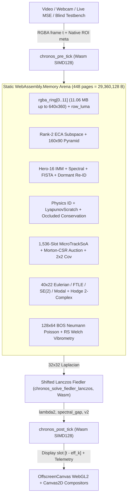

# Architecture and mathematical foundations

CHRONOS-SPECTRAL solves real-time multi-target tracking, sub-pixel vibration analysis, Background-Oriented Schlieren (`BOS`) refraction recovery, discrete Hodge flow decomposition, and governing-equation discovery using bounded numerical linear algebra, signal processing, and `#![no_std]` Rust SIMD128 kernels inside a fixed `28.00 MB` linear memory arena.

## 1. End-to-end execution and static arena architecture

All compute state lives in one static aligned struct (`Arena` in [src/lib.rs](../src/lib.rs)), compiled to `wasm32-unknown-unknown` with `+simd128` (`101,655` SIMD128 instructions, `8` `i32.clz` instructions, `76` exports, `0` imports, `0` `memory.grow` ops, `0` `call_indirect` ops, `0` call cycles, and `13,776 B` verified max call-graph stack depth below the `16,384 B` shadow stack reserve).

Static checks in [build.sh](../build.sh) and [src/lib.rs](../src/lib.rs) pin `sizeof(Arena)` (`23,300,224 B <= 24,117,248 B`), static `.rodata` end (exactly `59,216 B`, so every region keeps its address), and static data end `dualStaticEnd` (`23,359,440 B <= 24,248,320 B`) inside `448` Wasm pages (`29,360,128 B`) with `0` runtime heap allocation. Major subsystems split memory cleanly:

| Arena section | Resident structs and buffers | Purpose |
| :--- | :--- | :--- |
| Pixel & Pyramid Buffers | `rgba_ring[0..11]` (`11.06 MB`), `row_luma`, `luma`, `chroma_rg`, `chroma_by`, `bg_luma`, `eca_res`, `160x90` pyramids | Non-causal `12`-frame pixel storage, unconditional ingest logging, Native `640x360` ROI metadata, and subspace decomposition across SD (`320x180`) and HD (`640x360`). |
| Hero-16 Tracker | `targets[0..16]`, `kalman[0..16]`, `dormant[0..32]`, `jv_cost[16][64]`, `all_pip_rgba[16]` | Full-physics non-causal tracking for up to `16` concurrent targets, plus `32`-slot `1200`-frame Re-ID vault. |
| Spectral Assignment | `laplacian[32x32]`, `fiedler_vec[32]`, `jacobi_mat`, `lanczos_scratch` | Pre-assignment graph connectivity partitioning via in-kernel Shifted Lanczos (`src/lanczos.rs`). |
| In-Situ Physics ID | `imm[0..16]`, `ode_states[0..16]`, `pend_states[0..16]`, `lyap_scratch`, `collision_state`, `conservation_state` | Weak-form STRidge/AICc ODE identification, nonlinear pendulum periods, chaos divergence, and four-branch occluded collision conservation. |
| Micro-Swarm Tracker | `micro_swarm: MicroTrackSoA` + CSR / Auction / IC-LK + `2x2` covariance scratch (`src/soa_tracks.rs`) | High-density tracking for up to `1,536` sub-pixel targets (`2,048` fine peaks/frame), `2x2` directional uncertainty, looming-filtered LOO residuals, and Auto-Hero promotion. |
| Continuum & Hodge Solvers | `continuum: ContinuumState` (`src/continuum_physics.rs`), `hodge: HodgeState` (`src/hodge.rs`) | `k=6` spatial graph strain, `32` `SE(2)` rigid bodies, `40x22` vorticity/divergence/FTLE, modal resonance fields, and `40x22` discrete Hodge `2`-complex (`grad phi`, `curl* psi`, `h`). |
| BOS & RS Vibrometry | `bos: BosState` (`src/bos.rs`), `vibro: VibroState` (`src/vibrometry.rs`) | Controlled-tripod `128x64` affine LK + Neumann Poisson refraction fields and calibrated rolling-shutter Welch audio coherence (`4096`-sample staging). |

## 2. Optical conditioning: Rank-2 ECA and sub-pixel pan advection

Before detecting motion peaks, [src/simd_ops.rs](../src/simd_ops.rs) decomposes each RGBA frame into normalized planar `luma`, `chroma_rg`, and `chroma_by`, builds the `160x90` box pyramid (`rgba_to_planar_and_pool160_simd128`), and detects global camera motion (`find_best_win_shift_simd128`).

1. **Camera pan and cut gating:** Whole-frame shift estimation runs coarse tile matching (`eval_cam_coarse_tile_simd128`), dense `[-4..4]` search, strided search, and exhaustive fallback (`cam_motion_state`: `0` locked, `1` PTZ pan, `2` scene cut). On a hard cut, ECA background subspace, streaks, tracks, and continuity priors reset automatically.
2. **Sub-pixel background advection:** During continuous camera pans, `advect_bg_subpixel_simd128` shifts `bg_luma` and `bg_stat_streak` through an 8-row L1D ring buffer using sub-pixel Catmull-Rom interpolation with overlap-safe border clamping (`pan_streak_and_eca_fused_subpx_simd128`).
3. **Orthogonal Rank-2 Extensive Cancellation Algorithm (ECA):** Instead of brittle threshold differencing `|I - B|`, `eca_subspace_project_masked_simd128` projects the incoming static-background subset orthogonally onto the 2-column matrix $X = [b - \bar{b}\mathbf{1},\, \mathbf{1}]$ in `f64x2` accumulators. Because constant offset $\mathbf{1}$ spans global exposure gain/bias shifts across the sensor, camera auto-exposure pumps cancel orthogonally in a single pass (`> 64 dB` attenuation on synthetic static clutter and `36-46 dB` on compressed H.264 video). Unverified moving pixels update background weights at only `0.15x` adaptation speed so hovering targets do not bleed into the background model.

## 3. Non-causal lookahead, Hermite bridges, and Dual Projected-FISTA

`Arena.rgba_ring` stores the most recent `12` full frames (`frame_idx % 12`), while the renderer reads delayed slot `(frame_idx + 12 - eff_k) % 12` for user-selected lookahead `K` in `0..11`. Holding future frames inside `[t - K + 1 .. t]` enables three operations impossible in causal trackers:

1. **Backward `rgba_ring` gap re-tracking (`backtrack_gap_in_rgba_ring`):** Whenever a track finishes `M-of-N` confirmation or re-emerges from a visibility drop (`ring_vis == 0`), the kernel unpacks localized historical ROIs (`roi_luma`, `roi_rg`, `roi_by`) across buffered ring frames `t - 1 .. t - K`, scoring sub-pixel template residuals to recover missed observations behind partial glare or transient noise.
2. **Bounded Hermite occlusion bridges:** Irreducible `0`-visibility spans strictly shorter than `K` frames are pinned at both visible entry and exit tangents using cubic Hermite splines, separating occluded reality from linear constant-velocity dead-reckoning errors.
3. **2-pass Iteratively Reweighted L1 Dual Projected-FISTA (`solve_noncausal_fista_irl1_target`):** Across each `12`-frame target window, the kernel solves the weighted second-difference L1 trend-filtering problem:

$$\min_{X \in \mathbb{R}^{12}} \frac{1}{2} \sum_{k=0}^{11} w_k (X_k - Y_k)^2 + \lambda_{\text{eff}} \sum_{j=0}^{9} w^{\text{IRL1}}_j |(D_2 X)_j|$$

where $w_k$ drops to `0` on occluded frames (`ring_vis == 0`) and $\lambda_{\text{eff}} = \lambda \cdot s$ scales linearly with resolution factor $s \in \{1, 2\}$ (`SD` vs `HD`) to keep trajectory curvature resolution-invariant. Pass 1 solves the box-constrained dual over $u \in [-\lambda_{\text{eff}}, \lambda_{\text{eff}}]^{10}$ via coordinate warm-starts, Gershgorin Lipschitz step bounds, and `6` FISTA iterations with gradient restart, taking an immediate early-out when $\min_j w^{\text{IRL1}}_j > 0.48$. When high-impulse acceleration knots occur (billiard strikes, rocket burnout, parachute deployment, pendulum peg stops), Pass 2 attenuates local knot weights so corners stay razor sharp, exporting both the certified primal-dual optimality gap $P(X) - D(u) \ge 0$ (`telemetry[25]`) and the sharp-knot count (`telemetry[1280 + m*16 + 3]`).

## 4. Hero-16 multi-target association and spectral identity

For the `16` full-physics Hero slots (`S1..S16` in [src/lib.rs](../src/lib.rs)):

- **Radial de-slipped P-N dual-anchor templates:** `capture_template_scaled` weights pixels by radial Gaussian times observed ECA mask (`sum = 1.0`, suppressing outer corners `> 12x`). `apply_radial_deslip_weights` dampens outer 1D gradients perpendicular to the radial spoke axis so pendulum rods and rail tracks do not capture the template center. Each track pairs an updating foreground model with an immutable birth anchor evaluated via zero-mean gain-invariant L1/SAD kernels (`sad_patch_zm_score_simd128`, `weighted_anchor_zm_l1_simd128`) so rocket exhaust flares cannot bleach lock.
- **2-adic Haar-Morton ultrametric signatures (`padic_ultrametric_val`):** Each `16x16` (`SD`) or `2x2`-pooled `32x32` (`HD`) patch maps to a `32`-bit code: bit `31` gates opponent chroma confidence, bits `30..27` encode opponent `R-G` / `B-Y` thermometer polarity with a `0.055` deadzone, bits `23..16` store orthogonal 2D Haar quadrant bits, and bits `15..0` pack Morton-interleaved sub-block signs. Comparing two codes via `(sig_a ^ sig_b).leading_zeros()` compiles to a single `i32.clz` instruction and defines an exact ultrametric $d_2(A, C) \le \max(d_2(A, B), d_2(B, C))$.
- **4-mode Interacting Multiple Model (IMM):** Couples Constant Velocity (CV), Ballistic-Drag (Verlet integration with gravity clamped to `[150s, 3600s]` `px/s^2`), Coordinated Turn (CTRV using 4th-order Taylor expansion for $|\psi| < 10^{-2}$), and pan-advected Oscillatory hypotheses.
- **Shifted Lanczos Fiedler graph partitioning:** Before global assignment, Wasm constructs a `32x32` Laplacian over active `16` tracks and up to `16` peaks, and [src/lanczos.rs](../src/lanczos.rs) (`chronos_solve_fiedler_lanczos`) runs `31`-step Shifted Lanczos orthogonalized iterations in-kernel to return $\lambda_2$, spectral gap $\Delta\lambda = \lambda_3 - \lambda_2$, and Fiedler partition vector $v_2$. Adding $\gamma_{\text{eff}} (v_m - v_{16+p})^2$ to the `16x64` Jonker-Volgenant cost matrix separates visually similar crossing lanes along algebraic connectivity cuts (`0` cross-lane swaps on Twin-Gray Gate B).
- **Dormant Re-ID vault:** Retired tracks enter a `32`-slot `1,200`-frame (`40 s` at `30 fps`) archive retaining `16x16` zero-mean foreground templates, `4`-mode trajectory corridors, and Haar-Morton affinity, allowing `2`-hit fast re-lock under their original `Tn` ID.

## 5. High-density `1,536`-slot swarm engine

When `swarm_mode` is `2` (`Forced Active`) or `1` (`Auto-Density` coarse occupancy gate passes), [src/soa_tracks.rs](../src/soa_tracks.rs) tracks up to `1,536` fine features inside fixed `MicroTrackSoA` arrays (`0` `64 B+` stack arrays, ensuring constant `~1.4-1.8 ms` HD throughput):

1. **Fine peak extraction:** `8x8` SIMD128 pyramid scoring with an integer bitmap NMS ring (`R_NMS_HD = 3 px`, `R_NMS_SD = 2 px`) yields up to `2,048` candidate micro-peaks per frame alongside `8x8` quantized `i8` zero-mean descriptors (`tpl8_i8`) and Haar-Morton prefix codes.
2. **16-bit Morton Z-order sort & sparse `CSR`:** Active tracks and candidate peaks receive normalized `(x, y)` `16`-bit Morton Z-order codes and sort via a `2`-pass `256`-bin counting radix sort (`peak_order`, `track_order`). A `3x3` neighborhood spatial cell search (`64x36` CSR grid) limits candidate evaluation strictly to `k <= 8` innovation-gated neighbors per track (`21.94x` speedup vs dense `N x M` scan on `1,200` targets).
3. **Integer `Q`-scaled Bertsekas forward-reverse `epsilon`-Auction:** Association costs scale to fixed-point `Q12` integers (`AUCTION_SCALE_Q = 4096`) with explicit per-track private coasting bids (`COAST_Q_CONF = 3277`, `COAST_Q_TENT = 2458`) and conflict-free reverse bidding repair, tagging narrow-margin assignments (`AMBIG_MARGIN_Q = 82`, `< 0.02`) as ambiguous so downstream FTLE integrators skip uncertain tracks.
4. **Conditioned `8x8` Huber IC-LK:** Confirmed high-gradient matches refine coordinates to sub-pixel precision (`0.039 px` median RMSE on `murmuration_1200`) using Inverse-Compositional Lucas-Kanade with Huber IRLS weighting.

## 6. In-situ physics discovery, phase analysis, and continuum fields

### Hero symbolic ODE and conservation (`src/physics_id.rs`)

Across each target's `64`-frame history ring (`HIST_RING_LEN = 64`), [src/physics_id.rs](../src/physics_id.rs) discovers governing laws without amplifying noise through raw second derivatives:

- **Weak-form STRidge + AICc (`1:4` staggered + event-driven on sharp FISTA knots):** Integrates compact-support test functions $\phi(u) = (1 - u^2)^p$ by parts against position trajectories across an `M <= 12` feature library (constant gravity, linear damping, quadratic drag `v|v|`, radial tether force, longitudinal boost acceleration), selecting sparse models via STRidge and small-sample corrected AIC (`AICc`) with `15`-frame hysteresis hold to output `phys_regime` (`0..8`), `ode_r2`, `aero_drag_beta`, and `thrust_accel`.
- **Jacobi Taubin curvature, AGM elliptic period, & Galileo peg jumps:** Computes `f64` cyclic `3x3` Jacobi Taubin circle fits (reporting center divergence against Kasa fits and curvature $\kappa$), exact nonlinear pendulum periods $T(\theta_0) = 4\sqrt{L/g}\,K(\sin^2(\theta_0 / 2))$ via Arithmetic-Geometric Mean, log-peak decrement damping $(\zeta, Q)$, and priority-latched constraint jumps (`COLLISION > PEG_JUMP > CANOPY > BURNOUT`).
- **Rosenstein chaos divergence & Kuramoto sync:** Runs a staggered (`1:8`) `4D` delay-coordinate Rosenstein divergence estimator inside `LyapunovScratch` (`64`-slot stride-2 reservoir) and computes ensemble Kuramoto phase order $R_{\text{sync}} e^{i\Psi} = \frac{1}{N}\sum e^{i\theta_j}$.
- **Causal two-body collision conservation:** Once post-impact frames clear the motion-blur exclusion band `[f_c - 2 .. f_c + 2]`, evaluates SNR-conditioned momentum balance and restitution to emit mass ratio $m_2 / m_1 \in [0.05, 20.0]$, normal restitution $e_n \in [0, 1]$, normalized momentum residual, and kinetic energy retention.

### Centered FIR Hilbert quadrature & phase prediction

When `K >= 7`, `chronos_post_tick` resamples each target's `hist_t_sec`-timestamped trajectory onto a uniform interval grid, projects displacements onto the principal covariance eigenvector, applies an analytically gain-equalized 15-tap Hamming-windowed FIR Hilbert filter centered at `[t - K]`, enforces a bi-directional turnaround-crossing periodicity gate (zero false frequencies on ballistic or highway trajectories), and forward-predicts phase across lookahead `K * dt` plus hardware WebAudio output latency.

### Continuum mechanics (`src/continuum_physics.rs`)

Operating in safe Rust over confirmed micro-tracks, apart from `6` `unsafe` tokens (two unaligned `v128` loads and four raw index reads) inside the SIMD128 `k`-NN candidate scan `visit_knn_slice_full_noskip`:

- **Sparse `k=6` strain graph & `SE(2)` rigid bodies:** Tracks persistent spatial neighborhoods (`rigid_streak >= 8`, edge strain `< 0.035`), extracts connected components of `>= 6` members via union-find, solves exact `2D` Procrustes rotations (`atan2`, `det = +1`) for up to `32` rigid bodies, and accumulates unwrapped $\omega$ (`rad/s`) and whole-component `SE(2)` RMSE.
- **`40x22` Eulerian velocity, vorticity, and divergence:** Aggregates local velocities into normalized `40x22` spatial CSR bins (`FIELD_CELLS = 880`), using ridge-conditioned weighted least squares with minimum rank conditioning to compute $\nabla \mathbf{u}$, scalar vorticity $\zeta = \partial v/\partial x - \partial u/\partial y$, and divergence $\nabla \cdot \mathbf{u}$.
- **2-bank Cauchy-Green FTLE:** Maintains staggered `20`-frame flow-map anchor banks (`A` at `f % 20 == 0`, `B` at `f % 20 == 10`) reset cleanly on track birth, reacquisition, low-margin ambiguity, or camera cuts, computing finite-time Lyapunov exponents $\sigma_T = \frac{1}{2|T|}\ln \lambda_{\max}(C)$ over unbroken lag intervals.
- **Modal virtual accelerometers & validity gating:** Tracks steady-equilibrium bandpass phase `(bp_i, bp_q)` per stationary vibrating node and exports cell circular phase (`[-pi, pi]`, sentinel `-9.0`), dominant frequency, and anti-phase nematic order $R_2 = |\text{mean}(\exp(2i\phi))|$. Every estimator reports unclamped finite numbers alongside explicit subsystem bitmask `diagnostic_validity_mask` (`bit0` Grad-V, `bit1` FTLE, `bit2` Rigid `SE(2)`, `bit3` Modal, `bit4` Kuramoto/CoM).

## 7. Metric calibration, Jacobian rectification, and provenance

Calibration geometry (`worker.js`) transforms pixels using normalized coordinates `[0..1]` so rulers and planes survive live `SD <-> HD` resolution switches:

1. **2-point ruler & multi-arc Auto-`g`:** Derives isotropic pixels-per-meter from an explicitly clicked baseline (`SURVEYED RULER`) or from scene parabolic consensus `scene_gravity_px_s2 / 9.80665` once at least `2` trajectories lock `scene_gravity_conf >= 0.50` (`AUTO-g LOCKED`).
2. **4-point DLT projective homography (`TL -> TR -> BR -> BL`):** Maps ground-plane pixel coordinates `(x, y)` to world metric coordinates `(X, Y)` via $3 \times 3$ homography $H$ and rectifies pixel velocity vectors `(vx, vy)` through the analytical $2 \times 2$ Jacobian:

$$\mathbf{v}_w = J_H(x, y)\,\mathbf{v}_{\text{px}}, \qquad J_H(x, y) = \frac{1}{w(x, y)^2} \begin{bmatrix} w h_{00} - X_{\text{num}} h_{20} & w h_{01} - X_{\text{num}} h_{21} \\ w h_{10} - Y_{\text{num}} h_{20} & w h_{11} - Y_{\text{num}} h_{21} \end{bmatrix}$$

Whenever projective denominator $w = h_{20} x + h_{21} y + h_{22} < 0.14$ (near the horizon vanish line) or Wasm reports active camera motion (`cam_motion_state != 0`), metric outputs immediately gate to `OUT OF PLANE` / `PX UNITS` (`metric_valid = -1`), and every `56`-column telemetry export increments `cal_segment_id` with full `ASSUMED` vs `SURVEYED` provenance metadata.

## 8. Calibrated field metrology, discrete Hodge, and rolling-shutter vibrometry

Release `v3.0.0` adds six physically guarded metrology subsystems on top of the Hero-16 and Micro-Swarm pipeline (see [Acquisition and Failure Modes](./ACQUISITION_AND_FAILURE_MODES.md) for required operating envelopes and refusal conditions):

1. **100% Frame-Ring Ingest and Native ROI Geometry (`src/lib.rs`):** `chronos_set_ingest_meta` records monotonic 64-bit source timestamps (`t_src_us`), `D4` orientation, scan axis (`scan_dir`), crop origin `(crop_x0, crop_y0)`, and `native_1to1` flags before committing every frame to `rgba_ring` and `row_luma`, preventing temporal aliasing across throttled downstream ticks.
2. **Directional `2x2` Track Covariance and Looming-Filtered Residuals (`src/soa_tracks.rs`):** Propagates symmetric inverse-Hessian plus empirical covariance `(c_xx, c_xy, c_yy)`, scores leave-one-out local flow residuals (`d2_bench`), and applies a sample-disjoint chord test (`d2_nonloom`) to suppress pinhole perspective approach decoys (`x = f X / Z`) while promoting anomalous candidates for Hero-16 lock.
3. **Controlled-Tripod BOS Schlieren (`src/bos.rs`):** Compares incoming frames on a `128x64` lattice via affine Lucas-Kanade against a frozen `16`-frame static reference, checks discrete curl $\nabla \times \boldsymbol{\varepsilon}$ consistency, and solves the inhomogeneous Neumann Poisson system $\Delta\Phi = \nabla \cdot \boldsymbol{\varepsilon}$ with boundary flux $\partial_n \Phi = \boldsymbol{\varepsilon} \cdot \mathbf{n}$ referenced to a designated quiet gauge ROI.
4. **Calibrated Rolling-Shutter Vibrometry (`src/vibrometry.rs`):** Inverts `D4` sensor scan coordinates to reconstruct sub-frame row displacement against `ref_luma_q16`, restricts Welch spectral bins strictly below the optical Nyquist bound (`0.48 / dt_row_us`), compensates shutter integration via $H(f) = \sin(\pi f T_e)/(\pi f T_e)$ (raising `EXPOSURE_NULL` when $|H(f)| < 0.05$), and enforces Bonferroni-corrected `K >= 8` Welch coherence against synchronized audio (`chronos_push_audio_block`) with fail-closed `CLOCK_SKEW`, `NO_PTS`, `NO_SCAN_DIR`, `NOT_NATIVE_1TO1`, and `AXIS_TRANSPOSED` guards.
5. **Bounded `40x22` Mesh Hodge `2`-Complex (`src/hodge.rs`):** Forms a cell-vertex complex up to `(V, E, F) = (880, 1698, 819)` from gradient-valid cells (`CELL_VALID_GRAD`), solves orthogonal exact (`grad phi`), coexact (`curl* psi`), and harmonic (`h`) components over one positive `W_1` edge metric via Jacobi PCG (gating to `UNCONV` on solver non-convergence), and floods complementary plaquettes from the exterior border to distinguish enclosed circulation holes (`beta_1`) from open boundary ports.
6. **Four-Branch Occluded Collision Conservation (`src/physics_id.rs`):** Scores `H0_KEEP`, `H0_SWAP`, `H1_KEEP`, and `H1_SWAP` hypotheses across co-occluded track pairs under declared mass priors, explicitly returning `AMBIGUOUS` for indistinguishable symmetric encounters and `VIOLATED` when impulse/energy bounds fail.

## 9. Wave A-C Tracking, Dual-Resolution Fovea, Native SDK, and ABI-v2 High-Res Fields

Release `v3.2.0` upgrades tracking fidelity, ingest throughput, native resolution, and field grids inside the same zero-import `448`-page (`28.00 MiB`) static Wasm memory budget (`0` `memory.grow`, `0` host imports):

1. **Wave A (Tracking & Ego-Motion):** Upgraded Hero-16 FISTA (`src/fista.rs`) with Barzilai-Borwein step sizing and multi-hypothesis split/merge + occlusion-freeze hysteresis (`src/lib.rs`), added 2-check confirmed hysteresis and `4.35*q` spatial de-dup in Micro-Swarm (`src/soa_tracks.rs`), and upgraded coarse ego-motion (`src/ego_motion.rs`) to 6-DoF affine + 8-DoF projective homography warps with Huber-IRLS and `12x9` RANSAC fallback.
2. **Wave B1/B2 (Dual-Resolution 1:1 Fovea & Worker WebCodecs PTZ):** Added a `160x160` lazy-chroma 1:1 native-sensor Fovea tile (`FoveaState`, `chronos_get_fovea_rgba_ptr`, `chronos_get_fovea_req_ptr`, `chronos_commit_fovea_tile`) and `INGEST_FLAG_ROI_SLEW` for seamless PTZ crop slewing without resetting tracker or BOS geometry (`src/lib.rs`), paired with multi-codec Worker WebCodecs fast-pass decode (`avc1`/`hvc1`/`vp09`/`av01`, classic + fMP4 `moof`/`trun`) and interactive drag-zoom / auto-slew PTZ in `web/worker.js` and `web/index.html`.
3. **Wave B3 (Native `hires-720p`, Zero-Copy SDK, Parallel CLI):** Added native-only `hires-720p` (`1280x720`, `res_mode=2`, `4x4` / `8x8` SIMD128 pooling) across Rust (`src/native.rs`), C ABI (`native/capi`, `native/include/chronos.h`), Python zero-copy NumPy views (`native/python/chronos_spectral.py`), and a multi-worker/RTSP CLI (`native/cli/main.rs`) with `--720p`, `--jobs`, `--ndjson`, `--hwaccel`, `--crop`, `--raw-in`, and `--fps auto`.
4. **Wave C (ABI-v2 High-Res Fields & 3,072-Target Swarm):**
   - **Micro-Swarm (`src/soa_tracks.rs`):** `MAX_MICRO = 3,072`, `MAX_MICRO_PEAKS = 4,096`, `MAX_RAW_PEAKS = 8,192`, `u16` CSR reverse-adjacency indices (`u16::MAX` sentinel).
   - **Eulerian Continuum & FTLE (`src/continuum_physics.rs`):** `64x36` grid (`2,304` cells, `2.62x` density), `u128` row occupancy masks, and 12-bit FTLE slot packing (`4,095` capacity) with exact `6` `unsafe` tokens preserved.
   - **Discrete Hodge 2-Complex (`src/hodge.rs`):** `64x36` complex `(V=2304, E=4508, F=2205)` accelerated by symmetric SSOR-preconditioned PCG (`omega = 1.45`, zero extra arena memory).
   - **BOS Schlieren (`src/bos.rs`):** `256x128` lattice (`32,768` nodes, `4x` density), `256x128` radix-2 DCT-II/III fast Neumann solver, `f32` SIMD-restored reference cache (`-1.18 MiB`), `solve_lp` buffer reuse (`-256 KiB`), and early-converged dense LK.
   - **Rolling-Shutter Vibrometry (`src/vibrometry.rs`):** `64x36` output grid, `32` spatial bands, `2048`-point Welch FFT (`128` bins, `2x` spectral resolution), `i16 Q13` signed displacement history, `f32` cross-spectral accumulators, and `f64x2` SIMD128 optical quadrature.
   - **Zero-ML Depth Sensing, FoE/TTC, Stereo BOS & External Depth-Plane ABI (`src/depth.rs`, `src/bos.rs`):**
     - **Option A (Monocular Parallax & Intrinsics-Free Optical Looming FoE/TTC):** `8`-frame contiguous `u16 Q5` OLS sliding window over `MicroTrackSoA` driven by the engine's authoritative frame clock (`hist_t_sec`, continuous unclamped `dt` in `[2 ms, 250 ms]`; gaps `> 250 ms` advance the continuity epoch and reset temporal history; any skipped mono frame resets the window). Combines a fail-closed 3-DoF Huber-IRLS pure-rotation gate with hysteresis and relative conditioning guard, a flow-relative lateral 4-term cross-flow purity regression (`[1, s_n, p_n, s_n*p_n]`, plus orthogonal-axis slope/spread pitch guard) rejecting mixed rotation+translation (down to `~4%` of angular flow speed) and oblique contamination, a 3-DoF radial tangential rotational-nullspace regression (plus off-center 5-DoF quadratic veto) paired with an inverse-depth relief observability guard (`p90/p10 >= 1.65`) and near-FoE emission exclusion (`r >= 72*res_scale`, `r_dot >= 5.5*res_scale*rate_scale`) before emitting radial `MONO_METRIC` (in moderate-relief forward scenes, very small sub-threshold yaw `~0.004-0.0075 rad/s` remains near the monocular uncalibrated observability floor), epipolar independent-motion rejection (for movers with a cross-epipolar component), deterministic longest-chord RANSAC FoE (`>= 2` quadrants) + staggered-midpoint-anchor `f64` bounded-window `1/r(t)` optical looming Time-to-Contact (`tau = Z / -dZ/dt`, assumes fixed `f`), `64x36` inverse-depth field, and per-Hero depth & TTC export (`export_hero_depth`, export-only; does not alter Hero association).
     - **Option B (`256x128` Calibrated Stereo Disparity):** Reuses `BosState` with `0 B` struct growth (`BosCtrl::stereo_ref_ready`, `stereo_ref_fresh`, `stereo_ref_epoch`) under strict BOS/Stereo mutual exclusion, explicit consume-once Left capture (`chronos_depth_capture_stereo_left`), and automatic invalidation on scene cuts (both explicit ingest flags and internal visual cut detection). Combines a coarse-to-fine 1D horizontal ZNCC epipolar search (`1 <= d <= max_disp_px <= 64`) with peak-uniqueness (`<= 0.85x`), bilateral 1-px-stride Left-patch horizontal autocorrelation periodicity screening across `±(2 * max_disp_px + 1)` (clamped `[4, 128]`) with apples-to-apples sub-pixel-refined match scoring, bidirectional (forward + reverse) continuous convex sub-pixel template projection, monotone 4-column seam-split screening, row-triggered Right-frame verification, and horizontal seam-crack bridging for both auto-sign and forced-sign modes, and reverse R->L pyramid consistency checks, SIMD128 `8x8` affine IC-LK subpixel refinement, vertical epipolar gating (`|eps_y| <= 0.25 px`), 720p-safe scanline half-occlusion culling, minimum coverage gating (`>= 512` nodes and `>= 32` cells for `READY_STEREO`), Left-reference metric `Z = fB/d` + local fit uncertainty `sigma_Z` (`bos.planes`), and Right-frame z-buffered `64x36` field / `256x128` RGBA reprojection (`SURVEYED_STEREO`). Mono `speed_m_s` and stereo `baseline_m` are strictly separate calibration fields.
     - **Option C (External Depth-Plane Ingest & Provenance Firewall):** Consume-once, `(frame_idx, continuity_epoch)`-bound `<= 128x64` `f32` (`32 KiB`) staging buffer (`chronos_get_depth_ingest_ptr` / `chronos_set_depth_external_meta`) that expires after its target frame even when Stereo wins in `AUTO_FUSED`, with strict provenance separation (`SURVEYED_LIDAR`, `SURVEYED_STEREO`, `ASSUMED_NEURAL_PRIOR` + `DEPTH_REASON_ASSUMED_NEURAL_PRIOR`), projectively linear inverse-depth bilinear resampling to `64x36`, and foreground-preserving per-Hero depth export. Freshness is stamped in `wave2_telem` (`PROD_W2_DEPTH`, word `40`). Verified by `scripts/gate_i7_depth.mjs`, `native/tests/miri_depth.rs`, and `Gate N` active depth parity.
