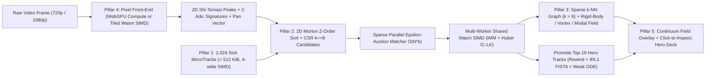

# CHRONOS-1000 Scale-Up Roadmap: 512 to 1,024+ Zero-ML Sub-Pixel Physics Tracks

> **Positioning Thesis:** Zero neural weights, zero training datasets, zero GPU inference models: real-time classical signal processing, convex optimization, and continuum physics running deterministically in a browser tab at up to `1080p` / `60 fps` (`<= 2.0 ms` target compute budget).

`CHRONOS-1000` scales the current `16`-target `640x360` engine (`src/lib.rs`, `src/simd_ops.rs`, `src/physics_id.rs`) by `32x-64x` in simultaneous target capacity. Rather than merely drawing more bounding boxes, scaling past ~`500` tracks crosses from discrete multi-object tracking into live continuum, modal, and swarm physics.

---

## 1. Scientific Credibility & Positioning Guardrails

Incorporating lessons from the independent `GPT-6-Astra` architecture audit, `CHRONOS-1000` separates **marketing hook**, **engineering invariants**, and **empirical validation**:

1. **Zero-ML Lead Hook vs. Exact Latency Accounting:**
   - Lead publicly with **0 neural weights, 0 training data, 100% white-box deterministic math**, and sub-millisecond to ~`2 ms` per-frame compute.
   - Always separate **kernel throughput** (CPU SIMD + WebGPU compute time) from **end-to-end display latency**: explicitly label causal zero-lag tracking (`K = 0`, `~0` frames algorithmic delay) versus non-causal lookahead smoothing (`K > 0`, e.g., `~267 ms` at `K = 8, 30 fps`) and capture/decode/render overhead.
2. **True Continuity-Aware Evaluation (Standard CLEAR / TrackEval):**
   - Replace the greedy distance-sorted frame matching loop in `scripts/calibrate_mp4.mjs` with global Hungarian / Jonker-Volgenant bipartite matching carrying previous-frame ID continuity ties per standard TrackEval CLEAR rules.
   - Report complete **Precision, Recall, HOTA/MOTA, IDSW, Fragmentation, and Localization RMSE** across held-out synthetic and real high-density benchmarks, plus component ablations (`baseline vs +ECA vs +sparse k-NN vs +IRL1`).
3. **Diagnostic Transparency (Unclamped & Unforced):**
   - Never bias AICc selection with arbitrary RSS scaling constants or clamp physical diagnostics (e.g., restitution `e_n`, energy retention, Lyapunov exponent) before logging raw estimates; report **unavailable / noisy / rejected / uncalibrated** states explicitly alongside confidence intervals and projective planar validity limits.
4. **Workflow-First Progressive Disclosure UI:**
   - Default view: *Video -> Auto-Lock Continuum / Target Field -> Trajectory & Field Plot -> One-Click Export*.
   - Keep `2`-adic signatures, sparse graph spectra, Hilbert phase scopes, and experimental symbolic ODE discovery behind an expandable **Expert Diagnostics** panel.

---

## 2. Why the Current `N = 16` Engine Hits a Wall at Scale

| Subsystem | Current `N = 16` Design (`src/lib.rs`) | Bottleneck at `N = 1,024` |
| :--- | :--- | :--- |
| **Per-Target Memory Layout** | Array-of-Structs `TargetTrack`: 7 `f32[256]` templates (`7 KiB`), `tpl8_*`, `RING_LEN=12` arrays, `HIST_RING_LEN=64` rings | `> 10 MiB` working set across 1,024 structs; poor cache locality and scalar gather overhead |
| **Global Data Association** | Dense `16 x 64` Jonker-Volgenant bipartite matrix (`MAX_TARGETS x ASSIGN_COLS`) | `1,024 x 2,048` dense cost matrix exceeds `2,000,000` evaluations per frame |
| **Spectral Coupling Graph** | Dense `GRAPH_NODES = 32` Laplacian (`32 x 32`) + JavaScript Lanczos eigensolver | `O(N^2)` graph construction (`> 1M` edges) and eigensolve break real-time frame budgets |
| **Pixel Front-End** | Single Web Worker CPU SIMD over `320x180` (`57,600` px) or `640x360` (`230,400` px) | At `1920x1080` (`2,073,600` px, `9x` HD), single-core CPU ECA + pyramid + corners takes several ms |
| **UI Readout Paradigm** | Fixed `16`-slot Split PiP card grid (`#rosterScrollWell`) + scalar cards | `1,024` PiP thumbnails are unreadable and DOM-prohibitive |

---

## 3. Five-Pillar Architecture for `CHRONOS-1000`

### Pillar 1: Two-Tier Structure-of-Arrays (SoA) Track Hierarchy
Split tracking state into two complementary tiers inside a static shared Wasm memory region (preserving zero runtime heap allocations inside the kernel):
- **Tier 1 - `MicroTrackSoA` (`MAX_MICRO = 1024`, target `< 512 KiB` total):**
  - Hot state packed in contiguous aligned typed arrays: `pos_x[1024]`, `pos_y[1024]`, `vel_x[1024]`, `vel_y[1024]`, `imm_w[3][1024]` (`w_cv, w_bal, w_osc`), `sig32[1024]` (`2`-adic Haar-Morton code), `age_coasting[1024]`, and quantized `i8[64]` (`8x8` zero-mean luma+chroma micro-patch, `64 B/track` = `64 KiB` total!).
  - Fits inside CPU L2 cache; SIMD128 advances 4 tracks per instruction through IMM prediction, pan advection, and lightweight Huber IC-LK alignment (`~0.25-0.40 ms` across worker threads).
- **Tier 2 - `HeroTrackPool` (`MAX_HERO = 16`, full `16x16`/`32x32` templates):**
  - Dynamically promotes the top `16` highest-interest targets (user `[FOCUS]` pinned, highest kinetic/oscillatory energy, collision pairs, structural extrema, or anomalous non-rigid outliers) into the full existing machinery: non-causal backward `rgba_ring` gap re-tracking, `25x` temporal-contrast Split PiPs, 2-pass IRL1 Dual Projected-FISTA (`solve_noncausal_fista_target` upgraded with true IRL1 reweighting), 15-tap Hilbert phase estimation, and `src/physics_id.rs` governing-ODE + Taubin/AGM fitting.

### Pillar 2: 2D Morton Spatial Hash + Sparse Parallel Epsilon-Auction Matching
Replace the dense `16 x 64` Jonker-Volgenant table (`src/lib.rs`) with an `O(N * k)` spatial matcher:
1. Reuse and generalize `morton2d_4x4` (`src/simd_ops.rs`) into full 16-bit interleaved Morton Z-codes over quantized `(x, y)` predicted track positions and detected peak coordinates.
2. Radix-sort (single pass `u16` counting/LSD pass inside preallocated scratch) tracks and candidate peaks along the Morton curve, plus a coarse uniform cell index (`120x68` tiles for `1080p`).
3. For each track, scan only the spatial cell window implied by its IMM innovation covariance gate and collect the `k <= 8` lowest-cost candidates (`2`-adic Hamming/ultrametric prior via `i32.clz` + zero-mean `8x8` micro-patch SAD + IMM Mahalanobis distance + sparse graph consistency bias).
4. Solve global 1-to-1 assignment over the Compressed Sparse Row (`CSR`) bipartite graph via **Bertsekas Epsilon-Auction** with a virtual unmatched/coasting column per track. Typical runtime target: `< 0.35 ms` at `N = 1,024`, `k = 8`.

### Pillar 3: Sparse `k`-NN Interaction Graph -> Emergent Continuum, Rigid-Body & Modal Physics
Replacing the dense `32x32` Laplacian (`GRAPH_NODES = 32`) with a sparse `k`-nearest-neighbor graph (`k = 6`, `<= 6,144` directed edges) over active `MicroTrack`s unlocks four macro-scale physics engines unavailable at `N = 16`:
1. **Autonomous Rigid-Body Clustering & Angular Kinematics (No CAD Required):**
   - Measure pairwise distance & relative speed stability along `k`-NN edges over a sliding window (`e_ij = |d_ij(t) - d_ij(t-w)| / max(d_ij, s)`).
   - Union-Find connected components with near-zero edge strain auto-discover **rigid bodies** (e.g., all 35 corner points on one tumbling rocket booster or spinning wheel), fitting exact 2D SE(2) translation + rotation (`theta(t)`, angular velocity `omega(t)`, rotational KE) per discovered body.
2. **Eulerian-from-Lagrangian Continuum Fields (`Lagrangian PTV`):**
   - Interpolate sparse tracked particle velocities onto a coarse simulation mesh (`60x34` at `1080p`) via local least-squares / RBF weights to compute **vorticity (`curl v`)**, **2D divergence**, **shear strain rate**, and **Finite-Time Lyapunov Exponent (FTLE)** Lagrangian Coherent Structures (LCS) highlighting vortex shedding and wake boundaries.
3. **Full-Field Structural Modal Analysis (`"1,000 Virtual Accelerometers"`):**
   - Bandpass/Hilbert-extract sub-pixel micro-displacements across every stationary-core surface corner; correlate complex phasors across the `k`-NN graph to reveal live **bending/torsional mode shapes**, nodal lines, and spatial phase speed across wings, bridges, speakers, or buildings.
4. **Ensemble Fragmentation, Shockwave & Swarm Metrics:**
   - Track rocket/debris breakup clouds (`N = 100-500` fragments) to measure center-of-mass conservation, continuous ballistic drag distribution `P(beta)`, traveling traffic congestion wave speed, and spatial **Kuramoto wave order parameter**.

### Pillar 4: Hybrid WebGPU Pixel Front-End + `SharedArrayBuffer` Multi-Worker Wasm SIMD
Keep **zero ML / zero neural weights** while unlocking multi-core and GPU throughput for `720p`/`1080p`:
- **Front-End Compute (`~0.3-0.5 ms` target at `1080p` via WebGPU Compute, with Automatic Multi-Worker CPU Wasm SIMD Fallback):**
  - Stage 1: RGBA-to-luma/chroma planar unpack + camera pan tile correlation.
  - Stage 2: Guarded Rank-2 ECA clutter projection + catmull-rom background advection.
  - Stage 3: Multi-scale pyramid pooling + 2D Shi-Tomasi (`lambda_min`, `lambda_max`) non-maximum suppression peak extraction (`<= 2,048` compact peaks transferred back to Wasm linear memory).
- **Back-End Tracking (`4-8` Web Workers sharing one `SharedArrayBuffer`-backed `WebAssembly.Memory`):**
  - Fork/join barrier across worker pool: shard `MicroTrackSoA` IC-LK refinement, Morton neighbor scoring, IMM steps, and sparse `k`-NN strain/vorticity updates across workers (`~1 us` per track total compute -> `~0.25-0.35 ms` wall time on 4 workers).
  - Gracefully degrades to single-worker `N = 256` SD/HD mode when `crossOriginIsolated` (`COOP/COEP` headers for `SharedArrayBuffer`) or WebGPU is unavailable (such as stock GitHub Pages without a COOP/COEP service worker).

### Pillar 5: Macro-to-Micro Continuum Field HUD & Benchmarking
- **UI & Visualization (`WebGL2` / `WebGPU` instanced overlay):**
  - Default **Field Layer**: velocity streamlines, vorticity/FTLE heatmaps, discovered rigid-body convex hulls with `omega` readouts, and clean path ribbons (`< 0.5 ms` GPU draw call vs 2D Canvas stroke overhead).
  - **Drill-Down Inspector**: click any cluster, vortex, outlier spark, or rigid body in the field to swap it live into the `16`-slot Hero Deck (`25x` temporal-contrast PiP, FISTA residuals, physics diagnostics).
  - Gate advanced internals behind a collapsible **Diagnostics** panel so first-time users see a clear scientific instrument immediately.
- **High-Density Quantitative Benchmark Suite:**
  - Build synthetic ground-truth generators with exact known physics (Rankine/Lamb-Oseen vortex shedding at `N = 500`, vibrating Euler-Bernoulli cantilever beam modes at `N = 400`, rigid-body fragmentation explosion at `N = 300`, cross-crossing ballistic particle swarm) alongside real high-density MP4s (`waterfall/sparks`, `traffic_dense`, `suspension_bridge_vibration`), scored with **continuity-aware TrackEval CLEAR + HOTA**.

---

## 4. Phased Implementation Plan (Post-Wave-3)

1. **Phase A - Benchmark & Memory Architecture Foundation (`N` Parameterized SoA + TrackEval Matcher):**
   - Fix greedy CLEAR matcher in `scripts/calibrate_mp4.mjs`; add synthetic multi-hundred-target vortex/modal/fragmentation generator.
   - Refactor `src/soa_tracks.rs` (`MicroTrackSoA`, `MortonCSR`, `EpsilonAuction`) cleanly alongside existing `TargetTrack` (`HeroTrackPool`) so all `N = 16` existing calibration gates remain 100% green while `MAX_MICRO` scales cleanly (`256` -> `1024`).
2. **Phase B - Multi-Worker Shared Wasm & Optional WebGPU ECA Front-End:**
   - Add COOP/COEP support in `scripts/dev_server.mjs` (plus optional `coi-serviceworker` strategy note for static GitHub Pages) and `SharedArrayBuffer` worker pool fallback chain (`WebGPU+SAB -> CPU-Workers+SAB -> Single-Worker N=256`).
3. **Phase C - Sparse `k`-NN Continuum Engines (`RigidBodySE2`, `VorticityFTLE`, `ModalPhasor`) & WebGL2/WebGPU Field HUD:**
   - Implement zero-allocation sparse graph engines in `#![no_std]` Rust (`src/continuum_physics.rs`), add field colormaps and click-to-promote Hero interaction in `web/index.html`, and add Gate C1..C5 continuum benchmarks.

---

## 5. Ready-to-Run `/swarm` Launch Prompt (Use After Current Swarm Completes)

Once the current `./build.sh --e2e` run finishes green, paste this in the main chat to kick off the `CHRONOS-1000` engineering swarm:

> Build `CHRONOS-1000` per `/Volumes/Storage/CHRONOS-SPECTRAL/docs/CHRONOS_1000_ROADMAP.md` (`Zero-ML, Zero-Training, 512-1024 Simultaneous Sub-Pixel Physics Tracks`). Wave 1 research (`@bench-trackeval`, `@res-soa-auction`, `@res-continuum`, `@res-webgpu-sab`, `@critic`): first fix greedy CLEAR matching in `calibrate_mp4.mjs` and generate synthetic `500-1000`-target vortex/modal/fragmentation GT datasets; design the `1024`-slot `MicroTrackSoA` + `Hero16` split, Morton CSR + Bertsekas `epsilon`-Auction matcher, sparse `k`-NN rigid-body SE(2) / vorticity-FTLE / modal phasor engines in `#![no_std]` Rust (`0` host imports, shared fixed `WebAssembly.Memory`), and hybrid WebGPU-compute / `SharedArrayBuffer` multi-worker pipeline with automatic single-worker fallback. Keep existing `16`-target calibration gates green, separate kernel vs end-to-end latency, expose raw unclamped continuum diagnostics cleanly behind an expandable Diagnostics view, and verify end-to-end in headless Chrome. `/swarm`
