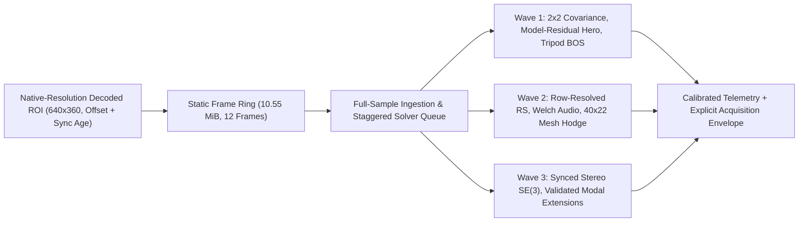

# CHRONOS-IMPOSSIBLE Roadmap: Calibrated Multi-Physics & Metrology Architecture (`v3.0.0-impossible`)

> [!IMPORTANT]
> **Sequencing Gate:** Do NOT begin implementation of `CHRONOS-IMPOSSIBLE` until `CHRONOS-1000` (`v2.0.0-chronos1000`, active 5-pillar SoA + Hero16 + Morton CSR scale-up) passes its final verification gates and merges cleanly from the baseline (`v1.5.0-physics16`). Nothing in this document alters live `CHRONOS-1000` code, scripts, or UI contracts.

---

## 1. Executive Thesis & Architectural Boundaries

**Thesis:** CHRONOS-IMPOSSIBLE is a fixed-memory `#![no_std]` Rust/Wasm kernel for calibrated motion, refractive-displacement, and vibration measurements, paired with explicit acquisition profiles, quantified uncertainty, and reproducible failure cases.

What distinguishes this architecture from conventional software trackers and deep-learning pipelines is the composition inside one static Wasm arena (`<= 448-512` pages = `28.00-32.00 MiB`) of zero-weight physical estimators, dense optical metrology, and real-time uncertainty propagation. At the same time, physical observability limits dictate strict boundaries:

| Framing Boundary | Rejected Overclaim | Defensible Engineering Specification |
| :--- | :--- | :--- |
| **Algorithmic Paradigm** | "Zero ML / zero assumptions" | **Zero pretrained weights and zero offline labeled training data.** Physics priors, noise floors, and acquisition parameters replace learned black-box weights and remain explicitly auditable. |
| **Input Stream** | "Any commodity pixel stream" | **Explicit acquisition profiles per organ:** passive cropped ROI for kinetic tracking (`640x360`), tripod + textured backdrop for BOS, calibrated $(\Delta t_{\text{row}}, T_e)$ readout metadata for rolling-shutter vibrometry, and hardware exposure-sync provenance for stereo `SE(3)`. |
| **Observability** | "Breaks the observability barrier" | **Respects conservation, projection, and exposure physics.** Unidentifiable configurations (such as pass-through vs velocity exchange behind an occluder, or curl-free optical zoom vs BOS refractive compression) are surfaced as explicit ambiguity bounds or consistency diagnostics rather than invented point estimates. |
| **Portability & Determinism** | "100% ARM/RISC-V flight portability & bit-exact Wasm everywhere" | **CPU-first `#![no_std]` core algorithms** isolate pure Rust math from browser bindings (`web/worker.js`, `web/index.html`). Native ARM/RISC-V flight targets require separate native SIMD and capture backends with independent hardware validation. Within Wasm, NaN bit patterns and `relaxed-simd` instructions introduce platform variance, so determinism gates enforce exact IEEE parity only on standard `simd128` builds and bounded numeric tolerances across runtimes. |

---

## 2. System Topology



All organs read from the shared static arena anchored in `src/lib.rs`, `src/physics_id.rs`, `src/simd_ops.rs`, and the planned `CHRONOS-1000` modules (`src/soa_tracks.rs`, `src/continuum_physics.rs`), reporting state to `web/worker.js` and `web/index.html` (`DeckUiFsm`) in lockstep with `docs/UI_TELEMETRY_GUIDE.md`.

---

## 3. Core Foundations: Decoded ROI, Ingestion & Metrology

### 3.1 Native-Resolution Decoded ROI (Not "Zero-Cost Optical Resolution")
Downscaling a `1080p` sensor frame (`1920x1080`) into a `640x360` buffer throws away $3\times$ linear spatial detail (`9x` pixel area). Retaining a native `640x360` crop window from the decoded sensor stream preserves $3\times$ per-axis spatial sampling across a narrower field of view without enlarging Wasm buffers:
- A `12`-frame `640x360` RGBA ring occupies `10.546875 MiB` (`11,059,200` bytes).
- A single `640x360` `f32` or RGBA plane occupies `0.87890625 MiB` (`921,600` bytes).

**Explicit costs and distortion sources:** Using a native-resolution ROI is not optically or computationally zero-cost. Host capture, codec decode, and pixel staging (`VideoFrame` / `WebGL` readback) still scale with upstream resolution and pixel format. Downstream geometry must propagate crop offsets $(x_0, y_0)$, display orientation flags, and rolling-shutter scan direction (`top-down` vs rotated sensor coordinates) into every spatial derivative. Furthermore, subpixel gradient estimators (`IC-LK` and `BOS`) remain bounded by H.264/HEVC `4x4`/`8x8` block transforms, loop deblocking, skipped P/B-frame residuals, Bayer demosaic aliasing, and automatic ISP gain/exposure changes.

### 3.2 Full-Sample Ingestion & Staggered Solve Discipline
Multiphysics updates and PDE solvers may stagger across frame ticks to cap peak work, **but pixel/timestamp ingestion cannot be skipped**:
1. Every incoming frame must be ingested into the ring and row-buffer accumulators with monotonic source timestamps (`t_src_us`), capture-to-worker age (`age_ms`), and frame-gap flags before any solver staggers or skips work.
2. Staggered downstream PDEs consume complete buffered histories rather than undersampled decimated snapshots, and every exported telemetry packet carries its source timestamp and measurement age.
3. Frame-time budgets measure **complete end-to-end peak scheduled frame latency**, including dense `BOS` displacement extraction, persistent background-texture maintenance, covariance propagation, and worker marshaling. The `v1.5.0-physics16` baseline (`0.215 ms` SD / `0.647 ms` HD M4 Pro medians for `16` targets) is strictly a baseline invariant, never a proxy for `1,536`-track multi-organ peak runtime.

### 3.3 Vector Uncertainty & Empirical Fisher Calibration
Single-scalar gradient bounds (such as $\sigma_x^2 \ge \hat{\sigma}_I^2/\lambda_{\min}$) erase directional anisotropy along edges (aperture problem) and confuse theoretical lower bounds with realized measurement error.
- **Full `2x2` track covariance:** Every track in `MicroTrackSoA` propagates its full symmetric $2 \times 2$ covariance $(C_{xx}, C_{xy}, C_{yy})$ (`12` bytes per slot $\times$ `1,536` slots = `18 KiB`):
  $$\operatorname{Cov}(\hat{\mathbf{x}}) \succeq (\mathbf{J}^\top \boldsymbol{\Sigma}^{-1} \mathbf{J})^{-1}$$
- **Conditional Fisher vs Empirical Uncertainty:** The inverse Fisher information measures *conditional local sensitivity* under linearized brightness constancy. Realized estimator covariance must be empirically calibrated to fold in H.264 quantization/deblocking noise, two-frame differencing variance, Early-Termination / `ECA` bias, shared camera jitter, and bilinear/bicubic interpolation bias.
- **Dimensional Coverage Distinction:** Confidence validation distinguishes 1D marginal intervals (`~68.3%` inside $\pm 1\sigma$) from 2D $1\sigma$ Mahalanobis error ellipses (`39.3%`, via $1 - e^{-1/2} \approx 0.3935$). Reporting `68%` targets on 2D ellipse containment is mathematically invalid.
- **BOS Variance Storage:** A full dense covariance matrix across `128x72` (`9,216`) BOS grid nodes would consume `324 MiB` (`9,216^2 * 4` bytes), violating Wasm limits by an order of magnitude. BOS therefore stores only per-node marginal/structured `2x2` or scalar variance (`<= 108 KiB`).

### 3.4 Static Arena Growth Budget (`320` -> `448-512` Wasm Pages)
Starting from the `CHRONOS-1000` static arena baseline (`320` pages = `20.00 MiB` = `20,971,520` bytes, `16 KiB` stack, `0` heap allocations), `CHRONOS-IMPOSSIBLE` expands the fixed static reservation to `448-512` pages (`28.00-32.00 MiB`):

| Static Arena Region | Exact Byte / KiB / MiB Size | Allocation Role |
| :--- | :--- | :--- |
| Baseline `CHRONOS-1000` Arena (`320` pages) | `20.00 MiB` (`20,971,520` B) | `12`-frame `640x360` RGBA ring (`10.546875 MiB`), `1,536` `MicroTrackSoA`, `16` Hero `64x64` PiPs, `40x22` grid, Morton CSR, `16 KiB` stack |
| `MicroTrackSoA` `2x2` Covariances (`1,536` slots) | `18 KiB` (`18,432` B) | Symmetric `(c_xx, c_xy, c_yy)` `f32` inverse-Hessian / calibrated covariance per track |
| `BOS` Reference + Displacement + Potential Planes | `~144-288 KiB` (`36 KiB` per `128x72` `f32` plane; `32 KiB` for `128x64`) | Persistent stationary texture reference, $(\varepsilon_x, \varepsilon_y)$, $\Phi$, marginal variance, validity mask |
| `40x22` Discrete Geometric 2-Complex | `< 64 KiB` | Vertex `0`-cochains, horizontal/vertical oriented edge `1`-cochains, face `2`-cochains, masks, CG scratch |
| Row-Resolved RS & Welch Audio Ring Buffers | `~1.0-2.0 MiB` | Per-row luminance strips across `360` ROI rows, multi-segment FFT windows, Welch cross-spectra |
| Dual-Camera Sync Ring / Stereo Scratch (`Wave 3`) | `~1.0-4.0 MiB` | Paired ROI metadata, rectified scanline strips, synchronized track match tables |
| **Total Ceiling (`448-512` pages)** | **`28.00-32.00 MiB`** | Fixed static `#![no_std]` bump/arena reservation with zero dynamic allocator |

---

## 4. Six Physics & Inference Organs

### Organ 1: Model-Residual Attention & Hero Promotion
- **Physical Trap:** Under perspective pinhole projection $x = fX/Z$, pure constant 3D velocity yields $\dot{x} = f(V_X Z - X V_Z)/Z^2$ and nonzero 2D image acceleration ($\ddot{x} \neq 0$). Camera parallax, pan/tilt rotation, and ambient wind gusts also trigger $\mathbf{a}_{\text{obs}} \cdot \mathbf{v} > 0$. Calling this signal "non-ballistic propulsion work" falsely labels looming linear targets or panning scenes as powered craft.
- **Defensible Design:**
  - Rename the metric to **ballistic-model residual** (explicitly conditioned on declared scene-motion / weak-perspective / planar-background assumptions).
  - Predict local expected motion using **leave-one-out** neighborhood flow so a fast maneuverer does not contaminate its own reference field.
  - Score anomaly likelihood using combined track covariance, local flow-field covariance, and innovation discrepancy, stabilized with entry/exit hysteresis before promoting a `MicroTrack` into one of the `16` Hero `64x64` PiP slots.
  - Evaluate performance strictly against explicit **false-alert rate (`FAR`) budgets** under perspective flybys and parallax decoys rather than uncalibrated power multipliers.

### Organ 2: Controlled Tripod + Textured-Background `BOS` (Background-Oriented Schlieren)
- **Exact Formulation:** Minimizing $\int_\Omega |\nabla\Phi - \boldsymbol{\varepsilon}|^2 \, dA$ requires solving the Poisson equation:
  $$\Delta\Phi = \nabla \cdot \boldsymbol{\varepsilon} \quad \text{in } \Omega, \qquad \partial_n \Phi = \boldsymbol{\varepsilon} \cdot \mathbf{n} \quad \text{on } \partial\Omega$$
  Homogeneous Neumann boundary conditions ($\partial_n \Phi = 0$) are mathematically wrong here: a uniform refraction shift $\boldsymbol{\varepsilon} = (a, 0)$ yields $\nabla \cdot \boldsymbol{\varepsilon} = 0$, which homogeneous BCs collapse to a flat constant $\Phi = \text{const}$ instead of the physical ramp $\Phi = ax$.
- **Diagnostic vs Oracle Boundary:** The discrete curl $\nabla \times \boldsymbol{\varepsilon}$ serves strictly as an **integrability consistency diagnostic** verifying gradient-field structure. It is **not** a solid-body motion oracle: optical zoom, planar radial expansion, and longitudinal strain $\nabla(ax+by)$ are also curl-free ($\nabla \times \boldsymbol{\varepsilon} = 0$).
- **Discrete Solver & Operational Constraints:**
  - `128x72` is non-power-of-2 along `y` (`72`). Choose either power-of-2 crop/padding (`128x64`, `32 KiB` per plane) for radix-2 DCT/FFT Poisson solves, or a mixed-radix FFT / validity-masked weighted least-squares Conjugate Gradient (`CG`) solver so occluded or saturated patches never bias smooth regions.
  - Require stationary tripod mounting, high-spatial-frequency textured backdrop, and persistently updated stationary texture reference maintenance (both dense `BOS` displacement extraction and reference maintenance are budgeted in frame latency).
  - Output **apparent refractive displacement** $\boldsymbol{\varepsilon}$ and **explicitly gauge-referenced scalar potential** $\Phi$ (relative to a designated unperturbed ROI). Calibrated density $\Delta\rho$ or temperature $\Delta T$ is out of scope unless optical sensitivity geometry and Gladstone-Dale constants are provided.

### Organ 3: Bounded Eulerian-Mesh Hodge Decomposition (`40x22` 2-Complex)
- **Topological Trap:** A bare sparse `k`-NN graph has vertices and edges (`0`- and `1`-simplices) but **no `2`-cells** ($d_1 = 0$). Without `2`-cells to bound local curl loops, **every divergence-free cycle becomes harmonic**, inflating the first Betti dimension to $\dim \mathcal{H}^1 = E - V + C$ (`hundreds` of spurious "obstacles" in ordinary laminar shear). Furthermore, classical 2D potential flow around an obstacle ($\mathbf{u} = \nabla\phi$) has zero circulation and therefore **zero** harmonic component despite $\beta_1 = 1$, and harmonic eigenfields attain maximum amplitude on domain boundaries rather than obstacle centroids.
- **Defensible Design:**
  - Construct discrete `0`-, `1`-, and `2`-cochains on an **explicit geometric 2-complex** backed by the `40x22` continuum Eulerian grid.
  - Partition boundaries cleanly into outer open inflow/outflow ports versus internal masked invalid cells.
  - Populate edge `1`-cochains via oriented line integrals over velocity fields, solve exact ($\nabla \phi$), coexact ($\nabla^\perp \psi$), and harmonic ($h \in \mathcal{H}^1$) components, report orthogonality and Poisson residuals, and flag/invalidate unconverged solves.
  - Scope Wave 2 outputs to **exact/coexact/harmonic flow breakdown plus wake/occupancy-gap hypotheses**. Generic automatic detection of "invisible obstacles" is deferred.

### Organ 4: Calibrated-Mode Rolling-Shutter Vibrometry & Welch Audio Coherence
- **Exposure & Readout Physics:** Finite exposure time $T_e$ attenuates temporal harmonics by the exposure boxcar transfer function:
  $$H(f) = \frac{\sin(\pi f T_e)}{\pi f T_e}$$
  At $f = 880\text{ Hz}$ with $T_e = 1\text{ ms}$, only `~13.3%` amplitude survives (`~1.9%` at $T_e = 1/60\text{ s}$, `0%` exact null at $T_e = 1/880\text{ s}$). Moreover, standard web `ImageCapture` / `VideoFrame` APIs rarely expose calibrated per-row readout time $\Delta t_{\text{row}}$ and true exposure $T_e$, while `8`-row `IC-LK` template patches smear multi-hundred-Hz inter-row phase differences. A `360`-row native ROI spans only `5.4-18 ms` of active scan time per frame, leaving inter-frame readout deadtime gaps across `16.6-33.3 ms` frame intervals.
- **Spectral Coherence Trap:** Single-segment magnitude-squared coherence satisfies $|X Y^*|^2 / (|X|^2 |Y|^2) \equiv 1$ identically for all nonzero spectra regardless of physical coupling. Meanwhile, `AudioContext.getOutputTimestamp()` measures *playback output* hardware timing, not microphone capture clock skew.
- **Defensible Design:**
  - Replace coarse `8`-row patch fitting with a **row-resolved** 1D/2D displacement estimator operating on constrained modal shapes under an explicit calibrated $(\Delta t_{\text{row}}, T_e)$ hardware acquisition profile (reporting attenuation bounds $H(f)$ and handling inter-frame scan gaps explicitly).
  - Compute audio-vision cross-spectral density using multi-segment **Welch averaging** ($K \ge 8$ overlapping segments), enforcing statistical significance thresholds above the finite-sample coherence null distribution and tracking capture-side clock skew.
  - Output **audio-correlated vibration response maps** with frequency bands and $H(f)$ confidence envelopes rather than claiming deterministic `"exact buzzing bolt"` part identification.

### Organ 5: Conservation Diagnostics (Dropped Occluded Collisions & Deferred `HAVOK`)
- **Dropped Feature (Unique Occluded-Collision Reconstruction):** Two-body elastic velocity exchange versus straight-line pass-through behind an occluding mask conserve identical total linear momentum $\mathbf{P}$, angular momentum $L_z$, and kinetic energy $H$. Reconstructing unique hidden trajectories via `Noether` invariants is physically non-unique. Organ 5 instead emits **conservation residuals, net-impulse bounds, and explicit multi-hypothesis ambiguity** conditioned on gravity, aerodynamic drag, spin/Magnus bounds, and perspective scaling bounds.
- **Deferred Feature (Generic `HAVOK` Early Warning):** Recovering linear damping vs unknown external forcing $f(t)$ via Hankel delay embedding + OLS `DMD` from passive 2D pixel tracks alone is unidentifiable under measurement noise (OLS `DMD` systematically biases damping toward rapid decay), and a `64`-frame window (`~2.13 s` at `30 fps`) cannot reliably resolve near-zero Hopf bifurcation growth rates. Generic `HAVOK` instability precursors remain **deferred** until offline ground-truth benchmarks prove predictive skill exceeding simple windowed amplitude and dominant-frequency alarms.

### Organ 6: Hardware Exposure-Sync Stereo `SE(3)` Profile
- **Synchronization Trap:** Unsynchronized dual webcams experience `1-33 ms` rolling/exposure skew; at `1,000 px/s` target motion, uncompensated skew creates `1-33 px` horizontal disparity error. Worse, target velocity aligned along epipolar lines injects massive fractional depth bias:
  $$\frac{|\delta Z|}{Z} \approx \frac{|v_{\text{img}} \, \delta t|}{d}$$
  while still passing static epipolar row-alignment checks!
- **Defensible Design:** Synchronized 3D `SE(3)` reconstruction in Wave 3 requires hardware exposure-sync provenance (genlock / hardware trigger or timestamped shutter skew below explicit $\delta t_{\max}$), pre-calibrated intrinsics + extrinsic baseline, and propagated triangulation ray conditioning ($2\sigma$ depth ellipsoid). Volumetric 3D vorticity reconstruction and "LiDAR equivalence" claims are permanently outside scope.

---

## 5. Verification Gates (`I0..I7`)

Every milestone transitions only when automated checks (`./build.sh --check`, `./build.sh --e2e`, offline synthetic harnesses, and recorded real fixtures) satisfy all quantitative gates:

| Gate | Wave | Pass Criteria |
| :--- | :--- | :--- |
| **`I0` Arena, Ingestion & Determinism** | `Wave 1` | Static arena `<= 448-512` Wasm pages (`28.00-32.00 MiB`), `0` heap allocations; 100% frame ingestion prior to staggered solves with exported `(t_src_us, age_ms)`; bit-exact determinism on standard Wasm `simd128` builds and bounded floating tolerance across runtimes. |
| **`I1` `2x2` Covariance Calibration & Model-Residual FAR** | `Wave 1` | Calibrated `2x2` track covariance meets empirical coverage (`~68.3%` 1D marginal, `39.3%` 2D $1\sigma$ Mahalanobis ellipse) across synthetic + compressed H.264 noise tracks; leave-one-out Model-Residual Hero promotion meets false-alert rate (`FAR`) ceiling under pinhole constant-3D-velocity looming and camera parallax decoys. |
| **`I4` Combined Peak Latency & Native-Crop Invariance** | `Wave 1` | End-to-end peak scheduled frame time (including dense `BOS` displacement extraction and stationary texture updates) meets real-time frame budget; crop offset `(x0, y0)`, orientation, and scan-direction metadata produce consistent world/pixel transformations. |
| **`I5` Controlled Tripod `BOS` & Neumann Poisson** | `Wave 1` | `128x64` radix-2 FFT / masked `CG` solves $\Delta\Phi = \nabla \cdot \boldsymbol{\varepsilon}$ with **inhomogeneous** Neumann BC $\partial_n \Phi = \boldsymbol{\varepsilon} \cdot \mathbf{n}$; synthetic uniform shift `(a, 0)` recovers linear ramp $\Phi = ax$ within `1e-4` relative error; curl $\nabla \times \boldsymbol{\varepsilon}$ logged cleanly as consistency diagnostic without claiming zoom rejection; masked variance avoids dense allocation. |
| **`I6` Real Physical Capture & Failure Matrix** | `Wave 1` | Executed immediately in **Wave 1** against recorded physical scenes: tripod + textured-backdrop thermal/airflow `BOS`, perspective flyby decoy sequences, and calibrated reference motion, paired with reproducible documented failure cases showing where each organ breaks down. |
| **`I2` Calibrated RS Vibrometry & Welch Coherence** | `Wave 2` | Explicit $(\Delta t_{\text{row}}, T_e)$ acquisition profile & sinc envelope $H(f)$ bounds reported; row-resolved estimator resolves sub-frame phase across frame-gap boundaries; Welch $K \ge 8$ averaging rejects uncoupled signals (`K=1` synthetic coherence trap fails cleanly if disabled); capture clock-skew tolerance tested. |
| **`I3` Bounded `40x22` Mesh Hodge Decomposition** | `Wave 2` | Discrete `0`/`1`/`2`-cochains on explicit `40x22` 2-complex separate open outer inflow/outflow ports from internal masks; orthogonality residuals reported and unconverged solves invalidated; classical potential flow around cylinder yields `~0` harmonic component; wake/occupancy hypotheses validated without false `k`-NN cycle inflation. |
| **`I7` Exposure-Synced Stereo `SE(3)` & Optional Modal Extensions** | `Wave 3` | Hardware/timestamp exposure-sync provenance verified below $\delta t_{\max}$; epipolar-parallel velocity skew bound $|\delta Z|/Z \approx |v_{\text{img}}\delta t|/d$ strictly satisfied; triangulation covariance matches surveyed truth; optional modal-pole estimator included only if offline benchmark beats amplitude/frequency baselines. |

---

## 6. Phased Delivery Roadmap (`Wave 1` -> `Wave 3`)

1. **Prerequisites (Blocking):** Land active `CHRONOS-1000` work cleanly (`v2.0.0-chronos1000`), preserving `./build.sh --check` and `./build.sh --e2e` as regression baselines.
2. **Wave 1: Foundations, Metrology, Controlled `BOS` & Real Physical Captures (`I0`, `I1`, `I4`, `I5`, `I6`)**
   - Native-resolution `640x360` ROI metadata contract (crop offset, orientation, scan direction, monotonic timestamp, sample age) + mandatory full-sample ingestion before staggered solves.
   - `18 KiB` per-track `2x2` covariance propagation + empirical calibration (`39.3%` 2D ellipse / `~68.3%` 1D marginal).
   - Leave-one-out Ballistic-Model Residual attention + Hero hysteresis with calibrated `FAR` limits under perspective looming/parallax decoys.
   - Controlled tripod + textured-backdrop `BOS` with persistent stationary background texture, inhomogeneous Neumann BCs ($\partial_n \Phi = \boldsymbol{\varepsilon} \cdot \mathbf{n}$), `128x64` FFT or weighted masked `CG`, curl consistency reporting, and marginal variance.
   - Immediate physical test captures and reproducible failure gallery (`I6`) + combined peak frame timing (`I4`).
3. **Wave 2: Calibrated Vibrometry, Welch Audio & `40x22` Mesh Hodge (`I2`, `I3`)**
   - Row-resolved rolling-shutter vibrometry under explicit $(\Delta t_{\text{row}}, T_e)$ acquisition profile, exposure sinc attenuation envelope $H(f)$, and frame-gap phase continuity.
   - Multi-segment Welch averaged audio-vibration coherence (`K >= 8`, capture clock-skew compensation, audio-correlated vibration response maps).
   - Bounded `40x22` Eulerian geometric `2`-complex Hodge decomposition (`0`/`1`/`2`-cochains, outer/internal boundaries, residual & convergence gating, wake/occupancy-gap hypotheses).
   - Conservation residuals and net-impulse bounds with explicit multi-hypothesis occluded-collision ambiguity.
4. **Wave 3: Synchronized Stereo `SE(3)` & Optional Validated Modal Extensions (`I7`)**
   - Hardware exposure-synchronized dual-camera `SE(3)` triangulation with explicit skew/intrinsics/baseline provenance and triangulation conditioning.
   - Narrow modal-pole identification *only* if offline ground-truth ablation proves lift over standard windowed spectral peak detectors.

**Explicitly Deferred / Excluded from Launch Scope:** Generic `HAVOK` precursor alarms, automatic unknown-obstacle detection from harmonic Hodge modes, unique hidden-collision `Noether` path reconstruction, volumetric 3D vorticity / LiDAR-equivalence claims, uncalibrated gas thermometry/densitometry, and unverified native ARM/RISC-V flight guarantees without dedicated native SIMD/capture backends.

---

## 7. Open-Source Selling Points & Target Verticals

With inflated claims stripped away, `CHRONOS-IMPOSSIBLE` offers rare, verifiable strengths for open-source users:
- **Deterministic Fixed-Arena Physics Kernel:** `<= 28-32 MiB` static Wasm execution, zero heap fragmentation, zero pretrained weights, zero telemetry lock-in.
- **Honest Metrology First:** Every output vector, refractive potential, and vibration map ships with empirical `2x2` or marginal uncertainty, acquisition requirements, and reproducible failure documentation.
- **Target Verticals:**
  - *Benchtop Fluid & Optics Labs:* Open-source tripod `BOS` refractive-displacement mapping and `40x22` discrete Hodge wake analysis without proprietary MATLAB toolboxes.
  - *Predictive Maintenance & Structural Inspection:* Synchronized rolling-shutter + Welch acoustic-vibration response mapping where readout/exposure geometry and mic capture clocks are characterized.
  - *Instrumented Edge / Range Telemetry:* Hardware-synced native ROI kinetic residual tracking with auditable physical `FAR` behavior and pure `#![no_std]` core portability (via dedicated native capture shims).
- **Non-Targeted Use Cases:** Uncalibrated consumer phones expecting kHz modal separation, handheld `BOS` without background stabilization, or ungenlocked consumer dual-webcams expecting metric `SE(3)` depth at high angular speeds.

---

## 8. Wave-1 `/swarm` Kickoff Prompt

Use the following prompt **only after** `CHRONOS-1000` (`v2.0.0-chronos1000`) merges and `./build.sh --check && ./build.sh --e2e` pass on clean `main`:

```text
Execute Wave 1 ONLY of docs/CHRONOS_IMPOSSIBLE_ROADMAP.md (`v3.0.0-impossible-w1`). Do NOT implement Wave 2 (rolling-shutter vibrometry, Welch audio, 40x22 Hodge) or Wave 3 (stereo SE(3)) in this run.

Hard Architectural Invariants:
- Keep core `#![no_std]` Rust + Wasm `simd128`, 0 heap allocations, static arena `<= 512` Wasm pages (`32.00 MiB`). Preserve `./build.sh --check` and `./build.sh --e2e` green at every step.
- Existing layout targets (`src/soa_tracks.rs`, `src/continuum_physics.rs`, `src/physics_id.rs`, `src/simd_ops.rs`, `src/lib.rs`, `web/worker.js`, `web/index.html`, `docs/UI_TELEMETRY_GUIDE.md`) must stay coherent.

Wave 1 Scope & Gates (`I0`, `I1`, `I4`, `I5`, `I6`):
1. Native-Resolution ROI & Full-Sample Ingestion (`I0`, `I4`):
   - Extend worker/kernel telemetry with ROI crop offset `(x0, y0)`, orientation, scan direction, monotonic `t_src_us`, and `age_ms`.
   - Enforce 100% frame-sample ingestion into ring buffers BEFORE any staggered downstream solver skip.
2. Full `2x2` Covariance & Empirical Calibration (`I1`):
   - Add `18 KiB` symmetric `(c_xx, c_xy, c_yy)` covariance propagation for `1,536` `MicroTrackSoA` slots.
   - Calibrate noise terms (codec quantization, differencing variance, jitter, interpolation) and validate `~68.3%` 1D marginal and `39.3%` 2D 1-sigma Mahalanobis ellipse coverage.
3. Ballistic-Model Residual Attention & Hero Promotion (`I1`):
   - Compute leave-one-out local flow residuals scored via track + field + discrepancy covariance with hysteresis for Hero `64x64` PiP promotion.
   - Verify false-alert rate (`FAR`) ceilings on synthetic perspective constant-3D-velocity looming and camera parallax decoys.
4. Controlled Tripod + Textured-Background `BOS` (`I5`, `I4`):
   - Add persistent stationary texture reference maintenance + dense `BOS` displacement extraction (`128x64` radix-2 FFT or validity-masked weighted CG) solving $\Delta\Phi = \nabla \cdot \boldsymbol{\varepsilon}$ with inhomogeneous Neumann BC $\partial_n\Phi = \boldsymbol{\varepsilon}\cdot\mathbf{n}$.
   - Verify exact linear ramp recovery on constant global shift `(a, 0)`, store marginal/structured variance only, log discrete curl strictly as consistency diagnostic, and benchmark end-to-end peak scheduled frame latency (`I4`).
5. Immediate Physical Captures & Reproducible Failure Suite (`I6`):
   - Record/ingest real Wave-1 physical captures (tripod textured-backdrop thermal/plume `BOS`, perspective flyby decoy, reference motion) and document reproducible failure modes where acquisition requirements are violated.
```
