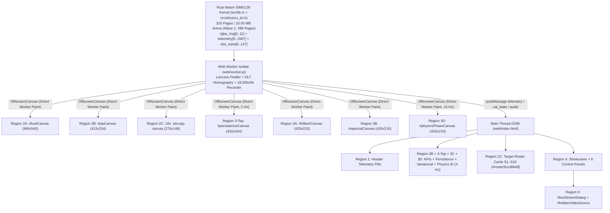

# CHRONOS-SPECTRAL UI and Telemetry Guide

This reference documents every UI element, `OffscreenCanvas` graphic, dynamic KPI state transition, calibration rule, WebAudio synthesizer voice, and exported telemetry field in the CHRONOS-SPECTRAL Command Deck ([index.html](file:///Volumes/Storage/CHRONOS-SPECTRAL/web/index.html), [worker.js](file:///Volumes/Storage/CHRONOS-SPECTRAL/web/worker.js), [lib.rs](file:///Volumes/Storage/CHRONOS-SPECTRAL/src/lib.rs), and [physics_id.rs](file:///Volumes/Storage/CHRONOS-SPECTRAL/src/physics_id.rs)).

Each entry explains three things:
1. **What it is** (exact UI label, DOM `#id` or CSS/canvas component, and source location).
2. **What it measures or controls** (exact mathematical quantity, units, gating threshold, and Wasm `telemetry[0..1567]` or `slot_meta[0..127]` slot).
3. **What we gain from it** (what physical behavior or failure mode it reveals and how it helps you tune or verify a run).

---

## Deck architecture and core concepts

Two architectural principles govern almost every number on the deck:

1. **Non-causal delayed presentation (`VIEW [t − K]` vs `NOW [t]`):** Incoming frames land in `Arena.rgba_ring[frame_idx % 12]` (`t NOW`), while the HUD displays delayed slot `(frame_idx + 12 - eff_k) % 12` (`t - K`, default `K = 8`). Holding `K` future frames lets Dual Projected-FISTA smooth trajectories across `12` frames, lets backward `rgba_ring` re-tracking fill missing detections, lets Hermite splines bridge bounded opaque occlusions, and feeds the symmetric `15`-tap Hamming Hilbert filter when `K >= 7`.
2. **Primary focus selection (`AUTO` vs `PINNED`):** Up to `16` targets (`S1..S16`) are tracked simultaneously in Wasm. `resolvePrimarySlot()` ([worker.js](file:///Volumes/Storage/CHRONOS-SPECTRAL/web/worker.js)) selects one primary target for the enlarged Split PiP, `#mortonReadout`, `#hilbertCanvas`, and the focus Kinematic Matrix cards. You can let the mode-aware selector choose automatically (`AUTO`) or pin any `Tn` by clicking near it on `#hudCanvas`, clicking its card header button (`.roster-pin-btn`), or stepping through `#btnFocusCycle`.

---

## Region 1: Top system telemetry header

Source: `header.deck-header` ([index.html](file:///Volumes/Storage/CHRONOS-SPECTRAL/web/index.html)).

| Element (`#id` / Badge) | UI Label / Example | What it measures | What we gain from it |
| :--- | :--- | :--- | :--- |
| `.brand-badge` | `WASM32 + SIMD128` | Static target architecture indicator. | Confirms the compute kernel targets 128-bit packed SIMD (`v128`) in `wasm32`. |
| `#pillKernel` | `◆ KERNEL: 0 HEAP ALLOC / 0 IMPORTS` | Wasm instantiation status (`ready`, `init_error`, worker `error`). | Proves the Rust module loaded with zero host imports and zero heap allocator calls; surfaces `⚠ KERNEL INIT FAILED` or `⚠ KERNEL WORKER ERROR` immediately on boot failure. |
| `#pillArena` | `ARENA: 320 PAGES / 20.00 MB` | Fixed `WebAssembly.Memory` size (`telemetry[20]` = `sizeof(Arena)` and `byteLength / 65536`; reports `288 PAGES / 18.00 MB` on Wave-1 Wasm builds before Wave-2 expansion). | Verifies static memory discipline across SD (`320x180`) and HD (`640x360`) resolution toggles with zero `memory.grow` leaks. |
| `#pillPerf` | `◆ KERNEL: 0.647 ms` | 120-frame rolling median tick latency (`wasmMedianMs`, [worker.js](file:///Volumes/Storage/CHRONOS-SPECTRAL/web/worker.js)) covering `chronos_pre_tick`, Lanczos Fiedler, and `chronos_post_tick`. | Flags `▲` warn above frame budgets (`0.35 ms` SD / `1.00 ms` HD testbench; `0.75 ms` SD / `2.20 ms` HD real video), letting you spot thermal throttling or slow hardware immediately. |
| `#pillFps` | `FPS: 30` | Smoothed ingest frame rate (`sourceFps` EMA over incoming `dtSec`, or `60` on testbench). | Verifies that the video pump (`requestVideoFrameCallback`) delivers unique frames at the clip's true native cadence rather than duplicate 60 Hz RAF polls. |
| `#pillStreamHealth` | `◆ CAM LOCKED · LAG 267ms · DROP 0` | Live camera state (`telemetry[1257]`: `0` locked, `1` PTZ pan `telemetry[1258]`, `2` scene cut), buffered lookahead lag `telemetry[1256]` (`disp_lag_ms`), and JS `pumpDroppedFrames` (hidden in `testbench`). | Separates genuine target motion from panning cameras (`▲ PTZ PAN (XX px/s)`) or hard cuts (`▲ CUT RESET`), and alerts you if worker backpressure drops incoming frames (`DROP > 0`). |

---

## Region 2: Left column (HUD, Split PiP, Primary KPIs, Target Roster)

### Region 2A: Delayed Wavefield HUD (`#hudPanel`, `#hudCanvas`)

Source: HUD container `#hudPanel` (docked inside zero-CLS placeholder `#hudDockSlot`), header `#hudSourceLabel`, quick-action buttons `#btnHudHeroToggle` (`Hero 16: ON` / `HERO 16: HIDDEN`) and `#btnHudFullscreen` (`⛶ Fullscreen` / `✕ Exit Full`) ([index.html](file:///Volumes/Storage/CHRONOS-SPECTRAL/web/index.html)), canvas renderer `renderCalibrationOverlay` ([worker.js](file:///Volumes/Storage/CHRONOS-SPECTRAL/web/worker.js)) and `renderMainHud` ([worker.js](file:///Volumes/Storage/CHRONOS-SPECTRAL/web/worker.js)).

- **`DeckUiFsm` State Machine (`transitionDeckState`, `renderDeckState`, `window.__chronosUiState`):** A pure finite-state reducer in [index.html](file:///Volumes/Storage/CHRONOS-SPECTRAL/web/index.html) coordinates all deck state across five orthogonal regions (`source`: `'IDLE' | 'TESTBENCH' | 'VIDEO' | 'WEBCAM'`, `engine`: `'SWARM_OFF' | 'AUTO_STANDBY' | 'SWARM_ACTIVE'`, `overlays`: `{ showHeroTargets, showAllOverlays, showEcaOverlay, showKalman, fieldOverlayMode }`, `pointerTool`: `'INSPECT_TARGET' | 'CAL_RULER_P1' | 'CAL_RULER_P2' | 'CAL_QUAD_PT1' | 'CAL_QUAD_PT2' | 'CAL_QUAD_PT3' | 'CAL_QUAD_PT4' | 'CROP_ROI'`, and `viewport`: `'DOCKED' | 'FULLSCREEN'`), projecting an idempotent DOM update and freezing each transitioned snapshot onto `window.__chronosUiState`.
- **Quick Header Controls (`#btnHudHeroToggle`, `#btnHudFullscreen`) & Keyboard Shortcuts (`H`, `F`, `Esc`):**
  - `#btnHudHeroToggle` stays fixed-width (`CLS = 0`) and synchronized 1-to-1 with `#chkHeroTargets` and keyboard shortcut `H` (ignored when focus is inside form inputs/selects or while `#liveStreamDialog` is open). Toggling off suppresses Step 5 Hero-16 drawing (reticles, trails, Hermite bridges, frozen apex locks, protractors, Kalman boxes) while keeping Wasm Hero tracking, `#pipCanvas` `1x` Raw / `25x` Eulerian inspection, and Swarm overlays active; if Swarm is inactive (`engine !== 'SWARM_ACTIVE'`), `[data-hidden-solo="true"]` highlights `#btnHudHeroToggle` (`HERO 16: HIDDEN`) in amber so hidden reticles remain unmistakable.
  - `#btnHudFullscreen` (`F` key) expands `#hudPanel` via native Fullscreen API (`requestFullscreen()`) with a zero-letterbox `.hud-maximized` (`inset: 0; z-index: 9999`) CSS fallback when Fullscreen is blocked, keeping `#hudCanvas` locked to exact `16:9` aspect geometry (`inline-size: min(100%, calc((100dvh - 54px) * 16 / 9))`). Pressing `F` again or `Escape` restores `DOCKED` mode cleanly via `fullscreenchange`, and pressing `Escape` from `.hud-maximized` exits fallback fullscreen and also cancels any armed calibration tool (`cancel_arm`) in the same keypress.

`#hudSourceLabel` prints the active source banner (for example `SOURCE: BLIND PIXEL PILLAR TESTBENCH (getImageData ONLY)`, `SOURCE: SAMPLE MP4 (...)`, `SOURCE: LIVE WEBCAM OPTICAL FEED (DEDUPLICATED)`, or `SOURCE: LIVE fMP4 MSE (...)`). `#hudCanvas` is a borderless `16:9` `960x540` `OffscreenCanvas` (`border: 0; padding: 0; outline: 1px solid`) so `getBoundingClientRect()` aligns directly with painted canvas edges without box-sizing inset drift, and pointer clicks follow mutually exclusive `DeckUiFsm` `pointerTool` arbitration: arming, advancing draft points, or cancelling with `Esc` updates `pointerTool` synchronously, sends calibration clicks with explicit `intent: 'calibration'` + monotonic `calSyncSeq` fencing, and drops both queued calibration clicks and `inspect_point` races on the worker whenever active calibration vs `calArmed === 'none'` disagrees.

Every visual layer drawn onto `#hudCanvas` in draw order:

1. **Delayed RGBA Base Frame (`[t - K]`):** Nearest-neighbor blit of `Arena.rgba_ring[dispSlot]` scaled `3.0x` (`320x180` SD) or `1.5x` (`640x360` HD). Shows the exact pixels seen by `t - K` overlays.
2. **Live ECA Motion-Residual Heatmap (`[Frame t]`):** Enabled by `#chkEcaOverlay`. Maps normalized Rank-2 Extensive Cancellation Algorithm foreground residual `ecaResView[i] > 0.025` to translucent cyan (`v = min(1.0, res * 3.2)`). Because ECA runs at ingest time `t` while target reticles render at `t - K`, seeing cyan silhouettes `K` frames ahead of the reticles proves non-causal lookahead visually.
3. **Testbench Blind Occluder Zones (`OCCLUDER P1`, `OCCLUDER P2`):** Dashed steel-blue outlines drawn in `testbench` scenarios with pillars (`pillar_crossing`, `short_gap_bridge`). Marks the 100% opaque zero-visibility (`w_k = 0`) intervals where targets disappear behind clutter.
4. **Calibration Geometry & Armed Click Guides:**
   - **2-Point Ruler:** Dashed gold (`#ffd166`) line with perpendicular end ticks and `📏 X.XX m` pill showing the calibrated reference span.
   - **4-Point Homography Plane:** Solid cyan quad (`TL`, `TR`, `BR`, `BL` corner badges) plus a dashed `4x4` iso-metric grid inverse-mapped through $H^{-1}$ (`mapMetricToNorm`). Inspecting the grid against floor lines or lane markings immediately confirms projective perspective rectification accuracy.
   - **Interactive Armed Prompt & Draft Crosshairs:** Top-center gold banner (`CLICK RULER ENDPOINT 1/2` or `CLICK PLANE CORNER 1/4 [TL]... ESC PRESERVES PRIOR`) and gold target crosshairs on clicked points before commit.
5. **Mode C Quadrant Voice Grid, Shockwaves & Scatter Wedges (`labMode === 2`):**
   - **Quadrant Grid:** Divides `#hudCanvas` into `Q0: SUB-KICK 808` (top-left), `Q1: CRISP SNARE` (top-right), `Q2: METALLIC FM HAT` (bottom-left), `Q3: HARMONIC TOM` (bottom-right), flashing each border in zone color at the exact `t - K` frame a delayed strike lands.
   - **Impact Shockwave & CAD Deflection Protractor:** Expanding double rings at strike coordinates `(shockX, shockY)` paired with a dashed white incident continuation ray, solid outgoing velocity arrow, gold signed arc sector, and `⚡ Δθ=+XX.X° | v⁺/v⁻=X.XX` callout rectified through the homography Jacobian $J_H$ (`rectifyStrikeKinematics`, `telemetry[1120 + m*8 + 3..5]`), or `⚡ L1 IMPACT Qz` on zero-rebound hits. Quantifies rebound angle and speed retention in physical ground-plane units.
   - **Two-Body Contact Scatter Wedge (`telemetry[1250..1255]`):** Cyan shaded wedge + twin outgoing arrows + `⟁ CONTACT SCATTER XX.X°` held for `24` frames around elastic two-body collisions (such as billiard carom collisions or Newton's cradle transfers).
6. **Per-Target Trajectory & Kinematics (`m = 0..15`):**
   - **44-Frame (`~1.5 s`) Tapered Comet Trail:** 3-band width/opacity trail (`trailX/Y`) showing recent smooth motion history; resets cleanly on `> 52*resScale` px jumps or camera cuts (`camState === 2`).
   - **Kåsa Virtual Pendulum / Metronome Pivot ([worker.js](file:///Volumes/Storage/CHRONOS-SPECTRAL/web/worker.js)):** Rendered whenever Wasm solves a valid `t - K`-synchronized $2 \times 2$ algebraic circle center (`telemetry[1120 + m*8 + 6..7]`). Draws a vertical grey dashed plumb line, a dashed green rigid tether to the tracked bob/arm, a green `◎ PIVOT` bullseye (or `▲ VIRT PIVOT` top-edge directional badge if the ceiling mount lies above the frame), a translucent green swing wedge, and `θ=+XX.X° | R=X.XXm` (`px`). Confirms rotational/pendular constraint vs free linear flight.
   - **Past Dual-FISTA Ribbon (`[t - 11 .. t - K]`):** Solid track-colored polyline through `telemetry[base + 20..43]`. Shows the piecewise-smooth L1 trend-filtered path up to the display frame.
   - **Future Lookahead & Hermite Bridge Ribbon (`[t - K .. t NOW]`):** Dashed polyline extending ahead of the display reticle to the `t NOW` anchor dot (`u = 11`). Turns bright gold (`#ffd166`) whenever `telemetry[base + 11] > 0.5` (`HERMITE-BRIDGE`), and draws a dashed red `20x20` square at the unrevised causal coasting ghost `(disp_raw_x, disp_raw_y)` whenever `ghostDist > 3.5 px`. The separation between the red causal ghost box and the gold Hermite curve is direct visual proof of non-causal occlusion repair.
   - **Tangent Velocity Vector & Flight Protractor:** Horizontal dashed `0°` datum ray, cyan angle sector, velocity arrow, and `∠+XX.X° · X.XX m/s` (or `OUT-OF-PLANE` in amber when projective denominator $w < 0.14$) on the primary, pinned, or ascending-apex track.
   - **Kinematic-Only `2x2` Kalman Baseline (`KAL-Tn`):** Dashed coral-red `26x26` square (`telemetry[base + 6..7]`) plus a red divergence tether to the Dual-FISTA reticle whenever `kalDist` exceeds `11 px` on real video (always drawn on testbench). Visually exposes where a pure constant-velocity Kalman filter drifts or swaps IDs behind occluders.
   - **Mode A Frozen Parabolic Apex Reticle (`labMode === 0`):** Predicted quadratic ascent curve + `APEX` crosshair locked while ascending (`APEX XXms` in gold), freezing before peak and scoring actual Euclidean error (`APEX Δ=X.Xpx` in green) once the projectile passes its true observed crest (`updateFrozenApexLocks`, [worker.js](file:///Volumes/Storage/CHRONOS-SPECTRAL/web/worker.js)).
   - **Primary Corner-Bracket Reticle & Staggered Callout Pill:** Track-colored corner brackets (`±30 px` primary, `±26 px` secondary, gold when bridged, plus outer white box if `PINNED`), top callout pill `Tn [FOCUS|PINNED|HERMITE-BRIDGE|LOCK|COAST] v2:XX F+|F-` plus 32-bit hex signature `0xXXXXXXXX` (or compact hysteresis speed pill `Tn · X.Xm/s` on secondary tracks), placed without overlap by `reserveHudLabelSlot`.
7. **Mode B Present-Phase Strobe Border (`labMode === 1`):** Full-canvas flashing border + bottom banner (`⚡ STROBE CUE [+π/2 QUADRATURE LEAD]` in amber or `◆ STROBE CUE [−π/2 QUADRATURE LAG]` in cyan) triggered at `telemetry[14]` (`strobe_fired`) using forward-predicted instantaneous phase `telemetry[27]` (`pred_phase_now`).
8. **HUD Telemetry Banners ([worker.js](file:///Volumes/Storage/CHRONOS-SPECTRAL/web/worker.js)):**
   - **Top-left status strip:** `VIEW [t-K] WxH | ECA XX.XdB (XX%bg) | IDSW:N | KAL:M [| ECA@t]`.
   - **Top-center camera motion alert:** `⚡ SCENE CUT DETECTED · ECA SUBSPACE & TRACKS AUTO-RESET` (`camState === 2`) or `⚠ CAMERA PTZ PAN (XX px/s) · TRACKING & SCALE HELD` (`camState === 1`).
   - **Top-right focus indicator:** `◎ FOCUS: Tn [AUTO · CLICK PATCH TO PIN]` / `[PINNED · CLICK TO UNPIN]` / `◎ AWAITING MOTION PATCH`.
   - **Bottom-left Mode A gravity badge:** `ĝ = XXX px/s² (PROV · 1/2 ARCS | LOCKED · N ARCS)` when `scene_gravity_conf >= 0.20` and `scene_gravity_px_s2 > 50` (`telemetry[1248, 1249, 1259]`).
   - **Bottom-right calibration provenance badge:** `📏 RULER [ASSUMED|SURVEYED]`, `⬠ PLANE H [ASSUMED|SURVEYED]`, `⚡ AUTO-g [PROVISIONAL|LOCKED]`, or `⚠ CALIBRATION HELD (CAM MOTION)`.

---

9. **CHRONOS-1000 Field Layer Compositor and Click-to-Inspect ([worker.js](file:///Volumes/Storage/CHRONOS-SPECTRAL/web/worker.js)):**
   When CHRONOS-1000 swarm tracking is active (`swarmActive`) or a field overlay mode (`fieldOverlayMode` 1..4) is selected, `renderChronos1000FieldLayer()` composites high-density overlays directly on `#hudCanvas` in under `0.5 ms` per frame via a dedicated `OffscreenCanvas` WebGL2 instanced renderer (`fieldGlCanvas`, with a batched 2D `OffscreenCanvas` fallback when WebGL2 is unavailable):
   - **Frame-Aligned Snapshot Ring (`swarmRing*`):** Since `export_micro`, `continuumField`, `rigidBodies`, and `export_modal_field` execute causally on the latest ingested frame `f`, `processIngestedFrame()` snapshots those views into a pre-allocated `12`-slot zero-GC typed ring (`swarmRingMicro`, `swarmRingField`, `swarmRingBodies`, `swarmRingModal`, `swarmRingTelem`). `renderMainHud(dispSlot)` draws strictly from `dispSlot` (`t - effK`) so micro-track pips, velocity stems, rigid-motion hulls, and `40x22` heatmaps align pixel-for-pixel with the delayed display frame.
   - **Bilinear `40x22` Continuum Heatmap Overlay (`fieldOverlayModeSelect`):** Normalized grid coordinates (`cx = floor(40 * x / W)`, `cy = floor(22 * y / H)`) cover all `640x360` HD / `320x180` SD pixels without bottom-row truncation, uploaded to an `RGBA8` WebGL2 texture (`gl.LINEAR` bilinear filtering for Velocity, Vorticity, and FTLE modes `1..3`, unblended `gl.NEAREST` filtering for Modal vibration phase mode `4`; `0` = Micro-Tracks + Rigid Hulls Only, `1` = Velocity `|v|`, `2` = Signed Vorticity Curl `dv/dx - du/dy`, `3` = 16-Frame Staggered FTLE Coherent Ridges, `4` = Modal Vibration Phase in `[-pi, pi]`). `packFieldOverlayTexture()` gates overlay rendering on `dispSwarmActive` so zero-initialized inactive frames (`swarm_active == 0`) remain transparent with a `[STANDBY]` caption instead of drawing false `0.0` phase washes. A top-left HUD legend prints active scale bounds (`px/s` or `s^-1`) so information is never conveyed by color alone.
   - **Instanced Micro-Tracks & Rigid-Motion Components (`SE(2)`):** Draws up to `1,536` velocity stems and signed-distance diamond lock pips in one instanced draw pass (cyan for confirmed free tracks, amber for tentative/coasting tracks, warm orange for rigid-motion members), followed by Andrew's monotone-chain convex hulls, rotational direction arcs, and numeric `B<id> · omega=+/-X.XX rad/s` labels for up to `32` discovered rigid-motion components.
   - **Canvas Click-to-Inspect (`inspect_point`):** Governed by `DeckUiFsm` `pointerTool`: only when calibration drafting is inactive (`pointerTool === 'INSPECT_TARGET'`) and either `engine === 'SWARM_ACTIVE'` or `Shift+Click` is used on `#hudCanvas`, clicking increments `inspectReqSeq` and sends `{ type: 'inspect_point', inspectSeq, x, y, normX, normY }` to `worker.js`. `inspectFieldPointAt()` advances monotonic `inspectSeq`, echoes the processed request (`inspectSeq`, `inspectReqNormX`, `inspectReqNormY`, `inspectReqPxX`, `inspectReqPxY`) into `telemetry.chronos1000` (projected onto frozen `window.__chronosUiState.lastInspectAck` and `#swarmInspectReadout` `dataset.*`) so ordinary movement of an already-pinned track never masquerades as a fresh click response, snaps clicks on `dispSlot` (`t - effK`) onto the live `microTracksView` coordinate, calls `wasmExports.chronos_inspect_field_point(x, y)` (matching the nearest confirmed micro-track within `< 24.0 * q` px, promoting into the Hero pool, and preserving Hero focus via `chronos_set_focus_target(tid)`), highlights the diamond reticle on `#hudCanvas`, and populates `#swarmInspectReadout`.

### Region 2B: Split `1x` Raw / `25x` Eulerian Audit and Primary KPIs

Source: [index.html](file:///Volumes/Storage/CHRONOS-SPECTRAL/web/index.html), PiP renderer `renderEulerianPip` ([worker.js](file:///Volumes/Storage/CHRONOS-SPECTRAL/web/worker.js)).

- **`#mortonReadout` (`BINARY-PREFIX SIG: 0x00000000 (v₂ = --)`):** Displays the primary focus track's 32-bit Haar-Morton + opponent-color signature (`telemetry[base + 12..13]`) and last-match 2-adic ultrametric valuation $v_2(A, B) = \operatorname{clz}(\text{sig}_A \oplus \text{sig}_B) \in [0, 32]$ (`telemetry[base + 14]`). Higher `v₂` means the patch matched on deeper sub-block wavelet bits and opponent polarity (`R-G`, `B-Y`), explaining why a re-acquired or crossing target resisted identity swaps.
- **`#pipCanvas` (`412x234`, full-width stacked primary PiP):**
  - Left square (`192x192`): `1x RAW [t−K]` (`32x32` SD upscaled `6x` or border-clamped `64x64` HD upscaled `3x`, centered at smoothed `disp_fista` position from `rgba_ring[dispSlot]`).
  - Right square (`192x192`): `25x TEMPORAL Δ` (label reflects `#sliderGain`, from `chronos_get_pip_rgba_ptr()`) showing co-registered luma change `(luma - pip_ref_luma) * eulerian_gain` rendered with cyan/magenta signed contrast and center crosshairs.
  - Bottom bar: `Tn [AUTO|PINNED] | 32x32` (or `64x64`) `FISTA STABILIZED`.
  - **Gain:** Reveals sub-pixel mechanical vibration, wheel rim flicker, pulse/tremor oscillations, or surface lighting shear inside the moving object's own stabilized coordinate frame without motion-blur halos, at `4x` larger pixel area than before.

#### Primary 6 KPI Cards

| Label `#id` | Value `#id` | Mode / Condition | What it measures | What we gain from it |
| :--- | :--- | :--- | :--- | :--- |
| `#lblPadicSwaps` | `#kpiPadicSwaps` | `testbench` -> `Oracle ID Swaps` | `oraclePadicSwaps`: 1-to-1 ground-truth ID swap count against known blind testbench crossing trajectories. | Proves true identity preservation across total occlusions with zero ground-truth leakage into the Wasm tracker. |
| `#lblPadicSwaps` | `#kpiPadicSwaps` | real video -> `2-Adic Fiedler` | `telemetry[5]` (`padic_id_swaps`): Wasm internal swap/inconsistency event counter. | Tracks assignment stability on unlabelled camera feeds. |
| (static label `Kalman Swaps`) | `#kpiKalmanSwaps` | All modes | `telemetry[6]` (`kalman_id_swaps`): Identity swaps committed by the baseline `2x2` constant-velocity Kalman tracker on the exact same frames. | Gives an immediate A/B benchmark showing how many swaps 2-adic + Fiedler + non-causal FISTA prevented (`◆ 0` vs `▲ N`). |
| `#lblClutterDb` | `#kpiClutterDb` | After 12-frame warmup (`telemetry[22] > 0.5`) | `ECA Clutter (XX%)` label = stationary evaluation pixel ratio `telemetry[23]` (`clutter_eval_ratio`); value = `telemetry[4]` (`clutter_db`) $= 10 \log_{10}(\sigma_{\text{raw}}^2 / \sigma_{\text{ECA}}^2)$ in dB (shows `WARMING` during initial 12 frames). | Measures how cleanly Rank-2 ECA suppresses static background and global auto-exposure changes (`> 64 dB` synthetic, `36 to 46 dB` H.264 video) while the `(XX%)` readout warns if a global pan shrinks the static evaluation mask. |
| `#lblWasmMs` | `#kpiWasmMs` | All modes | Label `Kernel (X.XX avg)` = rolling 120-frame mean tick time; value = rolling 120-frame median tick time (`ms`). | Distinguishes consistent SIMD128 kernel cost from isolated OS/GC timer outliers. |
| (static label `Tracked Patches`) | `#kpiTargets` | All modes | `telemetry[3]`: count of confirmed (`3`-of-`8` M-of-N, or `2`-hit dormant re-ID) active slots out of `16` (`N / 16`). | Confirms scene occupancy and tells you if clutter thresholds (`#sliderLambda`, `#sliderEca`) are over- or under-seeding targets. |
| `#lblCollisions` | `#kpiCollisions` | `testbench` -> `Pillar Collisions` | `inPillarCollisions`: cumulative blind crossings inside testbench occluders. | Quantifies difficulty/stress level in synthetic occlusion runs. |
| `#lblCollisions` | `#kpiCollisions` | real video, Mode A/B -> `Hermite Bridges` | `totalBridgedEvents` (`Xf`): cumulative frames repaired by non-causal Hermite splines. | Proves the non-causal bridge is actively reconstructing occluded paths (e.g., cars passing under highway gantries). |
| `#lblCollisions` | `#kpiCollisions` | real video, Mode C -> `L1 Impact Strikes` | `totalStrikeEvents`: cumulative second-difference L1 acceleration impulses detected in Mode C. | Counts physical collisions / bounces (e.g., billiard bank impacts or Newton's cradle impacts). |

---

### Region 2C: Target Roster (`S1` through `S16`)

Source: `#rosterPanelTitle`, `#rosterSummaryMeta`, `#rosterScrollWell`, `#rosterGrid` ([index.html](file:///Volumes/Storage/CHRONOS-SPECTRAL/web/index.html)), DOM updater `updateSlotRosterUi` ([index.html](file:///Volumes/Storage/CHRONOS-SPECTRAL/web/index.html)), EMA & card renderer `updateSlotRosterEma` / `renderAllSlotPips` ([worker.js](file:///Volumes/Storage/CHRONOS-SPECTRAL/web/worker.js)).

- **Header Chips (`#rosterSummaryMeta`):**
  - `#rosterReacqVal` (`↻ RE-ACQ N`): Sum of `slot_meta[m*8 + 3]` dormant re-identifications across active/held slots. Shows how many times targets resumed their prior `Tn` identity after exiting or occluding behind poles/signs (`1200`-frame / `40 s` @ `30 fps` `32`-slot `DormantTrack` archive using `16x16` zero-mean foreground templates with radial rod/rail de-slip, `4`-mode IMM trajectory corridor, and 2-adic Haar-Morton affinity).
  - `#rosterHoldChip` / `#rosterHoldVal` (`HOLD N`): Count of slots currently held in the `48`-frame (`~1.5 s`, or `180`-frame / `3.0 s` when `PINNED`) graceful post-loss latch (`SLOT_HOLD_FRAMES` / `PINNED_HOLD_FRAMES`). Prevents telemetry numbers from flashing to `--` the instant a vehicle passes out of view.
- **Scrollable 2-Column Container (`#rosterScrollWell`, `#rosterGrid`):** Holds all `16` target cards inside a `472 px`-max-height scrollable well so `16` enlarged cards stay scannable without bloating page height or causing layout shift (`CLS = 0`).
  - **Explicit Card & Canvas DOM IDs:** Cards `#rosterCard0`, `#rosterCard1`, `#rosterCard2`, `#rosterCard3`, `#rosterCard4`, `#rosterCard5`, `#rosterCard6`, `#rosterCard7`, `#rosterCard8`, `#rosterCard9`, `#rosterCard10`, `#rosterCard11`, `#rosterCard12`, `#rosterCard13`, `#rosterCard14`, `#rosterCard15` paired 1-to-1 with split canvases `#slotPip0`, `#slotPip1`, `#slotPip2`, `#slotPip3`, `#slotPip4`, `#slotPip5`, `#slotPip6`, `#slotPip7`, `#slotPip8`, `#slotPip9`, `#slotPip10`, `#slotPip11`, `#slotPip12`, `#slotPip13`, `#slotPip14`, `#slotPip15`.
- **Per-Slot Cards (`.roster-card` for `data-slot="0..15"`):**
  - `.slot-pip-canvas` (`276x148`): Integer-upscaled (`4x` for `32x32` SD, `2x` for `64x64` HD into dual `128x128` boxes) per-slot `1x RAW [t−K]` vs `25x Δ` split viewport from `Arena.all_pip_rgba[m]`. Overlays a translucent `HOLD Tn · LAST LOCK` veil during post-loss hold or `SLOT 0k IDLE` when empty.
  - `.roster-pin-btn` (containing `.roster-swatch` color dot + `.roster-slot-id` `Sk · Tn`): Accessible toggle (`aria-pressed`) to pin/unpin `[FOCUS]` onto slot `k`.
  - `.roster-state-badge`:
    - `IDLE`: Slot free.
    - `LOCKED`: Visible and actively matched.
    - `FOCUS`: Currently auto-selected primary target (`resolvePrimarySlot`).
    - `PINNED` (or `PIN·BRI` / `PIN·COA`): User-pinned focus target (stays sticky for up to `180` frames / `3.0 s` through gaps).
    - `COAST`: Temporarily occluded; predicted via curved CTRV + ballistic model (`predict_curved_step`).
    - `BRIDGED`: Occlusion gap pinned by non-causal Hermite spline across `[t - K .. t NOW]`.
    - `HOLD`: Target exited viewport or retired; card keeps last smoothed measurements frozen for `~1.5 s` (`48` frames) for inspection.
  - **4 Throttled Stat Cells (`~4.5 Hz` / `220 ms` DOM cadence):**
    1. `.rs-lbl-spd` / `.rs-val-spd`: EMA-smoothed speed (`0.78` decay / `0.22` update) in `px/s`, `m/s`, or `OUT-PLANE`. Label switches from `SPD` to `SPD · HZ` (`XX px/s·X.XHz`) whenever per-slot `slot_meta[m*8 + 4] >= 0.35 Hz`, flagging harmonic oscillators at a glance even when they are not the primary focus target.
    2. `.rs-lbl-ang` / `.rs-val-ang`: Context-sensitive angular state:
       - `HDG · ω`: Flight/ground-plane heading (`+XX°`) and angular turn rate (`+YY°/s`).
       - `SWG · R`: Switches automatically when Kåsa pivot lock is active on slot `m`, showing plumb swing angle (`+XX.X°`) and tether radius (`X.XXm` or `XXpx`).
    3. `LOCK AGE` (`.rs-val-age`): Persistence duration in seconds (`slot_meta[m*8 + 0] / effSampleRate`), appending `(Cf)` coasting frame count (`slot_meta[m*8 + 1]`) during occlusions.
    4. `v₂ · RE-ACQ` (`.rs-val-id`): Last 2-adic match depth `v₂:XX` (`telemetry[base + 14]`) and dormant re-acquisition count `↻N` (`slot_meta[m*8 + 3]`).

---

## Region 3: Middle column (Session Continuity, Scopes, Variational Matrix, and Physics ID)

Both middle and right `.deck-column.isolated-region` panels apply CSS `content-visibility: auto; contain-intrinsic-size: auto 300px auto 800px;` (with `@supports not (content-visibility: auto) { .isolated-region { contain: layout style paint; } }` fallback) so complex off-screen layout/paint skips smoothly without layout shift.

### Region 3-Top: Session Persistence & Custody (`#persistencePanel`)

Source: `#persistencePanel`, `#persistPanelTitle`, `#persistSummaryMeta`, `updatePersistenceDomUi` ([index.html](file:///Volumes/Storage/CHRONOS-SPECTRAL/web/index.html)), and Zero-GC ring/canvas renderer `renderPersistenceScope` ([worker.js](file:///Volumes/Storage/CHRONOS-SPECTRAL/web/worker.js)).

Unlike the frame-rate scopes below, `#persistencePanel` is intentionally rate-limited so numbers remain legible across long multi-minute streams without rapid flicker: DOM KPIs refresh at `1 Hz` (`1000 ms`, waking immediately only on peak/unique increments or session reset), and `#persistenceCanvas` repaints at `2 Hz`.

- **`#persistSummaryMeta` (`DORMANT ARCHIVE: N / 32`):** Live occupancy of Wasm's `32`-slot, `1200`-frame (`40 s` @ `30 fps`) `DormantTrack` Re-ID vault (`telemetry[1272]`).
- **6 Slow-Cadence Continuity KPI Cards:**
  - `#kpiPersistSpan` (`Session Span`, `MM:SS`): Elapsed session runtime across current continuous stream/benchmark.
  - `#kpiPersistActivePeak` (`Active / Peak`, `A / P`): Currently active tracks vs session-maximum simultaneous confirmed targets (`telemetry[1267]`).
  - `#kpiPersistUnique` (`Unique IDs`, `N`): Monotonic count of distinct `Tn` track identities assigned during the session (`telemetry[1264]`).
  - `#kpiPersistRelocks` (`Same-ID Re-Locks`, `N`): Combined dormant archive re-identifications (`telemetry[1266]`) and coast reacquisitions (`telemetry[1265]`), proving same-target re-engagement rather than churning fresh IDs.
  - `#kpiPersistLongest` (`Longest Custody`, `Tn (Xs)` / `MM:SS`): Longest single-identity custody duration (`telemetry[1268..1269]`).
  - `#kpiPersistSustained` (`Locks >=10s / 60s`, `A / B`): Counts of distinct targets continuously held or re-engaged for `>= 10 s` (`telemetry[1270]`) and `>= 60 s` (`telemetry[1271]`).
- **`#persistenceCanvas` (`420x204`, `2 Hz` Zero-GC Timeline):**
  - Upper band: `0..16` Simultaneous Locked Targets bar chart aggregated across `CONT_HIST_BINS = 240` dynamic chronological bins that halve/compact cleanly so multi-minute runs stay in view without dropping history.
  - Lower band: `TOP-10 TARGET CUSTODY SWIMLANES (LOCKED vs RE-ENGAGED)` tracking up to `CONT_MAX_TRACKS = 128` identities (`CONT_MAX_SEGS = 24` gap segments each), rendering solid locked bars vs dashed gap-bridged re-lock links across minutes.

### Region 3A: Hilbert Quadrature Scope (`#hilbertMeta`, `#hilbertCanvas`)

Source: [index.html](file:///Volumes/Storage/CHRONOS-SPECTRAL/web/index.html), renderer `renderHilbertScope` ([worker.js](file:///Volumes/Storage/CHRONOS-SPECTRAL/web/worker.js)).

- **`#hilbertMeta`:** Displays live phase-lock telemetry for the primary focus track:
  - `HILBERT GATED (K<7)` when Lookahead Delay `K < 7` (the centered 15-tap FIR filter requires `7` future samples `[t - K + 1 .. t - K + 7]`).
  - `φ = XX° | f = X.XX Hz | COH XX%` when both `phase_valid` (`telemetry[26]`) and the bi-directional turnaround periodicity gate (`telemetry[1260]`) pass.
  - `φ = XX° | APERIODIC MOTION` when instantaneous phase exists but motion is linear/ballistic rather than periodic (`telemetry[1260] == 0`), proving zero false frequency hallucination on juggling/highway/carom clips.
  - `STENCIL WARMING / HOLD` before 15 samples fill.
- **`#hilbertCanvas` (`420x210`):**
  - **Left Polar Phase Portrait:** Auto-ranges across 4 discrete physical tiers (`±1.5`, `±4`, `±12`, `±28 px` * `resScale`) so both sub-pixel tremor and wide metronome swings stay legible. Plots the analytic trajectory $(R(t-K),\, \mathcal{H}\{R\}(t-K))$ (`telemetry[9]`, `telemetry[10]`) in green (`#38f27a`) with a white current-phase dot and a dashed phase-strobe trigger ray rotated by `phaseOffsetRad` (`#phaseOffsetLabel`). A clean circular orbit shows narrow-band sinusoidal energy; collapsed noise near `(0, 0)` shows steady translation.
  - **Right 128-Frame Waveform Plot:** Plots `R(t-K)` in cyan, `H{R}(t-K)` (exact 90-degree quadrature shift) in magenta, and vertical amber trigger ticks (`histStrobe`) on every frame the strobe fired. Pen strokes break cleanly whenever focus switches to a different target ID (`histPipTid`).

### Region 3B: Lanczos Fiedler & Timeline Scope (`#spectralMeta`, `#spectralCanvas`)

Source: [index.html](file:///Volumes/Storage/CHRONOS-SPECTRAL/web/index.html), renderer `renderSpectralAndRingScope` ([worker.js](file:///Volumes/Storage/CHRONOS-SPECTRAL/web/worker.js)).

- **`#spectralMeta`:** Prints `λ₂ = X.XXXX | Δλ = X.XXX` (`telemetry[7]` and `telemetry[24]`) computed by the 31-step Shifted Lanczos eigensolver (`solveShiftedLanczosFiedler`, [worker.js](file:///Volumes/Storage/CHRONOS-SPECTRAL/web/worker.js)) on the Wasm `32x32` Track-Peak graph Laplacian prior to `16x64` Jonker-Volgenant matching.
  - Higher $\lambda_2$ indicates tighter coupling across active track-peak nodes; a wider eigengap $\Delta\lambda = \lambda_3 - \lambda_2$ guarantees the Fiedler partition vector $v_2$ is numerically well-conditioned and separated from higher modes.
- **`#spectralCanvas` (`420x210`):**
  - **Upper-Left Fiedler Eigenvector Bars:** One bar per slot `0..15` showing `fiedlerView[m]` (`telemetry[base + 19]`), colored cyan (`v₂ >= 0`, `F+`) vs crimson (`v₂ < 0`, `F-`). Gives immediate visual confirmation that crossing/nearby targets occupy opposite algebraic graph partitions before assignment.
  - **Upper-Right `λ₂(t)` Sparkline:** 128-frame rolling gold trace of algebraic connectivity over time. Spikes or drops mark moments when multiple trajectories converge (`λ₂` climbs) or separate.
  - **Lower `NON-CAUSAL TIMELINE` (`t−11` -> `VIEW [t−K]` -> `NOW [t]`):** 12 cells representing the exact `Arena.rgba_ring` sliding window (`u = 0..11`). Each cell shows relative time offset (`t-11`..`t`), physical Wasm ring buffer slot (`s0`..`s11`), and state:
    - Cyan `VIEW`: Delayed frame currently shown on `#hudCanvas` (`t - K`).
    - Green `NOW`: Most recent ingested frame (`t`).
    - Teal `+LK`: Visible future lookahead frames `[t - K + 1 .. t - 1]`.
    - Amber `OCC` or `BRG`: Frames where the focus target had `ring_vis == 0` (`OCC` while occluded at present edge, turning into `BRG` once future re-emergence pins a Hermite bridge).

### Region 3C: Variational & Kinematic Matrix (`#fistaGapMeta` + 8 KPI cards)

Source: [index.html](file:///Volumes/Storage/CHRONOS-SPECTRAL/web/index.html).

- **`#fistaGapMeta` (`DUAL GAP: X.XXX`):** Displays `telemetry[25]` (`fista_duality_gap`), the convex duality gap $P(X) - D(u) \ge 0$ of the 2-pass Iteratively Reweighted L1 (IRL1) Dual Projected-FISTA solver (`solve_noncausal_fista_irl1_target`):
  $$\min_{X \in \mathbb{R}^{12}} \frac{1}{2} \sum_{k=0}^{11} w_k (X_k - Y_k)^2 + \lambda_{\text{eff}} \sum_{j=0}^{9} w^{\text{IRL1}}_j |(D_2 X)_j|$$
  Pass 1 uses a smooth box constraint and takes an immediate early-out when $\min_j w^{\text{IRL1}}_j > 0.48$; Pass 2 reweights localized high-impulse knots (carom strikes, Galileo peg stops, burnout, canopy deploy) to eliminate corner rounding while exporting `fista_sharp_knots` to `#kpiFistaKnots`. Near-zero gap certifies that constant-time proximal iterations converged close to the exact global optimum for that trajectory window.

#### Complete 8-Card Dynamic State-Transition Matrix

| Card DOM `#id` (Label / Value) | Condition | Rendered Label | Rendered Value & Physical Meaning |
| :--- | :--- | :--- | :--- |
| `(static)` / `#kpiTremorHz` | `K < 7` | `Oscillation Freq` | `GATED (K<7)` (15-tap centered Hilbert requires 7 future frames) |
| `(static)` / `#kpiTremorHz` | `freqValid` (`telemetry[1260] > 0.5`) | `Oscillation Freq` | `X.XX Hz` (`telemetry[13]`, cycle rate verified by turnaround crossings) |
| `(static)` / `#kpiTremorHz` | `phaseValid` only | `Oscillation Freq` | `APERIODIC` (translation/arc without sustained oscillation) |
| `(static)` / `#kpiTremorHz` | No phase lock | `Oscillation Freq` | `HOLD` (insufficient samples or target stationary) |
| `(static)` / `#kpiTremorPhi` | `K < 7` / `phaseValid` / else | `Delayed Phase φ(t−K)` | `GATED` / `XX°` (`telemetry[11] * 180 / π`) / `HOLD` |
| `#lblApexKpi` / `#kpiApexMs` | `apexMs > 1.0 ms` | `Ballistic T-Apex` | `XX ms` (live countdown to parabolic crest from `telemetry[base + 17]`) |
| `#lblApexKpi` / `#kpiApexMs` | Mode A post-apex (`apexErrPx >= 0`) | `Last Apex Euclid Δ` | `X.X px` (Euclidean distance error between frozen prediction and true crest) |
| `#lblApexKpi` / `#kpiApexMs` | Idle | `Ballistic T-Apex` | `STEADY` |
| `#lblReflexKpi` / `#kpiSaccadeMs` | `stimulusArmed` (`telemetry[29] > 0.5`) | `Stimulus Armed` | `AWAITING` (step detector armed via `#btnLabStimulus`) |
| `#lblReflexKpi` / `#kpiSaccadeMs` | `saccadeLatencyMs > 0` (`telemetry[19]`) | `Stimulus Onset Δt` | `XX.X ms` (elapsed latency from armed stimulus to first response motion) |
| `#lblReflexKpi` / `#kpiSaccadeMs` | `stepSettleMs > 0` (`telemetry[28]`) | `Step Settle Δt` | `XX.X ms` (step-response stabilization duration) |
| `#lblReflexKpi` / `#kpiSaccadeMs` | Idle | `Onset / Settle Δt` | `READY` |
| `#lblKinAngle` / `#kpiKinAngle` | `pivotValid` (`telemetry[kb+6..7] > -9e5`) | `Pendulum Swing θ` | `+XX.X°` (signed deflection from vertical plumb relative to Kåsa pivot) |
| `#lblKinAngle` / `#kpiKinAngle` | Free translation | `Flight / Heading θ` | `+XX.X°` ($J_H$-rectified ground-plane angle if homography active, else tangent image angle) |
| `#lblKinAngle` / `#kpiKinAngle` | `activeTargets == 0` | `Flight / Swing θ` | `--°` |
| `#lblKinSpeed` / `#kpiKinSpeed` | `metricValid < -0.5` | `Perspective Guard` | `OUT OF PLANE` ($w = H_{20} x + H_{21} y + H_{22} < 0.14$ or camera panning) |
| `#lblKinSpeed` / `#kpiKinSpeed` | `calibrated` (`SURVEYED` vs `ASSUMED`) | `Surveyed Speed` / `Assumed Speed` | `X.XX m/s` (explicitly tags scale provenance right in the KPI title) |
| `#lblKinSpeed` / `#kpiKinSpeed` | Uncalibrated | `Tangential Speed` | `XX px/s` |
| `#lblKinDeflect` / `#kpiKinDeflect` | Mode C + strike + scatter `> 2°` (`<= 90f`) | `Deflect Δθ / Scatter` | `+XX° / YY°` (post-impact turn angle and 2-body separation wedge) |
| `#lblKinDeflect` / `#kpiKinDeflect` | Mode C single-body / waiting | `Impact Deflection Δθ` | `+XX.X°` or `AWAITING` |
| `#lblKinDeflect` / `#kpiKinDeflect` | Mode A/B + `pivotValid` | `Tether Radius R` | `X.XX m` or `XX px` (radial distance from Kåsa center to tracked mass) |
| `#lblKinDeflect` / `#kpiKinDeflect` | Mode A/B free translation | `Angular Rate ω` | `XX°/s` ($J_H$-rectified heading turn rate when homography active, else `telemetry[kb+2]`) |
| `#lblKinRestGrav` / `#kpiKinRestGrav` | Mode C | `Speed Ratio v⁺/v⁻ (Tn)` | `X.XX` (or `X.XX (X.Xs)` age > `15f`, or `READY`); ratio $\|v^+\|/\|v^-\|$ across L1 strike |
| `#lblKinRestGrav` / `#kpiKinRestGrav` | Mode A/B + `sceneGravityConf >= 0.50` | `Gravity ĝ (N arcs)` | `XXX px/s²` (`telemetry[1248]`, multi-arc consensus acceleration) |
| `#lblKinRestGrav` / `#kpiKinRestGrav` | Mode A/B + `sceneGravityArcs == 1` | `Gravity ĝ (1/2 arcs)` | `XXX prov` (single-arc provisional gravity estimate, held below Auto-g lock) |
| `#lblKinRestGrav` / `#kpiKinRestGrav` | Otherwise | `Metric Calibration` | Mirrors `#calBadge` or `PX UNITS` |

### Region 3D: In-Situ Physics ID & Conservation (`#physicsIdPanel`, `4 Hz` DOM + `15 Hz` Canvas)

Source: `#physicsIdPanel`, `#physicsIdPanelTitle`, `#physicsIdMeta`, `updatePhysicsIdDomUi` ([index.html](file:///Volumes/Storage/CHRONOS-SPECTRAL/web/index.html)), worker formatting & `15 Hz` OffscreenCanvas scope ([worker.js](file:///Volumes/Storage/CHRONOS-SPECTRAL/web/worker.js)), and `#![no_std]` physics engine ([physics_id.rs](file:///Volumes/Storage/CHRONOS-SPECTRAL/src/physics_id.rs)).

To keep multi-physics telemetry calm and readable with zero layout shift (`tabular-nums`, fixed card geometry, single-line overflow clamping), DOM text refreshes at a throttled `4 Hz` (`250 ms` cadence), snapping immediately whenever `hasPrimary`, `phys_regime`, `constraint_jump_code`, or `last_pair_frame` changes or on session reset. `#physicsPhaseCanvas` (`420x210`, explicit CSS `display: block` and `aspect-ratio: 2 / 1` preventing inline gaps) renders in-worker at `15 Hz` (`>= 66 ms` throttle) and on paused redraws.

- **Header (`#physicsIdPanelTitle`, `#physicsIdMeta`):** Shows `In-Situ Physics ID & Conservation (4 Hz)` alongside `ODE R² X.XXX | KNOTS N | METRIC|PX|OUT-OF-PLANE` (`telemetry[b + 6]`, `telemetry[b + 3]`, and active homography/camera-motion unit mode).
- **Regime & Constraint-Jump Badges:**
  - `#physRegimeBadge`: Displays `Rk · NAME (CC%)` for `phys_regime` (`0..8` from `telemetry[b + 4]`): `0` `Inertial_CV`, `1` `Ballistic`, `2` `Ballistic_AeroDrag`, `3` `Powered_Boost`, `4` `Parachute_Terminal`, `5` `Pendulum_Harmonic`, `6` `Micro_Tremor`, `7` `Impulsive_Collisional`, `8` `Curved_CTRV`, plus confidence `telemetry[b + 5]` (`[0, 1]`, with `15`-frame hysteresis hold and `56`-frame cooldown on jump events).
  - `#physJumpBadge`: Displays `Jk · EVENT` for `constraint_jump_code` (`0..4` from `telemetry[b + 15]`, priority `4 > 1 > 3 > 2`): `0` `NONE`, `1` `PEG JUMP` (`galileo_peg_jump`, 3-frame hold on sudden radius jump), `2` `BURNOUT` (`boost_burnout`), `3` `CANOPY` (`parachute_deploy`), `4` `COLLISION` (`collision_impulse`).
- **Symbolic ODE Readout (`#physicsOdeEq`):** Displays the AICc-selected symbolic differential equation discovered from staggered (`1:4` + event-driven) compact-support weak-form quadrature ($\phi(u) = (1 - u^2)^p$) across the `64`-frame history ring (`HIST_RING_LEN = 64`), formatted automatically in calibrated SI (`m, s, m/s², m⁻¹`) when calibration is active and camera-steady, or `px` units otherwise.
- **`#physicsPhaseCanvas` (`420x210`, `15 Hz` `OffscreenCanvas`):** Renders the primary target's delayed phase-space orbit and normalized mechanical energy / angular momentum conservation trace directly inside the worker isolate.

#### Complete 15-Card In-Situ Physics ID Matrix

| Card DOM `#id` | Telemetry Source | Displayed Units & Physical Meaning |
| :--- | :--- | :--- |
| `#kpiPhysicsR2` | `telemetry[b + 6]` | Weak-form STRidge equation coefficient of determination `ode_r2` (`[0, 1]`). |
| `#kpiPhysicsConf` | `telemetry[b + 5]`, `telemetry[b + 4]` | Classification confidence (`0%..100%`) paired with active regime `(Rk)`. |
| `#kpiImmWeights` | `telemetry[b + 0..2]` | Collapsed 4-mode IMM probabilities `w_cv / w_bal / w_turn_osc` (`sum = 1.0`), coupling CV, Verlet ballistic-drag (`g_bal` clamped `[150s, 3600s]`), CTRV (4th-order Taylor for small turns), and pan-advected oscillatory hypotheses. |
| `#kpiPhysicsBeta` | `telemetry[b + 7]` | Quadratic aerodynamic drag coefficient `aero_drag_beta` (`m⁻¹` when calibrated, else `px⁻¹`). |
| `#kpiPhysicsThrust` | `telemetry[b + 8]` | Net longitudinal boost acceleration `thrust_accel` (`m/s²` when calibrated, else `px/s²`). |
| `#kpiPhysicsDamping` | `telemetry[b + 10..11]` | Log-peak decrement damping ratio `damping_zeta` (`[0, 1]`) and quality factor `Q` (`[0, 999]`, `INF` near `999` for undamped oscillations; `0` when `< 3` peaks). |
| `#kpiPhysicsEllipticT` | `telemetry[b + 9]` | Exact nonlinear pendulum period `T(theta0) = 4 sqrt(L/g) K(sin^2(theta0/2))` (`elliptic_period_s`, computed via `f64` AGM). |
| `#kpiKuramotoSync` | `telemetry[1536]`, `telemetry[1538]` | Ensemble Kuramoto order parameter `R_sync / N` over `N >= 2` periodic oscillators (mean phase `kuramoto_mean_psi` in `telemetry[1537]`). |
| `#kpiLyapunovMax` | `telemetry[1547]` | Staggered (`1:8`) `4D` delay-coordinate Rosenstein maximal Lyapunov divergence rate `lambda_max` (`s⁻¹`, `64`-slot stride-2 `LyapunovScratch` on interior oscillatory/CTRV tracks). |
| `#kpiTaubinDelta` | `telemetry[1548]` | Euclidean center separation `||(xc_T, yc_T) - (xc_K, yc_K)||_2` comparing `f64` `3x3` Jacobi Taubin vs algebraic Kåsa circle fits (`m` or `px`). |
| `#kpiTaubinKappa` | `telemetry[1549]` | Taubin trajectory curvature `kappa` (`m⁻¹` or `px⁻¹`). |
| `#kpiFistaKnots` | `telemetry[b + 3]` | Count of localized high-impulse acceleration knots (`0..=10`) flagged by Pass 1 IRL1 weights (`min(w_irl1) <= 0.48`) for Pass 2 sharp corner preservation. |
| `#kpiTwoBodyMassE` | `telemetry[1541]`, `telemetry[b + 14]` | Causal SNR-conditioned mass ratio `m2 / m1` (`[0.05, 20.0]`) and latched normal restitution `e_n` (`[0, 1]`) over blur-excluded pre/post-impact windows (`f_c + 2 + win_w < frame_idx`). |
| `#kpiTwoBodyMomRes` | `telemetry[1542]`, `telemetry[1543]` | Normalized two-body momentum residual (`last_pair_mom_resid`) paired with kinetic energy retention percentage (`last_pair_energy_retention`, event track IDs/frame in `telemetry[1544..1546]`). |
| `#kpiPhysicsConserv` | `telemetry[b + 12..13]` | Specific mechanical energy `specific_energy` and signed specific angular momentum `specific_ang_mom` about pivot or scene center (scene totals in `telemetry[1539..1540]`). |

- **Supporting Tracker Signal Conditioning (`src/lib.rs`, `src/simd_ops.rs`):** Luma-only Huber IC-LK (`refine_subpixel_ic_lk_huber_simd128`) prevents chroma saturation from rocket plumes/glare; Zero-Mean Foreground SAD (`sad_patch_zm_score_simd128`, `sad_patch_zm_weighted_simd128`, `weighted_anchor_zm_l1_simd128`) provides DC/contrast-gain invariance; `eval_cam_coarse_tile_simd128` accelerates global pan estimation; and `apply_radial_deslip_weights` suppresses moving 1D pendulum/metronome rod texels during P-N template capture and updates.

---

### Region 3E: CHRONOS-1000 Continuum & Swarm Field (`#continuumFieldPanel`, `4 Hz` DOM + Progressive Disclosure)

Positioned inside an `.isolated-region` (`contain: layout style paint`, `font-variant-numeric: tabular-nums lining-nums`) directly below `#physicsIdPanel`, `#continuumFieldPanel` separates high-level continuum telemetry from expert solver internals using a native collapsed-by-default `
` disclosure (`#expertDiagnosticsDrawer`) to preserve `CLS = 0.000000`.

#### Controls & Heading (`#continuumFieldPanel`)

| Element DOM `#id` | Role / Event | Behavior & State Rules |
| --- | --- | --- |
| `#continuumFieldPanel` | Analytical `<section>` container | Isolated layout/paint boundary for `4 Hz` continuum KPI updates and progressive disclosure. |
| `#continuumPanelHeading` | Section `<h2>` title | Labels `#continuumFieldPanel` (`CHRONOS-1000 Continuum & Swarm Field`). |
| `#continuumSummaryMeta` | Header status pill (`aria-live="off"`) | Transitions across `SWARM: STANDBY · LEGACY WASM`, `SWARM: OFF · HERO 16`, `SWARM: AUTO STANDBY`, `SWARM: FORCED WAIT`, and `SWARM: ACTIVE · WEBGL2` (or `CANVAS2D`). |
| `#swarmModeSelect` | Native `<select>` (`set_swarm_mode`) | `0` = Off (Hero 16 Baseline, default per Astra-1 gate), `1` = Auto-Density (Coarse Gate), `2` = Forced Active (`1,000+` Targets; auto-selected by C1K showcases/scenarios/MP4). |
| `#fieldOverlayModeSelect` | Native `<select>` (`set_field_overlay_mode`) | Switches `#hudCanvas` Field Layer between `0` (Micro-Tracks + Rigid Hulls), `1` (Velocity `|v|` 40x22), `2` (Vorticity Curl `dv/dx - du/dy`), `3` (FTLE 16f Ridges), and `4` (Modal Phase `[-pi, pi]`). |
| `#swarmInspectReadout` | Single-line inspection readout | Fixed `block-size: 1.78rem` readout updated via click-to-inspect (`inspect_point`); shows `μT<tid>`, rigid-motion `B<id>`, `(x, y)`, speed `px/s`, and local `FTLE`. |

#### Primary Swarm, Latency Split & Continuum KPI Cards (`4 Hz` `setTextIfChanged`)

| Card DOM `#id` | Telemetry Source (`chronos1000`) | Displayed Units & Physical Meaning |
| --- | --- | --- |
| `#kpiSwarmConfirmed` | `confirmedCount` / `coastingCount` | Simultaneously confirmed observed micro-tracks (`state === 1`) vs coasting tracks (`coasting > 0`, never blended into observed confirmed count). |
| `#kpiSwarmPeak` | `peakSimultaneous` | Session high-water mark of simultaneously confirmed observed micro-tracks (`1,000+` proof). |
| `#kpiSwarmUnique` | `uniqueTracks` | Cumulative distinct micro-track IDs (`track_id`) minted over the session. |
| `#kpiLatencySplit` | `kernelComputeMedianMs` / `partialPipelineLatencyMs` | Explicitly separates Wasm **Kernel Compute Median (`ms`)** (`wasmMedianMs`) from **Partial Pipeline Latency Estimate (`ms`)** = `lookaheadWindowMs + kernel_ms + snapshotCopyMs + fieldRenderMs` (`source_pts` PTS delta when available, else `accumulated_dt` / `dt_estimate`), excluding camera capture, video decode, queuing, secondary scopes, and display presentation. |
| `#kpiRigidBodies` | `rigidBodyCount`, `topRigidOmegaRadS`, `validityMask & 4` | Active multi-frame `SE(2)` **rigid-motion components** (e.g., rotating polygons or solid-body vortex cores) + signed angular velocity `omega` in `rad/s`, gated by validity bit `2` (`-- | -- rad/s` when invalid/unavailable). |
| `#kpiContinuumVort` | `maxVorticityS1`, `rmsVorticityS1`, `validityMask & 1` | Peak & RMS Eulerian vorticity curl (`dv/dx - du/dy`) in `s^-1`; prefixes `RAW` if validity bit `0` is clear so raw unclamped solver outputs stay inspectable. |
| `#kpiContinuumFtle` | `maxFtleS1`, `ftleCells`, `ftleMatureTracks`, `validityMask & 2` | Largest finite-time Lyapunov exponent ridge in `s^-1` plus mature cell count (or `WARM <N>t` while the staggered anchor window fills). |
| `#kpiModalField` | `modalDomFreqHz`, `modalR2` | Virtual accelerometer dominant oscillation frequency (`Hz`) paired with nematic anti-phase order parameter `R_2 = |mean(exp(2i * phi))|` (`~1.0` on anti-phase cantilevered beams). |

#### Collapsed Expert Diagnostics Drawer (`#expertDiagnosticsDrawer`)

Starts closed by default (progressive disclosure); native `
` + `
` (`#expertDiagnosticsSummary`) exposes solver transparency counters on user click/keyboard toggle without inducing layout shift elsewhere on the deck:

| Diagnostic Card `#id` | Telemetry Source | Raw Diagnostic Meaning |
| --- | --- | --- |
| `#expertDiagnosticsDrawer` | Native `
` element | Collapsed expert drawer containing low-level Auction, bitmask, FTLE window, k-NN graph, Kuramoto, and compositor metrics. |
| `#expertDiagnosticsSummary` | Native `
` element | Keyboard/screen-reader toggle label (`Expert Solver & Raw Continuum Diagnostics`). |
| `#diagAuctionSteps` | `auctionSteps`, `reacqEvents` | Integer `Q`-scaled Bertsekas epsilon-Auction step count and micro-track reacquisition counter for the latest frame. |
| `#diagRawResiduals` | `meanIcLkRes`, `topRigidSe2RmsePx` | Raw unclamped mean `8x8` Huber IC-LK intensity residual alongside top rigid-motion component `SE(2)` fit `RMSE` (`px`). |
| `#diagValidityMask` | `validityMask` (`swarm_telem[16]`) | Hex bitmask `0x00..0x1F` + active subsystem initials: `G` (`1` Eulerian grad), `F` (`2` FTLE), `R` (`4` Rigid SE(2)), `M` (`8` Modal accel), `K` (`16` Kuramoto/CoM). |
| `#diagFtleWindow` | `ftleMatureTracks`, `ftleCells` | Count of micro-tracks holding mature staggered FTLE anchor windows (`ftleMatureTracks`) and conditioned grid cells (`ftleCells`). |
| `#diagSparseGraph` | `knnEdgeCount`, `peakCount` | Active sparse `k`-NN interaction graph edges (`k <= 6`) and extracted sub-pixel fine peaks (`<= 2,048`) per frame. |
| `#diagKuramotoCom` | `kuramotoR`, `velDispersion` | Global swarm heading Kuramoto order parameter `R` (`[0, 1]`) and swarm velocity dispersion (`px/s`). |
| `#diagFieldBackend` | `fieldBackend`, `fieldRenderMs` | Active HUD Field Layer backend (`WEBGL2` instanced vs `CANVAS2D` batched fallback) and frame render duration (`ms`, target `< 0.50 ms`). |
| `#diagMeanStrain` | `meanStrain` (`swarm_telem[37]`) | Mean smoothed `k`-NN edge strain rate (`s^-1`) across active links. |

## Region 4: Right column (Showcases and 6 Control Panels)

### ★ Featured Showcases (`1-Click HD`)

Source: `.showcase-btn` buttons ([index.html](file:///Volumes/Storage/CHRONOS-SPECTRAL/web/index.html)).

Each button (`aria-pressed`) atomically stops prior streams, enables `640x360 HD`, selects the appropriate Lab Mode (`A`, `B`, or `C`), launches the feed, and applies the matching calibration mode (`preset`, `auto_g`, or `none`):
- **`data-showcase="model_rockets"` (`🚀 Model Rockets · Chutes (31s)`):** Loads `./samples/model_rocket_full_flights.mp4` (`25 fps`, Mode A) with assumed `15.00 m` vertical ascent/chute corridor ruler (`preset`), tracking complete hobby solid-motor launches through boost, coast, apogee rollover, pyrotechnic stage separation, and twin parachute canopy descent.
- **`data-showcase="rocket_vtvl"` (`🚀 Rocket Pad-to-Pad (80s)`):** Loads `./samples/rocket_vtvl_full_flight.mp4` (`30 fps`, Mode A) with assumed `10.00 m` pad-to-hover vertical ruler (`preset`), tracking a single continuous `79.9 s` stationary-camera VTVL flight from pad ignition through ascent, apogee hover across crane-boom occlusion, and vertical powered touchdown.
- **`data-showcase="live_i80"` (`🌉 Live I-80 Cam`):** Connects Tier 3 FFmpeg fMP4 MSE to `caltrans_d4_i80_ashby` (Mode A), automatically failing over to the first `[LIVE ONLINE]` Caltrans camera if Ashby Ave is unreachable.
- **`data-showcase="cologne_motorway"` (`🛣️ A4 Motorway (45s)`):** Loads `./samples/cologne_motorway_occlusion.mp4` (`30 fps`, Mode A) with assumed `28.0 m x 48.0 m` 4-point highway deck homography (`preset`).
- **`data-showcase="rally_pan"` (`🏎️ Rally Ego-Pan (29s)`):** Loads `./samples/rally_ego_pan_tracking.mp4` (`30 fps`, Mode A, `cal: 'none'`) demonstrating pixel-domain ego-pan advection and metric suspension.
- **`data-showcase="chaos_pendulum"` (`🧲 Chaos Pendulum (50s)`):** Loads `./samples/chaotic_magnetic_pendulum.mp4` (`25 fps`, Mode A) with assumed `0.35 m` pendulum ruler (`preset`), showcasing Kåsa virtual pivot locks and Hermite bridging.
- **`data-showcase="coupled_metronomes"` (`🎵 Sync Metronomes (55s)`):** Loads `./samples/coupled_metronomes_sync.mp4` (`30 fps`, Mode B) with assumed `0.45 m` platform span (`preset`), driving Hilbert phase-locking and quadrature strobes.
- **`data-showcase="newtons_cradle"` (`⚪ Newton's Cradle (45s)`):** Loads `./samples/newtons_cradle_impulses.mp4` (`30 fps`, Mode C) with assumed `0.18 m` cradle span (`preset`), auto-enabling WebAudio Mode C impulse sonification.

### Panel 1: Optical Input Source

Source: [index.html](file:///Volumes/Storage/CHRONOS-SPECTRAL/web/index.html).

| Control (`#id`) | Type / UI Label | What it controls / measures | What we gain from it |
| :--- | :--- | :--- | :--- |
| `#inputResMeta` | Status text (`320×180 SD RGBA` / `640×360 HD RGBA`) | Reports active `frameW x frameH` grid inside the static arena. | Confirms active pixel resolution at a glance. |
| `#btnResSd` / `#btnResHd` | Toggle buttons (`320×180 SD (32²)` / `640×360 HD (64²)`) | Calls `chronos_set_resolution(0 or 1)` inside the fixed `20.00 MB` (`320`-page; Wave 1: `18.00 MB`) arena. | Trade `4x` pixel throughput (`0.215 ms` SD vs `0.647 ms` HD median tick) against `2x` spatial acuity and enlarged `32x32` SD / `64x64` HD PiPs (with `32x32` `2x2`-pooled HD Haar-Morton patches). |
| `#btnSrcTestbench` | Button (`■ Pillar Bench`) | Switches to the CPU-drawn blind pixel testbench (`stepAndRenderBlindPillarScene`, [worker.js](file:///Volumes/Storage/CHRONOS-SPECTRAL/web/worker.js)), pixel-isolated (`getImageData` / RGBA only). | Provides deterministic, zero-noise ground-truth physics scenarios and 1-to-1 oracle swap auditing. |
| `#btnSrcWebcam` | Button (`◉ Live Webcam`) | Requests `navigator.mediaDevices.getUserMedia` (`640x360`, `60 fps` ideal) pumped via deduplicated `requestVideoFrameCallback`. | Tests live physical motion, auto-exposure shifts, and Mode B tremor cues on real webcam video. |
| `#btnSrcLiveStream` | Button (`📡 Live Stream`) | Opens `<dialog id="liveStreamDialog">` (Region 5). | Connects live highway/HLS/CORS/browser-tab feeds. |
| `#mp4Input` | File input (`▶ Upload MP4`) | Loads any local `video/*` file via `URL.createObjectURL`, forces HD if on SD, and pumps native PTS frames. | Lets you test arbitrary user footage completely client-side. |
| `#sampleVideoSelect` | Select (`Built-in real-camera physics & traffic MP4s`) | 14 open-licensed MP4s in 3 `<optgroup>` groups: 8 extended showcases (`29 s` to `80 s`, including `model_rocket_full_flights.mp4`, `rocket_vtvl_full_flight.mp4`, and `water_rocket_parachute_flights.mp4`), 5 ground-truth calibration clips (`5.4 s` to `6.7 s`), and `CHRONOS-1000 Continuum Swarms (1,000+ Targets)` (`./samples/starling_murmuration_1000.mp4`), each carrying `data-fps`, `data-lab`, and optional `data-swarm="2"` auto-setup attributes. | Instant one-click regression checking against real camera compression, occlusion, dense swarms, and physics benchmarks. |
| `#benchScenarioField` / `#benchScenarioSelect` | Select (`Synthetic testbench physics scenario`, visible in `testbench`) | Picks one of 10 synthetic benchmarks: `pillar_crossing`, `short_gap_bridge`, `ballistic_cascade`, `model_rocket_flight`, `multi_target_swarm` (12 crossing targets across dual pillars), `harmonic_tremor`, `percussion_ricochet`, plus CHRONOS-1000 Q1-Q3 (`vortex_swarm_1200`, `murmuration_1200`, `modal_beam_1152`). | Exercises specific subsystems cleanly in isolation before moving to noisy camera feeds. |
| `#liveStreamBar` | Contextual bar (visible in `live`) | Container for live stream controls below. | Keeps live-only controls out of the way when running MP4s or testbench. |
| `#liveTierBadge` | Badge (`TIER 1 · TAB / WINDOW CAPTURE`, `TIER 2 · DIRECT CORS URL`, `TIER 3 · FFmpeg fMP4 MSE`) | Identifies which ingestion pipeline feeds `videoEl`. | Confirms whether CORS direct readback, local FFmpeg MSE relay, or tab capture is active. |
| `#liveStreamMeta` | Status text (`F#N · LAG XXms · DISCONT M` or `RECONNECTING (i/3)...`) | Reports frame counter, display lag, discontinuity counter (`telemetry[1263]`), and auto-retry state. | Surfaces network stalls, PTS jumps, and reconnect attempts without opening DevTools. |
| `#liveCropSelect` | Select (`Full Frame 100%`, `Center 85%`, `Center 70%`) | Sets normalized crop ROI `cropNorm` (`[x, y, w, h]`) in `drawCroppedLetterboxedFrame` ([worker.js](file:///Volumes/Storage/CHRONOS-SPECTRAL/web/worker.js)). | Trims player chrome, watermarks, or timestamp overlays out of live feeds so ECA and peak seeders only see optical motion. |
| `#btnReopenLiveModal` / `#btnStopLiveFeed` | Buttons (`⚙ Switch Feed` / `■ Stop Feed`) | Reopens `#liveStreamDialog` or stops capture and returns to `Pillar Bench`. | Quick stream switching or clean teardown. |
| `#videoTransportBar` | Contextual bar (visible in `video`) | Container for frame-accurate MP4 playback controls. | Enables frame-by-frame inspection on paused footage. |
| `#vidTimeLabel` | Readout (`XX.XXs / YY.YYs`) | Current `videoEl.currentTime` vs total `videoEl.duration`. | Tracks exact playback position when stepping or auditing exports. |
| `#btnVidPlayPause` | Toggle (`⏸ Pause` / `▶ Play`) | Pauses or resumes `videoEl`. Paused frames stay live for clicking `[FOCUS]` or metric calibration (`redrawPausedHudIfReady`). | Freeze tricky collisions or calibrate rulers cleanly while paused. |
| `#btnVidStepBack` / `#btnVidStepFwd` | Buttons (`⏮ −1f` / `⏭ +1f`) | Seeks by exact `±1 / activeVideoFps` seconds (`stepVideoByFrames`, [index.html](file:///Volumes/Storage/CHRONOS-SPECTRAL/web/index.html)); `-1f` cleanly resets tracker state to prevent backward teleportation. | Lets you step frame-by-frame through carom impacts, pendulum crests, or overpass exits. |
| `#btnVidReplay` | Button (`↺ Replay`) | Resets Wasm arena, rewinds `videoEl.currentTime = 0`, and plays cleanly from frame `0`. | Re-runs any clip deterministically from the first frame. |
| `#btnAudioToggle` | Toggle (`♪ Enable WebAudio Synth` / `♪ WebAudio Synth: ON`) | Activates `AudioContext` ([index.html](file:///Volumes/Storage/CHRONOS-SPECTRAL/web/index.html)) and sends hardware `outputLatency + baseLatency` to Wasm (`chronos_set_audio_latency`). Voices: Mode B strobe oscillator (`528 Hz` resonant triangle / `264 Hz` sine chirp); Mode C 4-zone latency-compensated percussion (`Q0` `155->42 Hz` 808 sub-kick, `Q1` `1.1 kHz` HP noise + `210->115 Hz` triangle snare, `Q2` `6.2 kHz` HP metallic hat, `Q3` `330/495 Hz` FM tom) scheduled at `netLeadSec = leadSec - msgDelaySec - outLatency`. | Delivers audio-visual synchrony at `t - K`: sound hits your ears at the exact millisecond the collision or strobe renders on `#hudCanvas`. |
| `#btnFocusCycle` | Button (`◎ Focus: AUTO` / `PIN Tn`) | Cycles pinned focus across active tracks (`cycleFocusTarget`) and back to `AUTO` (`0`) across up to `16` concurrent slots (`T1..T16`). | Full keyboard-accessible equivalent of clicking patches on `#hudCanvas`. |
| `#btnResetArena` | Button (`↺ Reset Tracks`) | Calls `chronos_reset_tracks()`, zeroing active tracks, swap counters, and background state while preserving resolution and slider parameters. | Clears stale tracks without reloading the video or losing hyperparameters. |

- **CHRONOS-1000 High-Density Additions (Panel 1 & Showcases):**
  - Featured Showcase buttons include `data-showcase="starling_1000"` (`Starling Murmuration (1,000+)`, streaming `./samples/starling_murmuration_1000.mp4` with HD `resMode=1`, `swarmMode=2`, `fieldOverlayMode=1`) and `data-showcase="vortex_1200"` (`Lamb-Oseen Vortex (1,200)`, launching the blind `vortex_swarm_1200` testbench generator in HD `resMode=1`, `swarmMode=2`, `fieldOverlayMode=2`).
  - `#sampleVideoSelect` includes `<optgroup label="CHRONOS-1000 Continuum Swarms (1,000+ Targets)">` with `./samples/starling_murmuration_1000.mp4` (`30 fps`, `13.0 s`, `640x360`, median `1,353` moving extrema/frame). Selecting an option carrying `data-swarm="2"` automatically enables HD resolution and switches `#swarmModeSelect` to `2`.
  - `#benchScenarioSelect` adds three high-density blind pixel generators in `worker.js` matching `benchmark_1000.mjs` Q1 through Q3 (`vortex_swarm_1200`, `murmuration_1200`, and `modal_beam_1152`), automatically configuring HD `640x360` (`resMode=1`) and `swarmMode=2` while leaving legacy testbench scenarios (`pillar_crossing`, `multi_target_swarm`, etc.) untouched.

### Panel 2: Kinematic Lab Mode

Source: [index.html](file:///Volumes/Storage/CHRONOS-SPECTRAL/web/index.html).

| Control (`#id` / Selector) | Label | What it configures | What we gain from it |
| :--- | :--- | :--- | :--- |
| `#labBadge` | `MODE A` / `MODE B` / `MODE C` | Active kinematic analysis regime indicator. | Confirms which physics overlays and KPI formatters are active. |
| `.lab-btn[data-lab="0"]` | `A · Apex` | Enables parabolic gravity consensus ($\hat{g}$), frozen apex prediction/scoring, tangent velocity protractors, Kåsa virtual pendulum pivots, and Hermite occlusion bridges. | Optimal setup for traffic, juggling, projectiles, and free/magnetic pendulums. |
| `.lab-btn[data-lab="1"]` | `B · Phase` | Enables the Hilbert quadrature scope, Kåsa metronome/pendulum pivots, Mode B strobe border pulses, static-wake clutter suppression on real video, and onset step timer. | Optimal setup for metronomes, tremor analysis, and closed-loop phase entrainment cues. |
| `.lab-btn[data-lab="2"]` | `C · Strike` | Enables the 4-quadrant percussion grid, CAD impact deflection & $v^+/v^-$ speed-ratio protractors, two-body scatter wedges, and auto-enables WebAudio synth. | Optimal setup for billiards, Newton's cradles, elastic bounces, and L1 strike timing. |
| `#labDescription` | Mode summary paragraph | Contextual text explaining the active Lab Mode's math and overlays. | Serves as an inline reminder of what signals the current mode highlights. |
| `#btnLabStimulus` | `⚡ Launch Ballistic Arc Impulse` / `⚡ Arm & Trigger Saccade Stimulus` / `⚡ Snap Air-Percussion L1 Strike` | Dispatches synthetic impulses (`ballistic_toss`, `air_strike`) in `testbench` (disabled with `aria-disabled="true"` on video in Modes A/C), or arms `chronos_trigger_stimulus()` (`saccade_step`) in Mode B on both `testbench` and live video. | Triggers deterministic step perturbations or onset-latency benchmarks on demand. |

### Panel 3: Metric Calibration

Source: [index.html](file:///Volumes/Storage/CHRONOS-SPECTRAL/web/index.html), solver & provenance state ([worker.js](file:///Volumes/Storage/CHRONOS-SPECTRAL/web/worker.js)).

- **`#calPanelHeading` & `#calBadge`:** Heading and compact provenance pill: `PX UNITS`, `SURVEYED RULER`, `ASSUMED RULER`, `SURVEYED 4-PT H`, `ASSUMED 4-PT H`, `AUTO-g 1/2 ARC`, or `AUTO-g LOCKED`.
- **`#calToolbar` (`role="toolbar"` with roving tabindex / `focusgroup`):**
  - `#btnCalRuler` (`📏 2-Pt Ruler`): Arms interactive 2-click ruler calibration (`calDraftRulerMeters`).
  - `#btnCalQuad` (`⬠ 4-Pt Plane`): Arms 4-corner (`TL -> TR -> BR -> BL`) Direct Linear Transform (DLT) projective homography $H$ (`calDraftPlaneW x calDraftPlaneH`). Rectifies pixel velocities and strike/scatter angles through the analytical homography Jacobian $J_H$ and flags `OUT OF PLANE` whenever projective depth $w < 0.14$.
  - `#btnCalAutoG` (`⚡ Auto-g`): Derives resolution-invariant meter scale $\text{px/m} = \hat{g}_{\text{px/s}^2} / 9.80665$ once $\ge 2$ parabolic trajectories reach consensus `scene_gravity_conf >= 0.50` (`AUTO_G_LOCK_CONF`).
  - `#btnCalPreset` (`✦ Preset`): Applies illustrative clip geometry for the built-in scene, explicitly labeled `ASSUMED` provenance so demo numbers are never confused with surveyed measurements.
  - `#btnCalClear` (`✕ Clear`): Resets calibration back to raw `PX UNITS`. Pressing `Escape` while clicking cancels an armed draft without altering the prior committed scale.
- **`#calStatusLive` (`role="status"`):** Live text status reporting armed click progress, validated scale (`px/m` or `[RECTIFIED]`), `CAMERA MOTION` suspension, or input validation errors.
- **`#calScaleForm` (`#calScaleHelp`):** Physical scale inputs validated in `0.05` to `500` meters (updates active calibration on blur or submit `#btnCalApplyDims` `Apply Scale`):
  - `#calRulerM` (`Ruler L (m)`) + `#errCalRulerM`
  - `#calPlaneW` (`Plane W (m)`) + `#errCalPlaneW`
  - `#calPlaneH` (`Plane H (m)`) + `#errCalPlaneH`
- **`#calKeyboardDisclosure` (`Keyboard Normalized Coordinates [0.00-1.00]`):** Accessible disclosure (`#calCoordForm`, `#calCoordHelp`) allowing mouse-free exact coordinate entry (`#calCoordMode`: `ruler` 2-point or `homography` 4-point) across `#coordX1`, `#coordY1`, `#coordX2`, `#coordY2` and quad-only `#coordX3`, `#coordY3`, `#coordX4`, `#coordY4`, submitted via `#btnCommitCoords` (`Commit Surveyed Coordinates`) with `SURVEYED` provenance. Coordinates are normalized `[0..1]`, so calibrations automatically survive SD <-> HD switches!

### Panel 4: Phase Strobe Offset

Source: [index.html](file:///Volumes/Storage/CHRONOS-SPECTRAL/web/index.html).

- **`#phaseOffsetLabel` & `.phase-btn` (`−π/2 Lag Cue`, `+π/2 Lead Cue`, `0° Peak Cue`, `π Trough Cue`):** Sets `phase_offset_rad` (`-π/2`, `+π/2`, `0`, `π`). Because Wasm forward-predicts present instantaneous phase $\hat{\phi}(t + \tau_{\text{audio}}) = \phi(t - K) + 2\pi f \cdot (K \Delta t + \tau_{\text{audio}})$ ([src/lib.rs](file:///Volumes/Storage/CHRONOS-SPECTRAL/src/lib.rs)), choosing quadrature lead or lag lets you place visual/audio cues at exact opposing or quadrature phases relative to real-world cyclic motion (e.g. tremor suppression or metronome beat synchronization).

### Panel 5: Kernel Hyperparameters

Source: [index.html](file:///Volumes/Storage/CHRONOS-SPECTRAL/web/index.html).

| Control (`#id`) | Value Readout (`#id`) & Range | What it controls | What we gain from it |
| :--- | :--- | :--- | :--- |
| `#sliderK` | `#valK` (`8 frames (133 ms)`), `0..11` | `lookahead_k`: Number of future frames buffered in `rgba_ring` before rendering `t - K`. | `0` gives lowest latency (causal tracker); `7..11` unlocks the 15-tap Hilbert filter (`K >= 7`), backward `rgba_ring` gap re-tracking, and longer Hermite occlusion bridges (`< K`). |
| `#chkHeroTargets` | Checkbox (`checked`) | `showHeroTargets`: Synchronized 1-to-1 with `#btnHudHeroToggle` and `H` shortcut via `DeckUiFsm`; toggles Step 5 Hero-16 drawing on `#hudCanvas`. | Clears dense CHRONOS-1000 swarm views of 16-slot Hero reticles, comet trails, Hermite bridges, apex locks, protractors, and Kalman boxes without pausing Wasm tracking or `#pipCanvas`. |
| `#chkKalman` | Checkbox (`checked`) | `showKalmanBaseline`: Toggles dashed coral-red `KAL-Tn` baseline squares on `#hudCanvas`. | Direct visual A/B proof showing where a `2x2` causal Kalman filter drifts during sharp turns or occlusions. |
| `#chkAllOverlays` | Checkbox | `showAllOverlays`: Forces full `Tn [...] v2:XX F+` callouts and Mode B slow-target overlays on every slot. | Reveals per-target internal signatures (`0xXXXXXXXX`) and Fiedler signs across secondary targets at the cost of extra HUD density. |
| `#chkEcaOverlay` | Checkbox | `showEcaOverlay`: Renders current-frame (`[Frame t]`) Rank-2 ECA foreground energy over `[t - K]`. | Inspects foreground/background separation quality directly and confirms the `K`-frame lookahead offset. |
| `#chkStrobe` | Checkbox (`checked`) | `strobeEnabled`: Arms Mode B HUD strobe flashes and strobe audio pulses. | Mutes border flashes without turning off Hilbert phase estimation. |
| `#sliderEca` (in Advanced disclosure) | `#valEca` (`0.035`), `0.005..0.150` | `eca_adapt_rate`: Rank-2 subspace background adaptation speed (guarded at `0.15x` on moving pixels). | Raise for fast changing clouds/shadows; lower to keep slow-moving targets from bleeding into the background model. |
| `#sliderLambda` (in Advanced disclosure) | `#valLambda` (`1.45`), `0.10..5.00` | `fista_lambda`: L1 second-difference penalty scaled internally as $\lambda_{\text{eff}} = \lambda \cdot s$. | Lower follows tight curves and tremor; higher enforces straight constant-velocity segments with sparse acceleration impulses (cleaner Mode C strikes). |
| `#sliderGain` (in Advanced disclosure) | `#valGain` (`25x`), `5..60` | `eulerian_gain`: Temporal luma amplification inside `#pipCanvas` and `.slot-pip-canvas`. | Boost high (`40x-60x`) to see subtle micro-vibrations; lower (`10x-20x`) to avoid clipping under noisy compression. |

### Panel 6: Session Recorder

Source: [index.html](file:///Volumes/Storage/CHRONOS-SPECTRAL/web/index.html), recorder ring slab `REC_COLUMNS` ([worker.js](file:///Volumes/Storage/CHRONOS-SPECTRAL/web/worker.js)).

- **`#recStatusLabel` & `#recSrAnnounce`:** Displays buffer fill (`IDLE (0 FRAMES)`, `● REC N FRAMES (X.Xs)`, `PAUSED (N FRAMES / X.Xs)`, `EMPTY BUFFER (RECORD FIRST)`, `EXPORTED N FRAMES (CSV|JSON)`) with polite screen-reader status announcements.
- **`#btnRecToggle` (`● Start Recording` / `■ Pause Recording`), `#btnRecClear` (`✕ Clear`), `#btnExportCsv` (`↓ Export CSV`), `#btnExportJson` (`↓ Export JSON`):** Writes into a pre-allocated `18,000 x 56` `Float64Array` ring buffer (`5` minutes at `60 Hz` with zero GC allocations). Every calibration change increments `cal_segment_id` and logs a provenance snapshot into `meta.calibrationSegments` (`schemaVersion: "1.5.0"` in JSON export), preventing silent unit mixing in downstream analysis.

#### All 56 Exported Telemetry Columns (`REC_COLUMNS`)

| Group | Columns (`REC_COLUMNS[0..55]`) | Meaning |
| :--- | :--- | :--- |
| Frame & Config | `frame_idx`, `elapsed_sec`, `frame_w`, `frame_h`, `lookahead_k`, `lab_mode` | Frame counter, accumulated `dt`, resolution, active `K`, active mode `0/1/2`. |
| Kernel & Clutter | `wasm_tick_ms`, `active_targets`, `clutter_db`, `clutter_eval_ratio` | Measured worker+Wasm compute time, confirmed count, ECA dB, static pixel ratio. |
| Assignment & Spectral | `padic_swaps`, `oracle_swaps`, `kalman_swaps`, `in_pillar_collisions`, `fiedler_lambda2`, `spectral_gap`, `fista_duality_gap` | Swap counts (Wasm/oracle/Kalman), testbench collisions, Lanczos $\lambda_2$, eigengap $\Delta\lambda$, FISTA dual gap. |
| Primary Trajectory | `primary_track_id`, `primary_sig_u32`, `primary_padic_val`, `disp_raw_x`, `disp_raw_y`, `disp_fista_x`, `disp_fista_y`, `disp_kalman_x`, `disp_kalman_y`, `disp_vis`, `disp_bridged` | Active primary ID, 32-bit unsigned signature, $v_2$, raw/FISTA/Kalman coords at `t - K`, visibility flag, Hermite bridge flag. |
| Hilbert & Events | `tremor_r`, `tremor_h`, `tremor_phase_deg`, `tremor_freq_hz`, `tremor_amp`, `phase_valid`, `strobe_fired`, `perc_mask`, `apex_ms`, `saccade_latency_ms` | Quadrature $(R, \mathcal{H}\{R\})$, phase, frequency, amplitude, gate, strobe trigger, percussion zone bitmask, T-apex ms, stimulus onset ms. |
| Physical Kinematics & Provenance | `heading_deg`, `speed_phys`, `ang_vel_deg_s`, `pend_swing_deg`, `strike_deflect_deg`, `strike_speed_ratio`, `metric_x_m`, `metric_y_m`, `cal_segment_id`, `metric_valid` | Calibrated/$J_H$-rectified heading, speed (`m/s` or `px/s`), turn rate, pendulum swing, strike deflection/ratio, world X/Y meters, provenance segment ID, validity (`1` metric, `0` px, `-1` out-of-plane). |
| In-Situ Physics ID & Synchronization | `phys_regime`, `phys_regime_conf`, `ode_r2`, `aero_drag_beta`, `thrust_accel`, `damping_zeta`, `kuramoto_order_r`, `lyapunov_div_rate` | Primary target regime index (`0..8`), confidence `[0, 1]`, weak-form ODE fit $R^2$, aerodynamic drag $\beta$, boost thrust acceleration, damping ratio $\zeta$, ensemble Kuramoto order $R_{\text{sync}}$, and Rosenstein Lyapunov divergence rate $\lambda_{\max}$ (`REC_COLUMNS[48..55]`). |

---

- **JSON Export Summary (`meta.chronos1000`) & CSV Compatibility:** All `56` columns in `REC_COLUMNS` (`meta.schemaVersion === "1.5.0"`) remain strictly invariant for backward compatibility with Step 4 E2E assertions and existing CSV pipelines (unavailable dense blind `oracle_swaps` exports as `null` in JSON and blank in CSV). When exporting JSON (`telemetry_export_data`), `meta.chronos1000` appends live swarm counts, raw continuum field peaks, modal frequency / `R_2`, validity bitmask, boolean `diagnosticsValid` (`false` whenever any field is nonfinite, non-integer where integer required, or out of range, with those corrupted fields set to `null`), `delayFrames: 0` alongside `causalFrameIdx` / `displayedFrameIdx` / `renderedDelayFrames`, `inspectStatus`, separate `kernelComputeMedianMs` / `snapshotCopyMs` / `fieldRenderMs` / `lookaheadWindowMs` (`lookaheadSource` `source_pts`, `accumulated_dt`, `dt_estimate`, or `zero_lookahead`) / `partialPipelineLatencyMs` (`estimatedPartialPipelineLatencyMs`), Field Layer compositor backend, and validity-gated `rigidBodies[]` records.

## Region 5: 3-Tier Continuous Live Stream Modal (`#liveStreamDialog`)

Source: [index.html](file:///Volumes/Storage/CHRONOS-SPECTRAL/web/index.html), hidden media sink `#hiddenVideoSource` (`<video playsinline muted loop>`).

- **`#liveDialogTitle` & `#liveDialogStatus`:** Modal title (`3-TIER CONTINUOUS LIVE STREAM INGESTION SUITE`) and status banner (`role="status"`, flips to error styling if CORS, browser API, or FFmpeg relay checks fail).
- **Tier 1 (`#btnStartTier1Capture`):** Browser tab or window capture via `navigator.mediaDevices.getDisplayMedia` (`ZERO CORS · UNIVERSAL`). Captures any live stream open in another browser tab cleanly without CORS restrictions; pair with `#liveCropSelect` to crop out browser chrome.
- **Tier 3 (`#tier3PresetSelect`, `#tier3UrlHelp`, `#tier3CustomHlsUrl`, `#errTier3Url`, `#btnStartTier3Mse`, `#btnRefreshTier3Presets`):** Connects via the same-origin `dev_server.mjs` `/api/live-stream` FFmpeg fragmented-MP4 relay into a native HTML5 `MediaSource` `SourceBuffer` (parses ISO-BMFF `avcC` codec string dynamically, evicts trailing buffer past `12 s`, clamps drift `> 35 s` back to live edge `- 15 s`, and auto-retries up to `3` times). Includes 5 Caltrans District 4 live highway HLS presets (`wzmedia.dot.ca.gov`), 3 local synthetic cut/traffic/billiards test relays, live health probing (`#btnRefreshTier3Presets`), and `#tier3CustomHlsUrl` protected by loopback and RFC1918 SSRF blocks (`#tier3UrlHelp` / `#errTier3Url`).
- **Tier 2 (`#tier2UrlHelp`, `#tier2StreamUrl`, `#errTier2Url`, `#btnStartTier2Url`, `#btnFallbackTier2ToTier3`):** Loads a direct external WebM/MP4/HLS URL with `crossOrigin="anonymous"` and performs a mandatory `1x1` `getImageData` pixel-readback check (`[index.html](file:///Volumes/Storage/CHRONOS-SPECTRAL/web/index.html)`). If the remote server withholds CORS headers, `#btnFallbackTier2ToTier3` (`↪ Relay URL via Tier 3 FFmpeg Proxy`) unhides for one-click server-side relay fallback.

---

## Appendix: Wasm `telemetry[0..1567]` and `slot_meta[0..127]` Memory Map

Zero-copy `Float32Array` exports populated in `chronos_post_tick` and `slot_meta` ([src/lib.rs](file:///Volumes/Storage/CHRONOS-SPECTRAL/src/lib.rs), [src/physics_id.rs](file:///Volumes/Storage/CHRONOS-SPECTRAL/src/physics_id.rs)):

| Index Range | Sub-fields & Units | Consumer in UI |
| :--- | :--- | :--- |
| `telemetry[0..31]` | Scalar frame telemetry: `[0]` `frame_idx`, `[1]` `eff_k`, `[2]` `slot_disp`, `[3]` `active_targets`, `[4]` `clutter_db`, `[5]` `padic_id_swaps`, `[6]` `kalman_id_swaps`, `[7]` `fiedler_lambda2`, `[8]` `primary_idx`, `[9..13]` primary `tremor_r`, `tremor_h`, `tremor_phase`, `tremor_amp`, `tremor_freq_hz`, `[14..18]` `strobe_fired`, `perc_mask`, `perc_lead`, `perc_zone`, `perc_vel`, `[19]` `saccade_latency_ms`, `[20]` `sizeof(Arena)`, `[21]` `num_peaks`, `[22..23]` `clutter_db_valid`, `clutter_eval_ratio`, `[24]` `fiedler_gap`, `[25]` `fista_duality_gap`, `[26..29]` `phase_valid`, `pred_phase_now`, `step_settle_ms`, `stimulus_armed`, `[30..31]` `frame_w`, `frame_h`. | Header pills, Primary KPIs, Hilbert & Spectral Scopes, Strobe & Audio cues. |
| `telemetry[32..927]` | `16 x 56` per-target blocks (`base = 32 + m*56`): `[0]` active, `[1]` `track_id`, `[2..9]` `disp_fista`, `disp_raw`, `kalman_disp`, current `pos`, `[10..11]` `disp_vis`, `bridged_at_disp`, `[12..14]` `sig_hi`, `sig_lo`, `last_padic_val`, `[15..17]` `apex_x`, `apex_y`, `apex_frames`, `[18]` `l1_impulse_mag`, `[19]` `fiedler_vec[m]`, `[20..31]` `fista_x[0..11]`, `[32..43]` `fista_y[0..11]`, `[44..55]` `ring_vis[0..11]`. | `#hudCanvas` reticles/splines/apex, `#mortonReadout`, `#spectralCanvas` Fiedler bars & 12-slot timeline. |
| `telemetry[928..991]` | `16 x 4` candidate peak list (`x, y, energy, sig_hi`, `TELEM_PEAKS = 928`). | Internal worker matching & spectral diagnostics. |
| `telemetry[992..1119]` | `16 x 8` strike & coherence block (`ebase = 992 + m*8`, `TELEM_EXCUR = 992`): `[0..5]` `strike_fired`, `zone`, `lead_frames`, `vel`, `strike_x`, `strike_y`, `[6]` `tremor_coherence`, `[7]` PCA axis angle `atan2(axis_y, axis_x)`. | Mode C shockwaves & WebAudio trigger, `#hilbertMeta` `COH %`. |
| `telemetry[1120..1247]` | `16 x 8` physical kinematics block (`kbase = 1120 + m*8`, `TELEM_KINETIC = 1120`): `[0]` `heading_deg`, `[1]` `speed_px_s`, `[2]` `ang_vel_deg_s`, `[3..5]` `strike_deflect_deg`, `strike_restitution`, `strike_in_deg`, `[6..7]` Kåsa `pivot_x`, `pivot_y` (`-1e6` when invalid). | Flight/CAD protractors, Kåsa virtual pivot bullseye, Kinematic Matrix, Roster cards. |
| `telemetry[1248..1263]` | Scene-level telemetry (`TELEM_GLOBAL = 1248`): `[1248..1249]` `scene_gravity_px_s2`, `scene_gravity_conf`, `[1250..1255]` 2-body `scatter_deg`, `(x, y)`, `(th1, th2)`, `scatter_event_frame`, `[1256]` `disp_lag_ms`, `[1257..1258]` `cam_motion_state`, `cam_pan_speed_px_s`, `[1259]` `scene_gravity_arcs`, `[1260]` primary `freq_valid`, `[1261..1262]` `last_strike_tid`, `last_strike_frame`, `[1263]` `discont_count`. | `#pillStreamHealth`, Auto-g scaling, Gravity & Scatter badges, Stream health. |
| `telemetry[1264..1279]` | Session persistence & Dormant Re-ID telemetry (`TELEM_PERSIST = 1264`): `[1264]` `unique_tracks_spawned`, `[1265]` `coast_reacq_count`, `[1266]` `dormant_reid_count`, `[1267]` `peak_simultaneous_confirmed`, `[1268]` `longest_tenure_frames`, `[1269]` `longest_tenure_tid`, `[1270]` `sustained_10s_count`, `[1271]` `sustained_60s_count`, `[1272]` `dormant_archive_active`, `[1273]` `last_reid_gap_frames`. | `#persistencePanel` 1 Hz continuity KPIs (`#kpiPersist*`), `#persistSummaryMeta`, `2 Hz` `#persistenceCanvas` timeline. |
| `telemetry[1280..1535]` | `16 x 16` per-target in-situ Physics ID block (`b = 1280 + m*16`, `TELEM_PHYSICS_START = 1280`; all `0` when inactive): `[0]` `imm_w_cv`, `[1]` `imm_w_bal`, `[2]` `imm_w_turn_osc`, `[3]` `fista_sharp_knots` (`0..=10`), `[4]` `phys_regime` (`0..8`), `[5]` `phys_regime_conf` (`[0, 1]`), `[6]` `ode_r2` (`[0, 1]`), `[7]` `aero_drag_beta` (`px⁻¹`), `[8]` `thrust_accel` (`px/s²`), `[9]` `elliptic_period_s` (`s`), `[10]` `damping_zeta` (`[0, 1]`), `[11]` `quality_factor_q` (`[0, 999]`), `[12]` `specific_energy_px2_s2`, `[13]` `specific_ang_mom_px2_s`, `[14]` `normal_restitution_e` (`[0, 1]`), `[15]` `constraint_jump_code` (`0..4`). | `#physicsIdPanel` 4 Hz KPIs, `#physRegimeBadge`, `#physJumpBadge`, `#physicsOdeEq`, `15 Hz` `#physicsPhaseCanvas`, `REC_COLUMNS[48..53]`. |
| `telemetry[1536..1567]` | Scene/ensemble Physics ID & conservation block (`TELEM_ENSEMBLE_START = 1536`): `[1536]` `kuramoto_order_r` (`[0, 1]`, `0` if `N < 2`), `[1537]` `kuramoto_mean_psi` (`[-pi, pi]`), `[1538]` `kuramoto_osc_count` (`N >= 0`), `[1539]` `ensemble_kinetic_px2_s2`, `[1540]` `ensemble_mech_energy_px2_s2`, `[1541]` `last_pair_mass_ratio` (`[0.05, 20.0]`), `[1542]` `last_pair_mom_resid`, `[1543]` `last_pair_energy_retention`, `[1544..1546]` `last_pair_tid_a`, `last_pair_tid_b`, `last_pair_frame`, `[1547]` `lyapunov_div_rate` (`s⁻¹`), `[1548]` `taubin_vs_kasa_delta_px`, `[1549]` `taubin_curvature_inv_px` (`px⁻¹`), `[1550..1567]` reserved `0.0`. | `#kpiKuramotoSync`, `#kpiLyapunovMax`, `#kpiTaubinDelta`, `#kpiTaubinKappa`, `#kpiTwoBodyMassE`, `#kpiTwoBodyMomRes`, `#physicsPhaseCanvas`, `REC_COLUMNS[54..55]`. |
| `slot_meta[0..127]` | `16 x 8` per-slot roster metadata (`mbase = m*8`): `[0]` `age`, `[1]` `coasting`, `[2]` `vis_eca_ema`, `[3]` `reacq_count`, `[4]` `tremor_freq_hz`, `[5]` `tremor_amp`, `[6]` `fista_duality_gap`, `[7]` `max_excursion`. | `.roster-card` stats (`SPD · HZ`, `LOCK AGE`, `v₂ · RE-ACQ`), `#rosterReacqVal`. |

## Appendix B: CHRONOS-1000 Micro-Swarm, Continuum Field & Rigid-Motion ABI

When Wave 2 Wasm exports are present (guarded dynamically in [worker.js](file:///Volumes/Storage/CHRONOS-SPECTRAL/web/worker.js)), the worker pre-allocates zero-GC `Float32Array` views directly over fixed Wasm memory (320 zero-growth pages):

1. **`chronos_get_micro_tracks_ptr()` (`export_micro: [f32; 1536 * 8]`):**
   Stride-`8` records per micro-slot (`0..1535`), updated causally on ingested frame `f`: `[0] track_id`, `[1] pos_x`, `[2] pos_y`, `[3] vel_x`, `[4] vel_y`, `[5] state` (`0=inactive`, `1=confirmed observed`, `2=tentative or coasting`), `[6] body_id` (`0=none`, `1..32=SE(2) rigid-motion component`), `[7] ftle_val` (`s^-1`).
2. **`chronos_get_continuum_field_ptr()` (`export_field: [f32; 880 * 6]`):**
   Normalized `40x22` Eulerian field (`cx = floor(40 * x / W)`, `cy = floor(22 * y / H)` covering every HD/SD pixel row), stride `6`: `[0] u_px_s`, `[1] v_px_s`, `[2] vorticity_s1` (`dv/dx - du/dy`), `[3] divergence_s1` (`du/dx + dv/dy`), `[4] ftle_s1` (`0.0` when `swarm_active == 0` standby/off, `-999.0` invalid/unpopulated sentinel when `swarm_active != 0`, finite `> -900.0` when valid), `[5] valid_weight` (`> 0.0` iff Eulerian Grad-V is valid in that cell, `0.0` otherwise).
3. **`chronos_get_modal_field_ptr()` (`export_modal_field: [f32; 880]`):**
   Per-cell circular mean vibration phase (`0.0` when `swarm_active == 0` standby/off, gated off by `dispSwarmActive` in [worker.js](file:///Volumes/Storage/CHRONOS-SPECTRAL/web/worker.js); when `swarm_active != 0`, populated cells lie in `[-pi, pi]` / `[-3.15, 3.15]` rad and unpopulated/invalid cells carry sentinel `-9.0`; rendered with unblended `NEAREST` filtering).
4. **`chronos_get_rigid_bodies_ptr()` (`export_bodies: [f32; 32 * 8]`):**
   Multi-frame `SE(2)` rigid-motion component descriptors (`body_id 1..32`): `[0] body_id`, `[1] member_count`, `[2] cx`, `[3] cy`, `[4] vx`, `[5] vy`, `[6] omega_rad_s` (unwrapped angular velocity), `[7] se2_rmse_px` (whole-component residual).
5. **`chronos_get_swarm_telemetry_ptr()` (`swarm_telem: [f32; 64]`):**
   - `0..15` (`soa_tracks`): `0: swarm_mode`, `1: swarm_active`, `2: peak_count`, `3: active_count`, `4: confirmed_count` (observed only), `5: peak_simultaneous_confirmed`, `6: unique_tracks`, `7: coasting_count`, `8: auction_steps`, `9: reacq_events`, `10: mean_ic_lk_res`, `11: inspected_micro_tid`, `12: inspected_body_id`, `13: births`, `14: tentative_count`, `15: ambiguous_count`.
   - `16..41` (`continuum_physics`): `16: diagnostic_validity_mask` (`bit0=1` Eulerian grad, `bit1=2` FTLE, `bit2=4` Rigid SE(2), `bit3=8` Modal accel, `bit4=16` Kuramoto/CoM), `17: valid_field_cells`, `18: max_abs_vorticity_s1`, `19: rms_vorticity_s1`, `20: rms_divergence_s1`, `21: max_ftle_s1`, `22: ftle_cells`, `23: rigid_body_count`, `24: top_rigid_omega_rad_s`, `25: top_rigid_members`, `26: top_rigid_se2_rmse_px`, `27: modal_dom_freq_hz`, `28: modal_phase_coherence`, `29: modal_valid_sensors`, `30: kuramoto_r`, `31: kuramoto_psi`, `32: com_x`, `33: com_y`, `34: com_vx`, `35: com_vy`, `36: swarm_velocity_dispersion`, `37: mean_knn_strain`, `38: knn_edge_count`, `39: ftle_mature_tracks` (exact count of clean confirmed tracks holding an eligible mature `8..=20` frame unbroken timestamped FTLE bank, `0 <= [39] <= active_count`, `0` when reset/invalidated/inactive), `40: top_rigid_theta_rad`, `41: modal_r2_antiphase` (`R_2 = |mean(exp(2i * phi))|`).
   - `42..63`: reserved `0.0`.
6. **Runtime Control & Inspection Exports:**
   `chronos_set_swarm_mode(mode)`, `chronos_get_swarm_mode()`, and `chronos_inspect_field_point(x, y) -> u32`: enforces finite `0 <= x < W, 0 <= y < H` (`OOB` or non-finite returns `0` without mutating focus or selection), matches the nearest confirmed micro-track strictly `< 24.0 * q` px (normalized spatial scale `q`, returning `micro_tid` or `0` if none), promotes/binds into the Hero pool (`focus_target_id = hero_tid`, recording `inspected_hero_tid` and `inspected_micro_tid_pin`), and preserves the Hero-pin bridge across `chronos_set_focus_target(tid)` (mapping `tid != 0 && tid == inspected_micro_tid_pin` onto `inspected_hero_tid`; `tid == 0` or any other ID clears `inspected_*` unless re-matched).
