# CHRONOS-SPECTRAL UI and telemetry guide

This reference documents every instrument region, `OffscreenCanvas` scope, finite-state control rule, shared scratch bus handoff, calibration mode, audit matrix, WebAudio voice, and exported C-ABI memory buffer in the CHRONOS-SPECTRAL v3.5.0 Optical Physics Instrument ([web/index.html](../web/index.html), [web/ui/](../web/ui/main.js), [web/styles/](../web/styles/layout.css), [web/worker.js](../web/worker.js), and `src/*.rs`).

Each section lists:
1. **Exact DOM `#id` or module path.**
2. **Mathematical quantity, gating condition, or C-ABI buffer slot.**
3. **Why the indicator or control matters during measurement.**

---

## Instrument architecture and core concepts

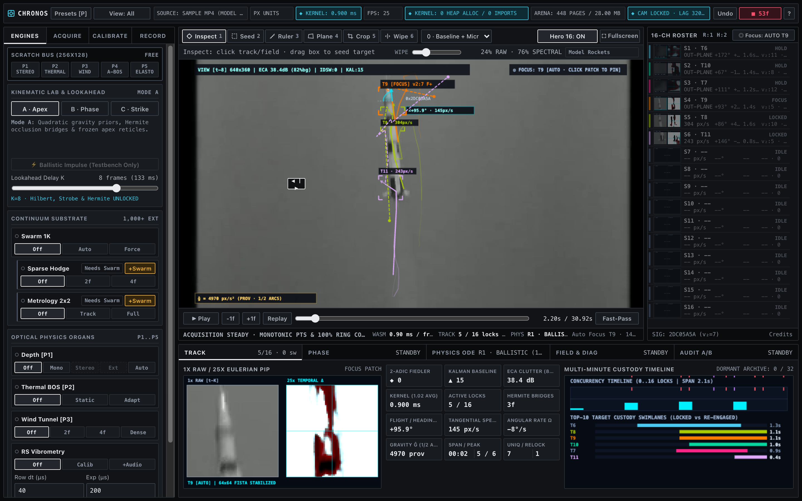

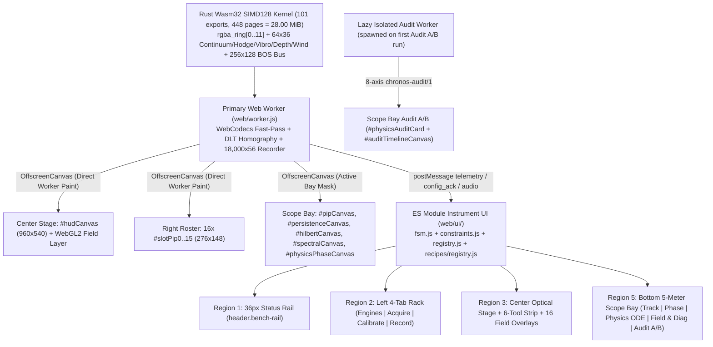

Three design choices govern the entire interface:

1. **Zero-CLS stacked tab layout (`CLS = 0.000000`):** Both the Left 4-Tab Rack and Bottom 5-Meter Scope Bay keep all pages stacked inside fixed dimensions using CSS visibility and `inert`. Switching tabs, opening drawers, pinning targets, or running audits never shifts surrounding panels. The worker receives `scopeVisibilityMask` (`track: 0x09`, `phase: 0x0a`, `physics: 0x0c`, `field: 0x08`, `audit: 0x08`) so hidden secondary canvases consume zero draw work while the 16-channel roster stays live.
2. **Verified finite-state machine & atomic repair (`web/ui/core/{fsm,constraints}.js`):** Five physics organs share the kernel's `256x128` BOS scratch arena (`P1` Depth Stereo, `P2` Thermal BOS, `P3` Wind Tunnel, `P4` Acoustic BOS, `P5` Surface Elastography). `planIntent()` resolves prerequisites and conflicting scratch claims atomically in one click, and `btnUndoConfig` reverses the previous atomic handoff. `scripts/verify_ui_fsm.mjs` exhaustively checks all `300` scratch tuples, all `30` directed owner handoffs, all `194,400` state combinations, and all `53` recipes.
3. **Non-causal delayed presentation (`VIEW [t - K]` vs `NOW [t]`):** Incoming frames enter `Arena.rgba_ring[frame_idx % 12]`, while `#hudCanvas` renders delayed slot `(frame_idx + 12 - eff_k) % 12` (default `K = 8`). Holding `K` future frames unlocks 2-pass IRL1 Dual Projected-FISTA smoothing, backward `rgba_ring` re-tracking, bounded cubic Hermite bridges, and the centered `15`-tap FIR Hilbert filter (`K >= 7`).

---

## Region 1: Top 36px status rail (`header.bench-rail`)

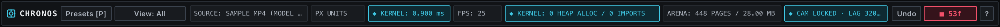

Source: `header.bench-rail` ([web/index.html](../web/index.html)), [web/ui/views/bench-shell.js](../web/ui/views/bench-shell.js).

| Element (`#id`) | Example readout / control | What it measures or controls | Why it matters |
| :--- | :--- | :--- | :--- |
| `#btnOpenPresets` | `Presets [P]` | Opens `#presetsDrawer` with all `53` declarative physics recipes across `7` domains. | Loads built-in demos with either **Load** (source + settings) or **Settings Only** (applies recipe settings to your own video). |
| `#btnVisibilityPolicy` | `View: All` / `View: Applicable` | Switches `visibility_policy` between `ALL_CONSTRAINED` and `APPLICABLE_ONLY`. | Focuses the rack on controls applicable to the active source while never hiding any selected or active organ. |
| `#hudSourceLabel` | `SOURCE: SAMPLE MP4 (...)` | Active optical input source (`IDLE BENCH`, local file, built-in clip, webcam, live MSE, or signal generator). | Confirms active ingest source and clip provenance. |
| `#calBadge` | `PX UNITS` / `SURVEYED RULER` | Active metric calibration state and provenance (`PX`, `ASSUMED`, `SURVEYED`, `AUTO-g LOCKED`). | Flags whether velocity and length readouts are pixel units, assumed preset scales, or surveyed SI units. |
| `#pillPerf` | `KERNEL: 0.700 ms` | `120`-frame rolling median Wasm tick latency (`chronos_pre_tick`, Lanczos Fiedler, `chronos_post_tick`). | Separates kernel compute cost from browser video decode and canvas presentation. |
| `#pillFps` | `FPS: 25` | Smoothed ingest frame rate EMA from unique `requestVideoFrameCallback` / WebCodecs frames. | Verifies native cadence without duplicate RAF polling. |
| `#pillKernel` | `◆ KERNEL: 0 HEAP ALLOC / 0 IMPORTS` | Wasm instantiation status and static zero-import check. | Surfaces boot or worker errors immediately. |
| `#pillArena` | `ARENA: 448 PAGES / 28.00 MB` | Fixed `WebAssembly.Memory` size (`telemetry[20] = 29,080,704 B`, `448` pages). | Confirms zero `memory.grow` leaks across SD/HD switches and organ changes. |
| `#pillStreamHealth` | `◆ CAM LOCKED · LAG 320ms · DROP 0` | Camera motion state (`telemetry[1257]`: `0` locked, `1` pan, `2` cut), buffered delay `disp_lag_ms`, and worker frame drops. | Distinguishes target motion from camera pans or scene cuts and reports backpressure drops. |
| `#btnUndoConfig` | `Undo` | One-level undo for the last atomic organ handoff or prerequisite repair. | Lets you test competing scratch owners without losing prior configuration. |
| `#btnRailRec` | `● Rec` / `■ 240f` | Starts or stops the `18,000 x 56` zero-GC telemetry ring recorder (`R` key). | Quick access to session capture from any rack tab. |
| `#btnShortcuts` | `?` | Opens `#shortcutsDialog` listing all `16` keyboard shortcuts. | Reference for single-key tools (`1..6`), transport (`Space`, `,`, `.`), and overlays (`H`, `F`, `P`, `O`, `R`, `]`, `Esc`). |

---

## Region 2: Left 4-tab instrument rack (`aside.bench-rack`)

Four tabs (`#rackTabEngines`, `#rackTabAcquire`, `#rackTabCalibrate`, `#rackTabRecord`) organize all instrument parameters without vertical scrolling bloat.

### Tab 2A: Engines (`#rackPageEngines`)

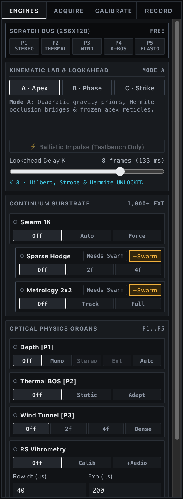

- **Shared BOS Scratch Priority Bus (`#bosBusStrip`, `#bosBusOwnerLabel`):** Displays live ownership of the `256x128` solver scratch across `#busSlotStereo` (`P1 STEREO`), `#busSlotBos` (`P2 THERMAL`), `#busSlotWind` (`P3 WIND`), `#busSlotAbos` (`P4 A-BOS`), and `#busSlotElasto` (`P5 ELASTO`). Clicking any slot performs an atomic one-click handoff via `takeBosScratch()`, retiring the prior owner and cleaning orphaned overlays.
- **Kinematic Lab Mode & Lookahead (`#labBadge`, `.lab-btn`, `#btnLabStimulus`, `#sliderK`, `#valK`, `#kUnlockStrip`):**
  - Selects `A · Apex` (ballistic gravity priors, Hermite bridges, frozen apex crosshairs), `B · Phase` (Hilbert quadrature, Kasa pivot, stimulus onset latency), or `C · Strike` (`4`-quadrant CAD deflection protractors + WebAudio impact synth).
  - `#sliderK` (`0..11`, default `8`) sets `lookahead_k`; `#kUnlockStrip` indicates when `K >= 7` unlocks Hilbert quadrature, strobe prediction, and Hermite bridges.
- **Continuum Substrate (`#rowSwarm`, `#rowHodge`, `#rowMetrology`):**
  - `#swarmModeSelect` (`0` Off, `1` Auto `>= 64` peaks, `2` Forced Active up to `3,072` micro-tracks).
  - `#hodgeModeSelect` (`0` Off, `1` 2f Staggered, `2` 4f/Every-frame `64x36` Hodge `2`-complex; auto-enables Swarm when needed).
  - `#metrologyModeSelect` (`0` Off, `1` Track `2x2` covariance + LOO residual, `2` Full + Auto-Hero promotion with pinhole looming rejection).
- **Optical Physics Organs (`#rowDepth`, `#rowBos`, `#rowWind`, `#rowRs`, `#rowElasto`):**
  - `#depthModeSelect` (`0` Off, `1` Mono Parallax/FoE/TTC, `2` Stereo SDK `P1`, `3` External SDK, `4` Auto-Fused `P1`).
  - `#bosModeSelect` (`0` Off, `1` Static Ref tripod `P2`, `2` Adaptive Ref `P2`).
  - `#windModeSelect` (`0` Off, `1` 2f Sparse Loads `P3`, `2` 4f/Every-frame Loads `P3`, `3` Dense Audit `READY_FIELD_ONLY` `P3`).
  - `#rsVibroModeSelect` (`0` Off, `1` Calibrated RS, `2` RS + Welch Audio `K >= 8`), paired with `#inpRsDtRowUs`, `#inpRsExposureUs`, `#selRsScanDir`, and the Live Acoustic Sound Probe (`#probeExciterPreset`, `#btnProbeExciter`).
  - `#elastoModeSelect` (`0` Off, `1` kHz RS + Audio Lock-In `P5`, `2` kHz RS Video-Only `P5`, `3` Surface Wave Elastography `P5`, `4` Lock-In Acoustic BOS `P4`).

### Tab 2B: Acquire (`#rackPageAcquire`)

- **Wavefield Resolution (`#inputResMeta`, `#btnResSd`, `#btnResHd`):** Live switches between `320x180` SD (`32x32` PiP) and `640x360` HD (`64x64` PiP) inside the fixed `448`-page arena with zero allocations.
- **Optical Signal Source (`#btnOpenVideoFile` / `#mp4Input` `[O]`, `#btnSrcWebcam`, `#btnSrcLiveStream`, `#btnSrcTestbench`, `#sampleVideoSelect`):** Opens local MP4/WebM files (`0` bytes uploaded), live webcams, 3-tier live streams, the internal pixel-isolated Signal Generator (`10` synthetic scenarios), or any of the `41` built-in MP4 clips organized into `7` `<optgroup>` groups.
- **Native `1:1` Sensor ROI & Virtual PTZ (`#roiGeomMeta`, `#chkNativeRoi`, `#chkAutoTrackRoi`, `#rangeRoiX0`, `#rangeRoiY0`, `#btnResetRoiCrop`):** Crops `1:1` native pixels without implicit downscaling and enables smooth focus-target ROI slewing (`INGEST_FLAG_ROI_SLEW`).

### Tab 2C: Calibrate (`#rackPageCalibrate`)

- **Calibration Actions (`#calToolbar`, `#btnCalAutoG`, `#btnCalPreset`, `#btnCalClear`, `#calStatusLive`):** Arms multi-arc gravity scale (`Auto-g`: `px/m = g_hat / 9.80665` across `>= 2` arcs), applies clip-declared illustrative `ASSUMED` presets, or clears back to `PX UNITS`.
- **Dimensions & Surveyed Coordinates (`#calScaleForm`, `#calRulerM`, `#calPlaneW`, `#calPlaneH`, `#calKeyboardDisclosure`, `#calCoordForm`):** Validates scale inputs (`0.05..500 m`) and lets keyboard users enter exact `[0.00..1.00]` normalized endpoints or `TL -> TR -> BR -> BL` plane corners committed as `SURVEYED` scale that persists across `SD <-> HD` switches. Pressing `Esc` cancels any armed draft without erasing committed calibration.

### Tab 2D: Record & Display Tuning (`#rackPageRecord`)

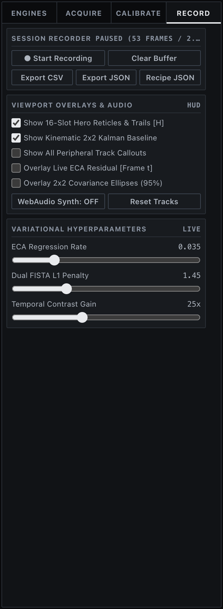

- **Session Recorder (`#recStatusLabel`, `#btnRecToggle`, `#btnRecClear`, `#btnExportCsv`, `#btnExportJson`, `#btnExportRecipe`):** Pre-allocated `18,000 x 56` `Float64Array` ring buffer (`5` minutes at `60 Hz`, `0` GC allocations). Calibration changes increment `cal_segment_id` and append snapshots to `meta.calibrationSegments` (`schemaVersion: "1.5.0"`). **Recipe JSON** exports the active engine, overlay, and calibration configuration as a reusable recipe object.
- **Viewport Overlays & Audio (`#chkHeroTargets` `[H]`, `#chkKalman`, `#chkAllOverlays`, `#chkEcaOverlay`, `#chkCovEllipses`, `#btnAudioToggle`, `#btnResetArena`):** Controls Hero-16 reticles, causal `2x2` Kalman baseline boxes, peripheral callouts, live `[Frame t]` ECA residuals, `95%` `2x2` covariance ellipses (`sqrt(chi^2_2(0.95)) = 2.4477`), and WebAudio Mode B/C synthesis (`netLeadSec = leadSec - msgDelaySec - outLatency`).
- **Variational Hyperparameters (`#sliderEca`, `#sliderLambda`, `#sliderGain`):** Live tuning for `eca_adapt_rate` (`0.005..0.150`), Dual-FISTA L1 penalty `fista_lambda` (`0.10..5.00`), and PiP temporal contrast gain `eulerian_gain` (`5..60x`).

---

## Region 3: Center optical viewport stage (`#hudPanel`)

<table>
  <tr>
    <td width="50%" align="center">
      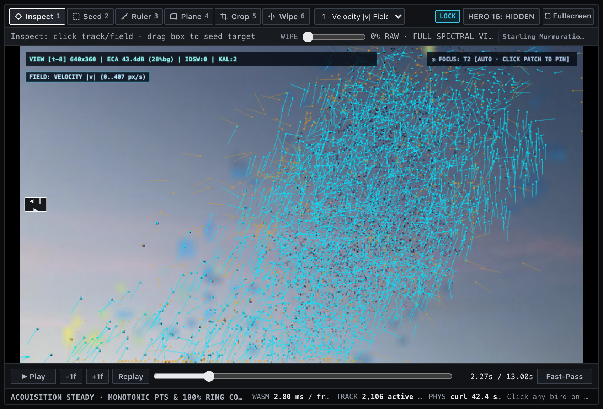 
      <strong>Starling Murmuration (<code>Hero 16: OFF</code> + <code>64x36</code> Velocity <code>|v|</code>)</strong>
    </td>
    <td width="50%" align="center">
      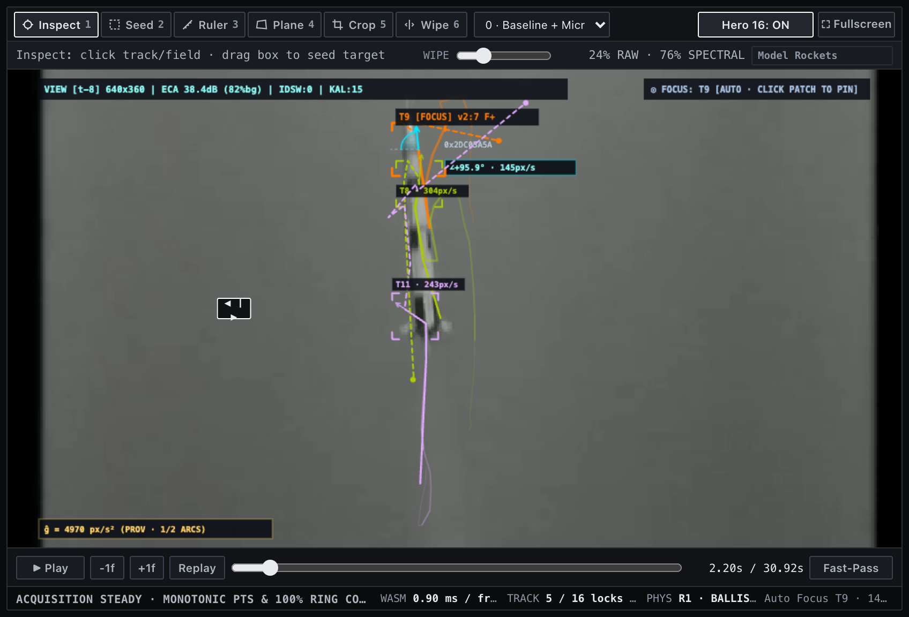 
      <strong>Model Rocket Flight (<code>Hero 16: ON</code> + FISTA Spline &amp; Protractor)</strong>
    </td>
  </tr>
</table>

Source: `#hudPanel`, `#hudCanvas` (`960x540` `OffscreenCanvas` + WebGL2 instanced compositor), [web/worker.js](../web/worker.js).

- **Row 1 (6-Tool Radio Strip + Field Overlay Selector + Quick Toggles):**
  - Pointer tools: `#toolInspect` (`1`, click to pin/inspect track or field), `#toolSeedBox` (`2`, drag box to seed target via `chronos_seed_target`), `#btnCalRuler` (`3`, 2-point ruler), `#btnCalQuad` (`4`, 4-point homography), `#btnToolCropRoi` (`5`, drag zoom crop ROI), `#toolWipe` (`6`, raw vs spectral split-wipe).
  - `#fieldOverlayModeSelect` (`0..15`):
    - `0` Baseline + Micro-Tracks / Rigid Hulls
    - `1..4` `64x36` Continuum: Velocity `|v|`, Vorticity Curl, FTLE Coherent Ridges, Modal Vibration Phase (`gl.NEAREST`)
    - `5..7` `256x128` Thermal BOS: Refraction `|eps|`, Neumann Potential `Phi`, Curl Diagnostic
    - `8..10` `64x36` Sparse Hodge: Exact `|grad phi|`, Coexact `|curl* psi|`, Harmonic `|h|`
    - `11` `64x36` Rolling-Shutter Amplitude / Welch Coherence `gamma^2`
    - `12` `64x36` Zero-ML Depth / Parallax / Stereo / FoE & TTC
    - `13` `64x36` Pocket Wind Tunnel `C_p` + Lift/Drag (or Dense Audit Field)
    - `14` `64x36` Surface Elastography Wave Speed `c(x, y)` + Poynting Power Flow
    - `15` `256x128` Lock-In Acoustic BOS `|Phi|`
  - `#btnHudHeroToggle` (`H`) hides Hero-16 clutter on dense fields without pausing tracking; `#btnHudFullscreen` (`F`) expands to native fullscreen or `16:9` `.hud-maximized` fallback.
- **Row 2 (Contextual Tool Options Bar):** `#toolOptionsHint`, `#showcaseWipeSlider` (`0..100%` raw vs spectral), `#showcaseWipeReadout`, and `#activeRecipeBadge`.
- **Row 3 (Optical Canvas Stage):** Pure `#000` `16:9` `#hudCanvas`, interactive `#hudWipeHandle` divider, and zero-CLS `#welcomeOverlay` idle drop card (drag-and-drop any MP4/WebM directly onto the viewport, or click quick-start inputs/presets).
- **Row 4 (Fixed 36px Source Transport Slot):** Swaps cleanly between `#videoTransportBar` (`Pause/Play` `[Space]`, `-1f` `[,]`, `+1f` `[.]`, `Replay`, `#videoScrubSlider`, `#vidTimeLabel`, `#btnFastPass` Worker WebCodecs fast-pass), `#liveStreamBar` (`#liveCropSelect`, `Switch Feed`, `Stop`), `#benchScenarioField` (`10` Signal Generator scenarios), and `#idleTransportRow`.
- **Row 5 (Acquisition Status & Proof Strip):** `#acquisitionStatusBanner` (`info|ok|warn|danger` for PTS locks, tripod disturbances, exposure nulls, and refusals) plus inline live readouts (`#scValKernel`, `#scValTracks`, `#scValPhysics`, `#scValInspect`).

---

## Region 4: Right 16-channel compact live target roster (`aside.bench-roster`)

Source: `aside.bench-roster`, `#rosterScrollWell`, `#rosterGrid`, `#slotPip0`..`#slotPip15` (`276x148` worker-transferred `OffscreenCanvas`es), `#btnFocusCycle` (`]`), `#mortonReadout`.

- Displays all `16` Hero slots (`S1..S16`) with live split `1x` Raw vs `25x` temporal-contrast thumbnails, state badges (`IDLE`, `LOCKED`, `FOCUS`, `PINNED`, `COAST`, `BRIDGED`, `HOLD`), dormant archive re-acquisition counter (`#rosterReacqVal`), hold counter (`#rosterHoldVal`), and per-slot speed/heading/age/`v_2` stats.
- Clicking any `.roster-pin-btn` pins focus onto that `Tn` ID (`aria-pressed`), locking the Track PiP, `#mortonReadout`, Hilbert scope, and Physics ODE bay onto that target.

---

## Region 5: Bottom 5-meter scope bay (`section.bench-bay`)

Five tabs (`#bayTabTrack`, `#bayTabPhase`, `#bayTabPhysics`, `#bayTabField`, `#bayTabAudit`) display live inline meters (`#bayMeterTrack` .. `#bayMeterAudit`) even when inactive.

### Bay Tab 5A: Track (`#bayPageTrack`)

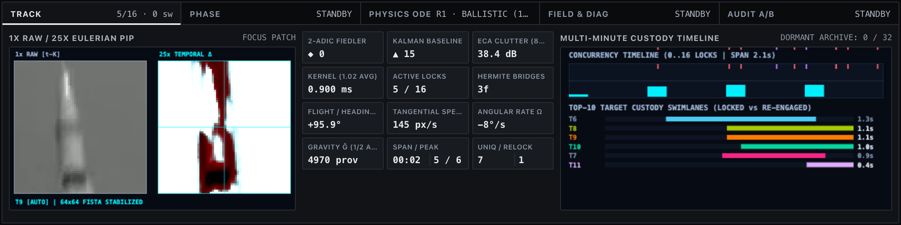

- **`#pipCanvas` (`412x234`):** Stabilized focus patch (`32x32` SD or `64x64` HD) next to its `25x` temporal contrast delta (`chronos_get_pip_rgba_ptr()`).
- **12 Primary & Kinematic KPIs:** `#kpiPadicSwaps` (Oracle or 2-Adic Fiedler swaps), `#kpiKalmanSwaps` (causal `2x2` Kalman baseline swaps), `#kpiClutterDb` (`telemetry[4]`, ECA background attenuation dB), `#kpiWasmMs` (median tick ms), `#kpiTargets` (`active / 16`), `#kpiCollisions` (pillar collisions, Hermite bridges, or Mode C L1 strikes), `#kpiKinAngle` (flight heading or pendulum swing angle), `#kpiKinSpeed` (provenance-tagged `m/s`, `px/s`, or `OUT OF PLANE`), `#kpiKinDeflect` (angular rate, tether radius, or strike deflection), `#kpiKinRestGrav` (`v+/v-`, multi-arc `g_hat`, or calibration badge), `#kpiPersistSpan`/`#kpiPersistActivePeak`, and `#kpiPersistUnique`/`#kpiPersistRelocks`.
- **Multi-Minute Custody Timeline (`#persistencePanel`, `#persistenceCanvas` `420x204`):**

Charts `0..16` simultaneous locks across `240` auto-compacting bins above Top-10 target custody swimlanes distinguishing continuous locks from dashed gap-bridged re-locks (`#persistSummaryMeta` reports `DormantTrack` archive occupancy `N / 32`).

### Bay Tab 5B: Phase (`#bayPagePhase`)

- **Discrete Hilbert Phase (`#hilbertMeta`, `#hilbertCanvas` `420x210`):** Auto-ranging polar phase orbit `(R(t-K), H{R}(t-K))` paired with `128`-frame `90 deg` quadrature waveforms. Gates cleanly to `HILBERT GATED (K<7)` below `K = 7` and `APERIODIC MOTION` on non-periodic targets.
- **Lanczos Spectral & FISTA (`#spectralMeta`, `#spectralCanvas` `420x210`):**

Displays Fiedler partition signs `v_2[m]` (`F+` vs `F-`), `128`-frame $\lambda_2$ sparkline, and the `12`-cell non-causal `rgba_ring` timeline (`VIEW [t-K]`, `+LK` future frames, `OCC` gaps, and `BRG` Hermite bridges).
- **Phase KPIs & Strobe Cue:** `#kpiTremorHz`, `#kpiTremorPhi`, `#kpiApexMs`, `#kpiSaccadeMs`, `.phase-btn` (`-pi/2 Lag`, `+pi/2 Lead`, `0 deg Peak`, `pi Trough`), `#chkStrobe`, and `#fistaGapMeta` (convex duality gap $P(X) - D(u)$).

### Bay Tab 5C: Physics ODE (`#bayPagePhysics`)

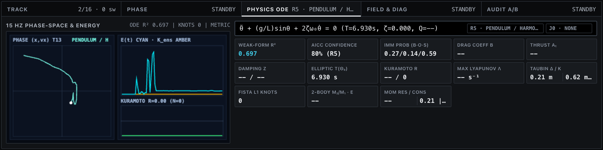

- **`#physicsPhaseCanvas` (`420x210`, `15 Hz`):** Phase-space trajectory and mechanical energy / angular momentum conservation traces.
- **Symbolic ODE Plate (`#physicsOdeEq`, `#physRegimeBadge`, `#physJumpBadge`):** Weak-form STRidge/AICc governing ODE over `HIST_RING_LEN = 64` frames, regime (`0 Inertial_CV` .. `8 Curved_CTRV`), and priority-latched constraint jump (`COLLISION > PEG_JUMP > CANOPY > BURNOUT`).
- **13 Physics ID KPIs:** `#kpiPhysicsR2`, `#kpiPhysicsConf`, `#kpiImmWeights`, `#kpiPhysicsBeta` (quadratic drag), `#kpiPhysicsThrust`, `#kpiPhysicsDamping` ($\zeta, Q$), `#kpiPhysicsEllipticT` (exact `f64` AGM elliptic period), `#kpiKuramotoSync` ($R_{\text{sync}}$), `#kpiLyapunovMax` (4D Rosenstein $\lambda_{\max}$), `#kpiTaubinDelta`/`#kpiTaubinKappa`, `#kpiFistaKnots`, `#kpiTwoBodyMassE` ($m_2/m_1, e_n$), and `#kpiTwoBodyMomRes`/`#kpiPhysicsConserv`.

### Bay Tab 5D: Field & Diag (`#bayPageField`)

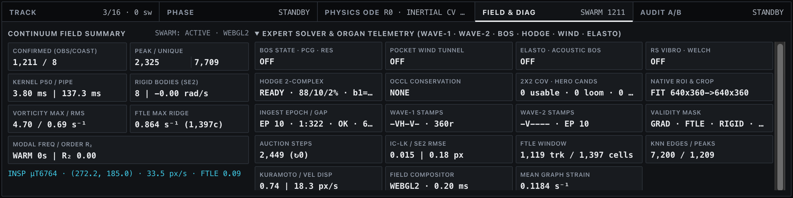

- **Continuum Field Summary (`#continuumSummaryMeta`):** `#kpiSwarmConfirmed` (observed vs coasting), `#kpiSwarmPeak`/`#kpiSwarmUnique`, `#kpiLatencySplit` (Kernel P50 vs partial pipeline estimate), `#kpiRigidBodies` (`SE(2)` count and top $\omega$), `#kpiContinuumVort` (max/RMS vorticity), `#kpiContinuumFtle` (max ridge and cell count), `#kpiModalField` (dominant frequency and $R_2$), and `#swarmInspectReadout` (populated by clicking `#hudCanvas` in Inspect mode via `chronos_inspect_field_point`).
- **Collapsed Expert Solver Drawer (`#expertDiagnosticsDrawer`):** Expands `19` diagnostic readouts across all physics organs: `#diagBosState`, `#diagWindTunnel`, `#diagElastography`, `#diagRsWelch`, `#diagHodge2Complex`, `#diagOcclConservation`, `#diagMetrologyCov`, `#diagRoiGeom`, `#diagWave1Ingest`, `#diagWave1Stamps`, `#diagWave2Stamps`, `#diagValidityMask`, `#diagAuctionSteps`, `#diagRawResiduals`, `#diagFtleWindow`, `#diagSparseGraph`, `#diagKuramotoCom`, `#diagFieldBackend`, and `#diagMeanStrain`.

### Bay Tab 5E: Audit A/B (`#bayPageAudit`)

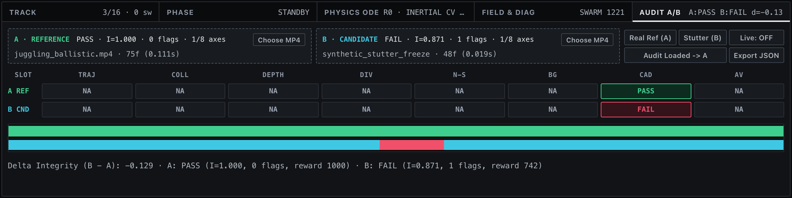

Source: [web/ui/views/audit-view.js](../web/ui/views/audit-view.js), `#physicsAuditCard`.

- **Lazy isolated Wasm worker:** Spawns on the first audit run (`0` idle memory or CPU overhead). Jobs serialize cleanly via a FIFO queue so running Slot A and Slot B concurrently never aborts either slot.
- **Dual Slots & Actions:** Slot A (`#auditSlotA`, `#auditGradeA`, `#btnAuditChooseA`) and Slot B (`#auditSlotB`, `#auditGradeB`, `#btnAuditChooseB`) accept dropped/chosen local MP4/WebM/MOV files, one-click built-in controls (`#btnAuditSampleRef`, `#btnAuditSampleStutter`, `#btnAuditCurrent` to audit the currently loaded HUD clip into Slot A), `#btnAuditLiveToggle` (live HUD telemetry mirror), and `#btnAuditExportJson` (`chronos-audit/1` JSON export).
- **2x8 Axis Matrix (`#auditPillGrid`) & Dual Severity Timeline (`#auditTimelineCanvas`):** Compares Slot A and Slot B side by side across all `8` physical axes (`TRAJ`, `COLL`, `DEPTH`, `DIV`, `N-S`, `BG`, `CAD`, `AV`) with per-axis `PASS` / `WARN` / `FAIL` / `NA` pills, per-frame violation bars clickable to seek the video, and `#auditDeltaLine` reporting `Delta Integrity (B - A)` and anti-gaming `reward_milli`.

---

## Region 6: Top-layer drawers and modals

<table>
  <tr>
    <td width="50%" align="center">
      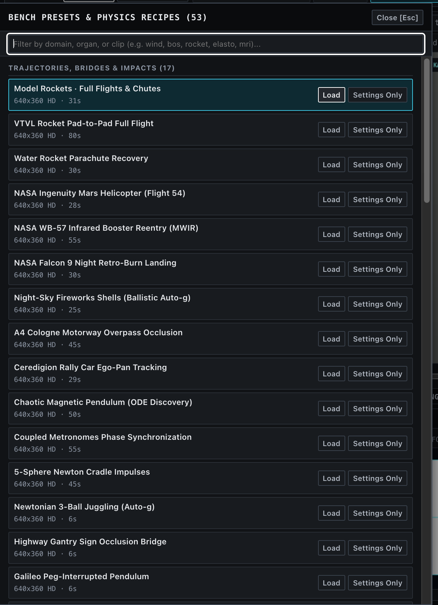 
      <strong>53-Recipe Presets Drawer (<code>#presetsDrawer</code>, <code>[P]</code>)</strong>
    </td>
    <td width="50%" align="center">
       
      <strong>3-Tier Live Stream Ingestion Modal (<code>#liveStreamDialog</code>)</strong>
    </td>
  </tr>
</table>

- **Bench Presets & Physics Recipes (`#presetsDrawer`, `[P]`):** Lists all `53` declarative recipes across `7` domains (`Trajectories, Bridges & Impacts`, `Continuum Swarms`, `Schlieren BOS, Depth & Fovea`, `Pocket Wind Tunnel & Fluid Mechanics`, `kHz Elastography, RS Vibrometry & Acoustic BOS`, `Live Camera & Streams`, and `Internal Signal Generator`) with live search filtering (`#presetsSearchInput`). Every recipe supports **Load** (loads clip + settings) and **Settings Only** (applies its engine/overlay/calibration configuration to your currently loaded video).
- **3-Tier Continuous Live Stream Modal (`#liveStreamDialog`):**
  - **Tier 1 (`#btnStartTier1Capture`):** Browser tab or window capture via `getDisplayMedia` (`ZERO CORS`).
  - **Tier 3 (`#tier3PresetSelect`, `#tier3CustomHlsUrl`, `#btnStartTier3Mse`, `#btnRefreshTier3Presets`):** Local same-origin [scripts/dev_server.mjs](../scripts/dev_server.mjs) `/api/live-stream` FFmpeg fMP4 MSE relay (`5` Caltrans highway feeds, `3` deterministic offline cut-stress relays, and SSRF-hardened custom URLs; hidden on static hosts like GitHub Pages).
  - **Tier 2 (`#tier2StreamUrl`, `#btnStartTier2Url`, `#btnFallbackTier2ToTier3`):** Direct `crossOrigin="anonymous"` URL with mandatory `1x1` readback probe and one-click Tier 3 relay fallback when CORS headers are absent.

---

## Session Recorder 56-column export schema (`schemaVersion: "1.5.0"`)

| Group | Columns (`REC_COLUMNS[0..55]`) | Meaning |
| :--- | :--- | :--- |
| Frame & Config | `frame_idx`, `elapsed_sec`, `frame_w`, `frame_h`, `lookahead_k`, `lab_mode` | Frame counter, accumulated `dt`, spatial size, `K`, mode `0/1/2`. |
| Kernel & Clutter | `wasm_tick_ms`, `active_targets`, `clutter_db`, `clutter_eval_ratio` | Compute duration, confirmed count, ECA dB, static ratio. |
| Assignment & Spectral | `padic_swaps`, `oracle_swaps`, `kalman_swaps`, `in_pillar_collisions`, `fiedler_lambda2`, `spectral_gap`, `fista_duality_gap` | Swaps, testbench crossings, Lanczos `lambda2`, eigengap, FISTA dual gap. |
| Primary Trajectory | `primary_track_id`, `primary_sig_u32`, `primary_padic_val`, `disp_raw_x/y`, `disp_fista_x/y`, `disp_kalman_x/y`, `disp_vis`, `disp_bridged` | Active primary ID, unsigned signature, `v_2`, raw/FISTA/Kalman coords at `t - K`, visibility, Hermite bridge flag. |
| Hilbert & Events | `tremor_r`, `tremor_h`, `tremor_phase_deg`, `tremor_freq_hz`, `tremor_amp`, `phase_valid`, `strobe_fired`, `perc_mask`, `apex_ms`, `saccade_latency_ms` | Quadrature state, phase, frequency, amplitude, gate, strobe, percussion zone, T-apex ms, stimulus onset ms. |
| Physical Kinematics & Provenance | `heading_deg`, `speed_phys`, `ang_vel_deg_s`, `pend_swing_deg`, `strike_deflect_deg`, `strike_speed_ratio`, `metric_x_m`, `metric_y_m`, `cal_segment_id`, `metric_valid` | Calibrated/$J_H$-rectified motion vectors, world coords (`m`), calibration segment, and metric validity (`1`/`0`/`-1`). |
| In-Situ Physics ID (`48..55`) | `phys_regime`, `phys_regime_conf`, `ode_r2`, `aero_drag_beta`, `thrust_accel`, `damping_zeta`, `kuramoto_order_r`, `lyapunov_div_rate` | Primary regime (`0..8`), confidence, weak-form ODE fit `R^2`, drag, thrust, damping, Kuramoto `R_sync`, Lyapunov `lambda_max`. |

---

## Appendix A: Core `telemetry[0..1567]` and `slot_meta[0..127]` memory map

Zero-copy `Float32Array` exports populated in `chronos_post_tick` ([src/lib.rs](../src/lib.rs), [src/physics_id.rs](../src/physics_id.rs)):

| Index Range | Sub-fields and Units | Consumer |
| :--- | :--- | :--- |
| `telemetry[0..31]` | `[0]` `frame_idx`, `[1]` `eff_k`, `[2]` `slot_disp`, `[3]` `active_targets`, `[4]` `clutter_db`, `[5]` `padic_id_swaps`, `[6]` `kalman_id_swaps`, `[7]` `fiedler_lambda2`, `[8]` `primary_idx`, `[9..13]` `tremor_r/h/phase/amp/freq`, `[14..18]` `strobe/perc`, `[19]` `saccade_ms`, `[20]` `sizeof(Arena)` (`29,080,704`), `[21]` `num_peaks`, `[22..25]` `clutter_valid/eval_ratio/spectral_gap/fista_gap`, `[26..31]` `phase_valid/pred_phase/settle_ms/armed/w/h`. | Status rail, Track KPIs, Phase scopes, Strobe/Audio cues. |
| `telemetry[32..927]` | `16 x 56` per-target blocks (`base = 32 + m*56`): `[0..11]` active, `track_id`, `disp_fista`, `disp_raw`, `kalman_disp`, current `pos`, `disp_vis`, `bridged`, `[12..14]` `sig_hi/lo/padic_val`, `[15..19]` `apex_x/y/frames/l1_mag/fiedler_vec`, `[20..55]` `fista_x/y[0..11]`, `ring_vis[0..11]`. | `#hudCanvas`, `#mortonReadout`, `#spectralCanvas`. |
| `telemetry[928..991]` | `16 x 4` candidate peak list (`x, y, energy, sig_hi`). | Assignment diagnostics. |
| `telemetry[992..1119]` | `16 x 8` strike & coherence block (`strike_fired`, `zone`, `lead`, `vel`, `strike_x/y`, `coherence`, `pca_angle`). | Mode C shockwaves, WebAudio, `#hilbertMeta`. |
| `telemetry[1120..1247]` | `16 x 8` kinematics block (`heading_deg`, `speed_px_s`, `ang_vel_deg_s`, `deflect`, `restitution`, `in_deg`, Kasa `pivot_x/y`). | Flight/CAD protractors, Kasa pivots, Roster cards. |
| `telemetry[1248..1263]` | Scene globals (`scene_gravity`, `grav_conf`, `2-body scatter`, `disp_lag_ms`, `cam_motion_state`, `cam_pan_speed`, `grav_arcs`, `freq_valid`, `last_strike`, `discont_count`). | `#pillStreamHealth`, Auto-`g`, Gravity badges. |
| `telemetry[1264..1279]` | Session persistence (`unique_tracks`, `coast_reacq`, `dormant_reid`, `peak_confirmed`, `longest_frames/tid`, `sustained_10s/60s`, `dormant_active`, `last_reid_gap`). | Custody timeline KPIs and swimlanes. |
| `telemetry[1280..1535]` | `16 x 16` per-target Physics ID (`b = 1280 + m*16`): IMM weights (`0..2`), `fista_sharp_knots`, `phys_regime`, `conf`, `ode_r2`, `aero_drag_beta`, `thrust_accel`, `elliptic_period_s`, `damping_zeta`, `Q`, `specific_energy`, `specific_ang_mom`, `restitution_e`, `constraint_jump_code`. | Physics ODE tab and `#physicsPhaseCanvas`. |
| `telemetry[1536..1567]` | Ensemble Physics ID: `kuramoto_r/psi/N`, `ensemble_kinetic/mech`, `last_pair_mass_ratio/mom_resid/retention`, `pair_tid_a/b/frame`, `lyapunov_div_rate`, `taubin_delta_px`, `taubin_curvature_inv_px`, reserved tail (`1550..1567 = 0.0`). | Physics ODE ensemble KPIs. |
| `slot_meta[0..127]` | `16 x 8` per-slot roster metadata (`age`, `coasting`, `vis_eca_ema`, `reacq_count`, `freq_hz`, `amp`, `fista_gap`, `max_excursion`). | `.roster-card` stats. |

## Appendix B: ABI-v2 Micro-Swarm (`3,072`) and Continuum (`64x36`) buffers

1. **`chronos_get_micro_tracks_ptr()` (`[f32; 3072 * 8]`):** Per micro-slot stride-`8` causal state: `[0] track_id`, `[1..2] pos_x/y`, `[3..4] vel_x/y`, `[5] state` (`0=inactive`, `1=confirmed`, `2=tentative/coasting`), `[6] body_id` (`0..32`), `[7] ftle_val` (`s^-1`).
2. **`chronos_get_continuum_field_ptr()` (`[f32; 2304 * 6]`):** `64x36` Eulerian field: `[0..1] u/v_px_s`, `[2] vorticity_s1`, `[3] divergence_s1`, `[4] ftle_s1`, `[5] valid_weight`.
3. **`chronos_get_modal_field_ptr()` (`[f32; 2304]`):** `64x36` circular mean vibration phase (`[-pi, pi]` rad, `-9.0` sentinel when unpopulated, rendered with `gl.NEAREST`).
4. **`chronos_get_rigid_bodies_ptr()` (`[f32; 32 * 8]`):** `SE(2)` rigid components: `[0] body_id`, `[1] member_count`, `[2..3] cx/cy`, `[4..5] vx/vy`, `[6] unwrapped omega_rad_s`, `[7] se2_rmse_px`.
5. **`chronos_get_swarm_telemetry_ptr()` (`[f32; 64]`):** `0..15` SoA counts, `16..41` continuum & validity fields (`diagnostic_validity_mask` `bit0..bit4`), `42..63` reserved `0.0`.
6. **Control & Inspection:** `chronos_set_swarm_mode(mode)`, `chronos_get_swarm_mode()`, `chronos_seed_target(x, y, w, h) -> u32`, `chronos_inspect_field_point(x, y) -> u32`, `chronos_inspect_micro_track(track_id) -> u32`.

## Appendix C: Wave-1 Ingest, Fovea, `2x2` Metrology, and `256x128` BOS ABI

1. **100% Frame Ring Ingest & Fovea (`src/lib.rs`):** `chronos_set_ingest_meta(...) -> u32`, `chronos_get_ring_meta_ptr()` (`[u32; 12 * 24]`), `chronos_get_row_luma_ptr()` (`[f32; 12 * 360]`), `chronos_get_wave1_telemetry_ptr()` (`[u32; 192]`: ABI header `0..15`, product stamps `[micro, grad, ftle, modal_field, hero_physics, bos]` at `16..63`, Hero slot stamps `64..191`), plus `160x160` Fovea tile exports (`chronos_get_fovea_rgba_ptr(0)`, `chronos_get_fovea_request_ptr()`, `chronos_commit_fovea_tile(...)`).
2. **`2x2` Track Covariance & Auto-Hero (`src/soa_tracks.rs`):** `chronos_set_micro_metrology_mode(0|1|2) -> u32`, `chronos_get_micro_cov_ptr()` (`[f32; 3 * 3072]`), `chronos_get_micro_residual_ptr()` (`[f32; 3 * 3072]`), `chronos_get_micro_loom_ptr()` (`[f32; 3072]`), `chronos_get_micro_quality_ptr()` (`[u32; 3072]`), and `chronos_get_hero_candidates_ptr()` (`[u32; 4 + 16 * 8]`).
3. **`256x128` Controlled-Tripod BOS (`src/bos.rs`):** `chronos_set_bos_mode(0|1|2) -> u32`, `chronos_reset_bos_ref()`, `chronos_set_bos_gauge_roi(x0, y0, x1, y1) -> u32`, `chronos_set_bos_overlay_kind(0|1|2) -> u32`, `chronos_get_bos_telemetry_ptr()` (`[u32; 32]`), `chronos_get_bos_planes_ptr()` (`[f32; 6 * 32768]` `[eps_x, eps_y, phi, var_x, var_y, curl]`), `chronos_get_bos_valid_ptr()` (`[u8; 32768]`), `chronos_get_bos_rgba_ptr()` (`[u8; 4 * 32768]`), and `chronos_bos_solve_manufactured_test(case_id, a, b) -> u32`.
4. **Test hook (`src/lib.rs`, non-host):** `chronos_test_hook_set_frame_counters(frame_idx, ring_cursor_lo, ring_cursor_hi)` positions frame counters near `u32::MAX` for wraparound tests.

## Appendix D: Wave-2 (`64x36` Vibrometry, `64x36` Hodge, Conservation) & v3.2 to v3.4 Organ ABI

Shared product stamps live at `chronos_get_wave2_telemetry_ptr()` (`[u32; 64]`: `[0]=1` ABI version, `[1]=sizeof(Arena)`, `[2]=enabled_bits`, `[3]=continuity_epoch`, `16..23` vibrometry, `24..31` Hodge, `32..39` conservation, `40..47` depth, `48..55` wind tunnel, `56..63` elastography):

1. **`64x36` Rolling-Shutter Vibrometry (`src/vibrometry.rs`):** `chronos_set_rs_calib(...)`, `chronos_get_audio_staging_ptr()` (`[f32; 4096]`), `chronos_push_audio_block(...)`, `chronos_get_vibro_telemetry_ptr()` (`[u32; 32]`), and `chronos_get_vibro_planes_ptr()` (`[f32; 7040]` = `3 * 2304` maps `[amp, coh, phase]` + `128`-bin spectrum).
2. **`64x36` Mesh Hodge `2`-Complex (`src/hodge.rs`):** `chronos_set_hodge_mode(0|1|2)`, `chronos_get_hodge_telemetry_ptr()` (`[u32; 32]`), `chronos_get_hodge_planes_ptr()` (`[f32; 16128]` = `7 * 2304` planes `[exact_u/v, coexact_u/v, harm_u/v, phi]`), `chronos_get_hodge_inject_ptr()` (`[f32; 6912]`), and `chronos_hodge_solve_injected(grid_dx, grid_dy)`.
3. **Occluded Pair Conservation (`src/physics_id.rs`):** `chronos_get_conservation_telemetry_ptr()` (`[f32; 32]`), `chronos_get_conservation_input_ptr()` (`[f32; 32]`), and `chronos_eval_occluded_pair()`.
4. **Zero-ML Depth, FoE/TTC, Stereo & External Depth (`src/depth.rs`):** `chronos_set_depth_mode(0..4)`, `chronos_get_depth_mode()`, `chronos_set_depth_calib(f_px, speed_m_s, baseline_m, max_disp_px, stereo_sign)`, `chronos_depth_capture_stereo_left()`, `chronos_set_depth_external_meta(w, h, f_px, provenance, seq)`, `chronos_get_depth_telemetry_ptr()` (`[u32; 32]`), `chronos_get_depth_field_ptr()` (`[f32; 2304 * 2]`), `chronos_get_depth_tracks_ptr()` (`[f32; 3072 * 2]`), `chronos_get_depth_track_flags_ptr()` (`[u8; 3072]`), `chronos_get_depth_hero_ptr()` (`[f32; 16 * 4]`), and `chronos_get_depth_ingest_ptr()` (`[f32; 8192]`).
5. **Pocket Wind Tunnel (`src/wind_tunnel.rs`):** `chronos_set_wind_mode(0..3)`, `chronos_set_wind_fluid_density(rho_kg_m3)`, `chronos_get_wind_telemetry_ptr()` (`[u32; 32]`), `chronos_get_wind_planes_ptr()` (`[f32; 6912]` = `3 * 2304` planes `[Cp, ns_resid, vort_budget]`), and `chronos_wind_solve_injected(...)`.
6. **kHz Elastography & Lock-In Acoustic BOS (`src/elastography.rs`):** `chronos_set_elasto_mode(0..4)`, `chronos_set_elasto_lock_freqs(count, f0, f1, f2, f3)`, `chronos_get_elasto_telemetry_ptr()` (`[u32; 32]`), `chronos_get_elasto_planes_ptr()` (aliases `bos.planes`), and `chronos_get_elasto_valid_ptr()` (aliases `bos.valid_mask`).
7. **Native Multi-Instance C ABI v4 & `chronos-audit/1` ([native/include/chronos.h](../native/include/chronos.h), [native/python/chronos_audit.py](../native/python/chronos_audit.py)):** Exposes `ChronosEngine*`, `chronos_abi_version() == 4`, `chronos_version_string()` (`"3.5.0"`), `chronos_engine_field_view(eng, 0..=24)`, `chronos_engine_ingest_rgba_strided`, `chronos_engine_push_audio`, and the `chronos_engine_audit_{begin,end,finalize,summary,spans}` lifecycle (`ChronosAuditSummary` = `416 B`, `ChronosAuditSpan` = `64 B`).
