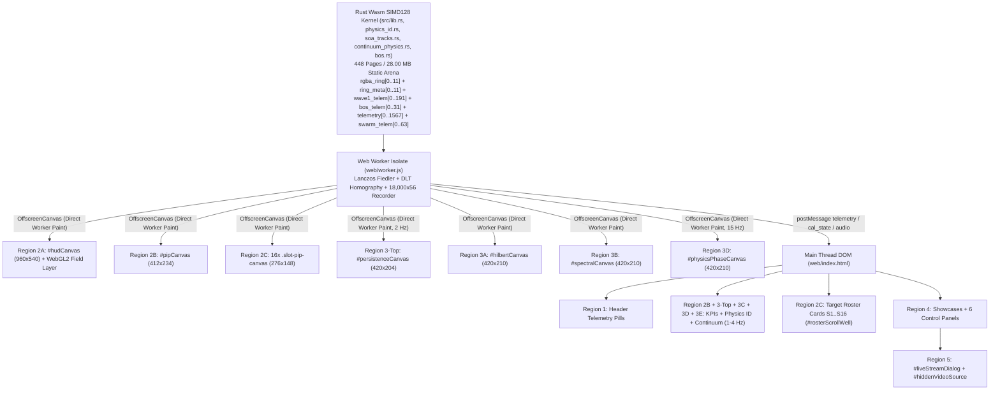
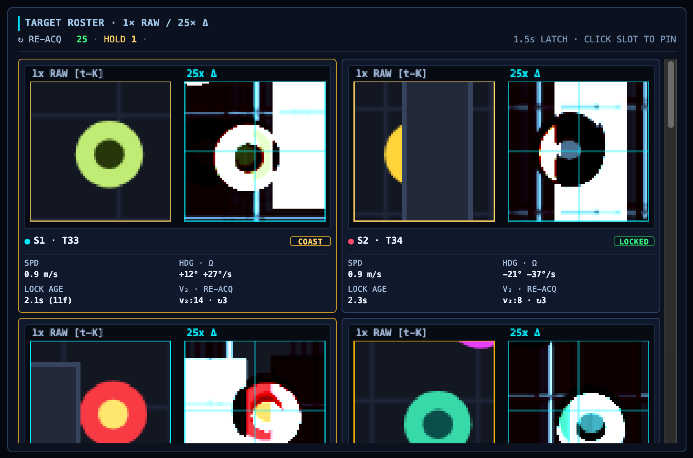
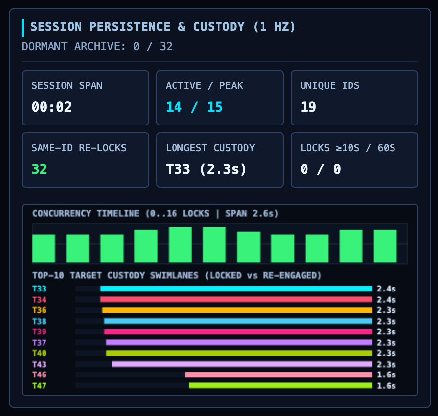
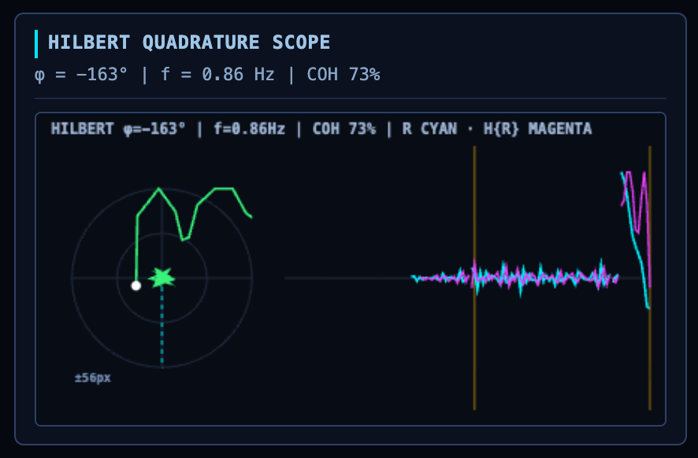
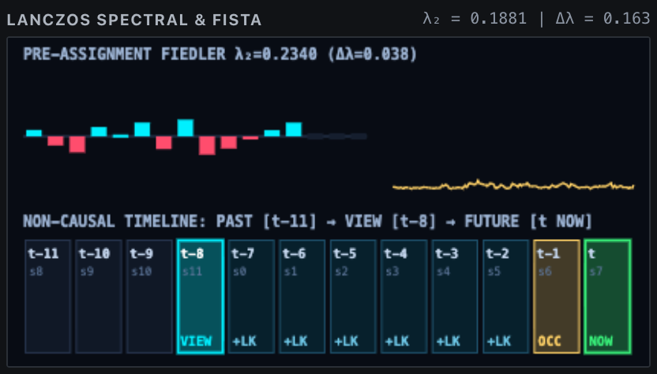
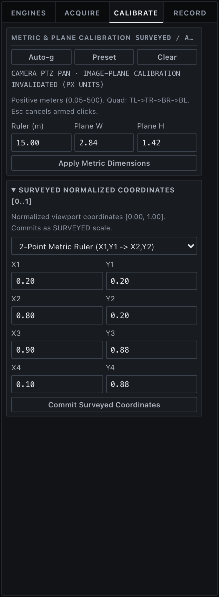
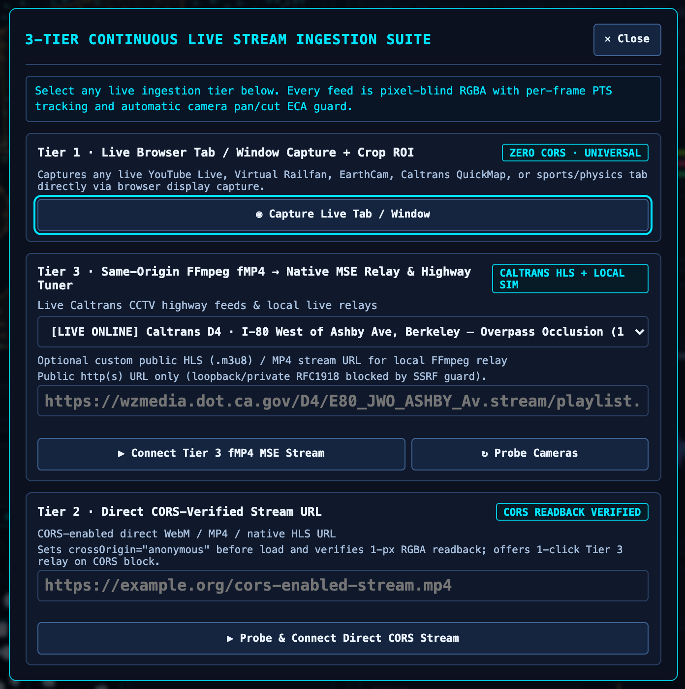

# CHRONOS-SPECTRAL UI and telemetry guide

This reference documents every UI panel, `OffscreenCanvas` visualization, dynamic KPI state transition, calibration rule, WebAudio synthesizer voice, and exported telemetry field in the CHRONOS-SPECTRAL Command Deck and Showcase ([web/index.html](../web/index.html), [web/worker.js](../web/worker.js), [src/lib.rs](../src/lib.rs), [src/physics_id.rs](../src/physics_id.rs), [src/soa_tracks.rs](../src/soa_tracks.rs), [src/continuum_physics.rs](../src/continuum_physics.rs), [src/bos.rs](../src/bos.rs), and [docs/ACQUISITION_AND_FAILURE_MODES.md](./ACQUISITION_AND_FAILURE_MODES.md)).

Each entry documents:
1. **What it is:** Exact UI label, DOM `#id` or CSS/canvas component, and source file.
2. **What it measures or controls:** Mathematical quantity, units, gating threshold, and linear-memory telemetry slot (`telemetry[0..1567]`, `slot_meta[0..127]`, or `swarm_telem[0..63]`).
3. **Why it matters:** What physical behavior, tracking limit, or tuning signal it exposes.

---

## Deck architecture and core concepts

Two architectural principles govern almost every indicator on the deck:

1. **Non-causal delayed presentation (`VIEW [t - K]` vs `NOW [t]`):** Incoming frames land in `Arena.rgba_ring[frame_idx % 12]` (`t NOW`), while the HUD displays delayed slot `(frame_idx + 12 - eff_k) % 12` (`t - K`, default `K = 8`). Holding `K` future frames lets Dual Projected-FISTA smooth trajectories across `12` frames, lets backward `rgba_ring` re-tracking fill missing detections, lets Hermite splines bridge bounded opaque occlusions, and feeds the symmetric `15`-tap Hamming Hilbert filter when `K >= 7`.
2. **Primary focus selection (`AUTO` vs `PINNED`):** Up to `16` Hero targets (`S1..S16`) are tracked simultaneously in Wasm. `resolvePrimarySlot()` ([web/worker.js](../web/worker.js)) selects one primary target for the enlarged Split PiP, `#mortonReadout`, `#hilbertCanvas`, and the focus Kinematic Matrix cards. You can keep mode-aware `AUTO` selection or pin any `Tn` by clicking near it on `#hudCanvas`, clicking its card header button (`.roster-pin-btn`), or stepping through `#btnFocusCycle`.

---

## Region 1: Top system telemetry header

Source: `header.deck-header` ([web/index.html](../web/index.html)).

| Element (`#id` / Badge) | UI Label / Example | What it measures | Why it matters |
| :--- | :--- | :--- | :--- |
| `.brand-badge` | `WASM32 + SIMD128` | Static target architecture indicator. | Confirms the compute kernel executes packed `v128` SIMD instructions in `wasm32`. |
| `#pillKernel` | `◆ KERNEL: 0 HEAP ALLOC / 0 IMPORTS` | Wasm instantiation status (`ready`, `init_error`, worker `error`). | Verifies the Rust module loaded with zero host imports and zero heap allocator calls; surfaces failures immediately. |
| `#pillArena` | `ARENA: 448 PAGES / 28.00 MB` | Fixed `WebAssembly.Memory` capacity (`telemetry[20]` = `sizeof(Arena) <= 20,702,240 B`, `wave1_telem[12]` = `__heap_base <= 20,833,312 B`, and `byteLength / 65536 = 448`). | Verifies static memory discipline across `SD` (`320x180`) and `HD` (`640x360`) resolution toggles with zero `memory.grow` leaks. |
| `#pillPerf` | `◆ KERNEL: 0.700 ms` | 120-frame rolling median tick latency (`wasmMedianMs`, [web/worker.js](../web/worker.js)) covering `chronos_pre_tick`, Lanczos Fiedler, and `chronos_post_tick`. | Flags `▲` warn above per-frame compute budgets (`0.35 ms` SD / `1.00 ms` HD testbench; `0.75 ms` SD / `2.20 ms` HD real video). |
| `#pillFps` | `FPS: 25` | Smoothed ingest frame rate (`sourceFps` EMA over incoming `dtSec`, or `60` on testbench). | Confirms `requestVideoFrameCallback` delivers unique decoded frames at native cadence rather than duplicate RAF polls. |
| `#pillStreamHealth` | `◆ CAM LOCKED · LAG 320ms · DROP 0` | Live camera state (`telemetry[1257]`: `0` locked, `1` PTZ pan `telemetry[1258]`, `2` scene cut), buffered lookahead lag `telemetry[1256]` (`disp_lag_ms`), and JS `pumpDroppedFrames` (hidden in `testbench`). | Separates true object motion from panning cameras (`▲ PTZ PAN`) or cuts (`▲ CUT RESET`) and alerts on worker backpressure drops. |

---

## Region 2: Left column (HUD, Split PiP, Primary KPIs, and Target Roster)

### Region 2A: Delayed Wavefield HUD (`#hudPanel`, `#hudCanvas`)

<table>
  <tr>
    <td width="50%" align="center">
       
      <strong>Starling Murmuration (<code>HERO 16: HIDDEN</code> + Velocity <code>|v|</code> Field)</strong>
    </td>
    <td width="50%" align="center">
       
      <strong>Model Rocket Trajectory (<code>Hero 16: ON</code> + Hermite Bridge + Protractor)</strong>
    </td>
  </tr>
</table>

Source: `#hudPanel` (inside `#hudDockSlot`), `#hudSourceLabel`, `#btnHudHeroToggle`, `#btnHudFullscreen` ([web/index.html](../web/index.html)), and canvas renderers in [web/worker.js](../web/worker.js).

- **`DeckUiFsm` State Machine (`transitionDeckState`, `renderDeckState`, `window.__chronosUiState`):** A pure finite-state reducer in [web/index.html](../web/index.html) coordinates all deck state across five orthogonal fields (`source`: `'IDLE' | 'TESTBENCH' | 'VIDEO' | 'WEBCAM'`, `engine`: `'SWARM_OFF' | 'AUTO_STANDBY' | 'SWARM_ACTIVE'`, `overlays`: `{ showHeroTargets, showAllOverlays, showEcaOverlay, showKalman, fieldOverlayMode }`, `pointerTool`: `'INSPECT_TARGET' | 'CAL_RULER_P1' | 'CAL_RULER_P2' | 'CAL_QUAD_PT1' | 'CAL_QUAD_PT2' | 'CAL_QUAD_PT3' | 'CAL_QUAD_PT4' | 'CROP_ROI'`, and `viewport`: `'DOCKED' | 'FULLSCREEN'`), freezing each transitioned snapshot onto `window.__chronosUiState`.
- **Quick Header Controls (`#btnHudHeroToggle`, `#btnHudFullscreen`) and Keyboard Shortcuts (`H`, `F`, `Esc`):**
  - `#btnHudHeroToggle` stays fixed-width (`CLS = 0.000000`) and stays synchronized 1-to-1 with `#chkHeroTargets` and `H` (ignored when focus sits inside inputs/selects or while `#liveStreamDialog` is open). Toggling off suppresses Hero-16 drawing (reticles, trails, Hermite bridges, frozen apex locks, protractors, Kalman boxes) while keeping Wasm tracking, `#pipCanvas`, and Swarm overlays active; when Swarm is inactive (`engine !== 'SWARM_ACTIVE'`), `[data-hidden-solo="true"]` highlights the button in amber.
  - `#btnHudFullscreen` (`F` key) expands `#hudPanel` via native Fullscreen API with a zero-letterbox `.hud-maximized` CSS fallback when blocked, locking `#hudCanvas` to exact `16:9` aspect geometry (`inline-size: min(100%, calc((100dvh - 54px) * 16 / 9))`). Pressing `F` again or `Escape` restores `DOCKED` mode cleanly and cancels any armed calibration draft in the same keypress.

`#hudSourceLabel` prints the active source banner (`BLIND PIXEL PILLAR TESTBENCH`, `SAMPLE MP4 (...)`, `LIVE WEBCAM`, or `LIVE fMP4 MSE`). `#hudCanvas` is a borderless `16:9` `960x540` `OffscreenCanvas` using monotonic `calSyncSeq` fencing to drop racing pointer clicks.

#### HUD layers in draw order

1. **Delayed RGBA Base Frame (`[t - K]`):** Nearest-neighbor blit of `Arena.rgba_ring[dispSlot]` scaled `3.0x` (`320x180` SD) or `1.5x` (`640x360` HD).
2. **Live ECA Motion-Residual Heatmap (`[Frame t]`):** Enabled by `#chkEcaOverlay`. Maps normalized Rank-2 Extensive Cancellation Algorithm foreground residual `ecaResView[i] > 0.025` to translucent cyan, visually exposing the `K`-frame lookahead offset between ingest time `t` and displayed overlays at `t - K`.
3. **Testbench Blind Occluder Zones (`OCCLUDER P1`, `OCCLUDER P2`):** Dashed steel-blue outlines marking 100% opaque zero-visibility (`w_k = 0`) pillars in synthetic occlusion runs.
4. **Calibration Geometry and Armed Click Guides:** Dashed gold 2-point ruler (`X.XX m`), solid cyan 4-point homography quad (`TL`, `TR`, `BR`, `BL`) with dashed `4x4` inverse-mapped `H^-1` iso-metric grid, and top-center armed click banners (`ESC PRESERVES PRIOR`).
5. **Mode C Quadrant Voice Grid, Shockwaves, and Scatter Wedges (`labMode === 2`):** Four audio-zone boundaries (`Q0..Q3`), expanding double impact shockwaves, CAD incident-vs-outgoing deflection protractors rectified via homography Jacobian `J_H`, and `24`-frame two-body contact scatter wedges (`telemetry[1250..1255]`).
6. **Per-Target Hero Trajectories (`m = 0..15`):**
   - `44`-frame tapered comet trail (`trailX/Y`).
   - Kasa virtual pendulum/metronome pivot bullseye (`◎ PIVOT` or top-edge `▲ VIRT PIVOT`) + plumb line + green tether + swing wedge (`theta`, radius `R`).
   - Past Dual-FISTA ribbon (`[t - 11 .. t - K]`) and future lookahead ribbon (`[t - K .. t NOW]`), turning bright gold (`HERMITE-BRIDGE`) across occluded spans alongside a dashed red `20x20` causal coasting ghost square.
   - Tangent velocity vector and horizontal `0 deg` flight protractor (`OUT-OF-PLANE` in amber when projective depth `w < 0.14`).
   - Kinematic `2x2` Kalman baseline (`KAL-Tn` coral-red `26x26` box) proving where causal constant-velocity filtering drifts or swaps IDs.
   - Mode A frozen parabolic apex crosshair (`APEX XXms` -> post-crest `APEX Delta=X.Xpx`).
   - Corner-bracket reticles and staggered callout pills (`Tn [FOCUS|PINNED|HERMITE-BRIDGE|LOCK|COAST] v2:XX F+|F-` + `0xXXXXXXXX` signature).
7. **Mode B Present-Phase Strobe Border (`labMode === 1`):** Full-canvas flash and bottom banner (`+pi/2 QUADRATURE LEAD` or `-pi/2 QUADRATURE LAG`) driven by `telemetry[14]` (`strobe_fired`) and forward-predicted phase `telemetry[27]` (`pred_phase_now`).
8. **HUD Corner Telemetry Strips:** Top-left `VIEW [t-K] WxH | ECA XX.XdB (XX%bg) | IDSW:N | KAL:M`, top-center pan/cut alert, top-right `FOCUS`, bottom-left multi-arc gravity consensus badge, and bottom-right calibration provenance badge (`ASSUMED` vs `SURVEYED`).
9. **WebGL2 Instanced Field Layer Compositor and Click-to-Inspect:** When swarm tracking (`swarmActive`) or field overlay mode (`1..4`) is active, a dedicated `OffscreenCanvas` WebGL2 instanced renderer (with batched 2D Canvas fallback) draws from a `12`-slot frame-aligned ring synchronized to `dispSlot` (`t - effK`) in `< 0.50 ms`:
   - `40x22` `RGBA8` continuum texture (`gl.LINEAR` for Velocity/Vorticity/FTLE; unblended `gl.NEAREST` for `-9.0`-sentinel Modal phase) with top-left numeric legend bounds (`px/s` or `s^-1`).
   - Up to `1,536` instanced velocity stems and signed-distance diamond lock pips (cyan = confirmed free tracks, amber = tentative/coasting, warm orange = `SE(2)` rigid-body members), plus Andrew's monotone-chain convex hulls and `B<id> · omega` labels (`<= 32` rigid components).
   - Clicking `#hudCanvas` in `INSPECT_TARGET` mode dispatches `{ type: 'inspect_point', inspectSeq, x, y, normX, normY }`, calls `chronos_inspect_field_point(x, y)` (matching the nearest confirmed micro-track strictly `< 24.0 * q` px and pinning its Hero slot), highlights a diamond reticle, and populates `#swarmInspectReadout`.

### Region 2B: Split `1x` Raw / `25x` Eulerian Audit and Primary KPIs

Source: [web/index.html](../web/index.html), PiP renderer `renderEulerianPip` ([web/worker.js](../web/worker.js)).

- **`#mortonReadout` (`BINARY-PREFIX SIG: 0x2C84EAAA (v_2 = 10)`):** Displays the primary focus track's 32-bit Haar-Morton + opponent-color signature (`telemetry[base + 12..13]`) and last-match 2-adic ultrametric depth `v_2(A, B) = clz(sig_A XOR sig_B)` (`0..32`, `telemetry[base + 14]`).
- **`#pipCanvas` (`412x234`):** Left `192x192` square upscales `1x RAW [t - K]` (`32x32` SD or `64x64` HD border-clamped centered on `disp_fista`); right `192x192` square shows `25x TEMPORAL Delta` (`chronos_get_pip_rgba_ptr()`), magnifying sub-pixel surface vibration, stage roll, or rotor flicker in the stabilized frame.

#### Primary 6 KPI cards

| Label `#id` | Value `#id` | Mode / Condition | What it measures | Why it matters |
| :--- | :--- | :--- | :--- | :--- |
| `#lblPadicSwaps` | `#kpiPadicSwaps` | `testbench` -> `Oracle ID Swaps` | `oraclePadicSwaps`: 1-to-1 ground-truth ID swap count on blind testbench crossings. | Proves true identity preservation across total occlusions without ground-truth hints. |
| `#lblPadicSwaps` | `#kpiPadicSwaps` | real video -> `2-Adic Fiedler` | `telemetry[5]` (`padic_id_swaps`). | Tracks assignment stability on unlabelled camera feeds. |
| (static `Kalman Swaps`) | `#kpiKalmanSwaps` | All modes | `telemetry[6]` (`kalman_id_swaps`): identity swaps by causal `2x2` Kalman baseline. | Direct A/B count showing how many swaps non-causal spectral assignment avoided. |
| `#lblClutterDb` | `#kpiClutterDb` | After `12`-frame warmup (`telemetry[22] > 0.5`) | `ECA Clutter (XX%)` (`clutter_eval_ratio`); value `telemetry[4]` (`clutter_db`) in dB (`WARMING` initially). | Measures background/exposure cancellation (`> 64 dB` synthetic, `36-46 dB` H.264 video). |
| `#lblWasmMs` | `#kpiWasmMs` | All modes | Label = 120-frame mean tick time; value = rolling median (`ms`). | Separates steady SIMD128 kernel compute cost from isolated browser jitter. |
| (static `Tracked Patches`) | `#kpiTargets` | All modes | `telemetry[3]`: confirmed Hero active count out of `16` (`N / 16`). | Verifies Hero pool occupancy and thresholding balance. |
| `#lblCollisions` | `#kpiCollisions` | `testbench` -> `Pillar Collisions` | `inPillarCollisions`: cumulative blind occluder crossings. | Quantifies crossing stress during synthetic tests. |
| `#lblCollisions` | `#kpiCollisions` | real video, Mode A/B -> `Hermite Bridges` | `totalBridgedEvents` (`Xf`): occluded frames reconstructed via Hermite splines. | Proves non-causal gap repair across signposts and overpasses. |
| `#lblCollisions` | `#kpiCollisions` | real video, Mode C -> `L1 Impact Strikes` | `totalStrikeEvents`: L1 acceleration impulse events detected in Mode C. | Counts physical bank cushions and multi-body impacts. |

---

### Region 2C: Target Roster (`S1` through `S16`)

Source: `#rosterPanelTitle`, `#rosterSummaryMeta`, `#rosterScrollWell`, `#rosterGrid` ([web/index.html](../web/index.html)), `updateSlotRosterUi`, `renderAllSlotPips` ([web/worker.js](../web/worker.js)).

- **Header Chips (`#rosterSummaryMeta`):** `#rosterReacqVal` (`RE-ACQ N`: cumulative Dormant Re-ID recoveries via the `32`-slot, `1,200`-frame archive) and `#rosterHoldChip` / `#rosterHoldVal` (`HOLD N`: cards frozen cleanly during the `48`-frame `~1.5 s` or `180`-frame `3.0 s` pinned post-loss latch).
- **Scrollable `16`-Card Well (`#rosterScrollWell`):** Houses cards `#rosterCard0`..`#rosterCard15` and split canvases `#slotPip0`..`#slotPip15` (`276x148`) inside a fixed `472 px`-max-height scroll container (`CLS = 0`).
- **State Badges (`.roster-state-badge`):** `IDLE`, `LOCKED`, `FOCUS`, `PINNED` (or `PIN·BRI` / `PIN·COA`), `COAST`, `BRIDGED`, and `HOLD`. Clicking `.roster-pin-btn` toggles focus pin (`aria-pressed`).
- **Four Throttled Card Stats (`~4.5 Hz`):**
  1. `.rs-lbl-spd` / `.rs-val-spd`: EMA speed (`m/s`, `px/s`, or `OUT-PLANE`); promotes to `SPD · HZ` whenever per-slot `slot_meta[m*8 + 4] >= 0.35 Hz`.
  2. `.rs-lbl-ang` / `.rs-val-ang`: Switches between `HDG · omega` (free heading/turn rate) and `SWG · R` (swing angle and tether radius on Kasa pivot locks).
  3. `LOCK AGE` (`.rs-val-age`): Custody seconds, appending `(Cf)` coasting frames during occlusion.
  4. `v_2 · RE-ACQ` (`.rs-val-id`): Last 2-adic match depth `v_2:XX` and dormant re-acquisition count.

---

## Region 3: Middle column (Session Continuity, Scopes, Variational Matrix, Physics ID, and Continuum Swarm)

Middle and right `.deck-column.isolated-region` columns apply CSS `content-visibility: auto; contain-intrinsic-size: auto 300px auto 800px;` with fallback `contain: layout style paint` so off-screen layout and paint remain isolated without layout shifts.

### Region 3-Top: Session Persistence and Custody (`#persistencePanel`)

Source: `#persistencePanel`, `#persistSummaryMeta`, `updatePersistenceDomUi` ([web/index.html](../web/index.html)), and `renderPersistenceScope` ([web/worker.js](../web/worker.js)).

DOM KPIs refresh at a calm `1 Hz` (`1000 ms`, waking immediately on peak increments or session reset), while `#persistenceCanvas` (`420x204`) repaints at `2 Hz`.

- **`#persistSummaryMeta` (`DORMANT ARCHIVE: N / 32`):** Live occupancy of Wasm's `32`-slot, `1,200`-frame (`40 s` @ `30 fps`) `DormantTrack` vault (`telemetry[1272]`).
- **6 Continuity KPI Cards:** `#kpiPersistSpan` (`Session Span` `MM:SS`), `#kpiPersistActivePeak` (`Active / Peak`), `#kpiPersistUnique` (`Unique IDs` cumulative), `#kpiPersistRelocks` (`Same-ID Re-Locks` combining archive re-ID + coast re-acquisition), `#kpiPersistLongest` (`Longest Custody` `Tn (Xs)` / `MM:SS`), and `#kpiPersistSustained` (`Locks >= 10s / 60s`).
- **`#persistenceCanvas`:** Upper band charts `0..16` simultaneous locked targets over `240` auto-compacting chronological bins; lower band draws `TOP-10 TARGET CUSTODY SWIMLANES` (`128` tracks, `24` segments each) distinguishing solid locked custody from dashed gap-bridged re-locks.

### Region 3A: Hilbert Quadrature Scope (`#hilbertMeta`, `#hilbertCanvas`)

Source: [web/index.html](../web/index.html), `renderHilbertScope` ([web/worker.js](../web/worker.js)).

- **`#hilbertMeta`:** Reports `HILBERT GATED (K<7)` when lookahead `< 7` (the centered 15-tap FIR filter requires `7` future frames), `phi = XX deg | f = X.XX Hz | COH XX%` on verified periodic targets, `phi = XX deg | APERIODIC MOTION` on non-periodic trajectories (zero false frequency hallucination on ballistic or highway clips), or `STENCIL WARMING / HOLD` prior to `15` samples.
- **`#hilbertCanvas` (`420x210`):** Left polar plot auto-ranges across `4` discrete radii (`+-1.5`, `+-4`, `+-12`, `+-28 px * resScale`) to plot `(R(t-K), H{R}(t-K))` in green with white phase marker and dashed trigger ray rotated by `phaseOffsetRad`. Right `128`-frame strip plots `R(t-K)` in cyan, `H{R}(t-K)` (exact `90 deg` quadrature) in magenta, and vertical amber strobe trigger ticks, breaking strokes cleanly on focus target ID changes.

### Region 3B: Lanczos Fiedler and Timeline Scope (`#spectralMeta`, `#spectralCanvas`)

Source: [web/index.html](../web/index.html), `renderSpectralAndRingScope` ([web/worker.js](../web/worker.js)).

- **`#spectralMeta` (`lambda2 = X.XXXX | Delta lambda = X.XXX`):** Live algebraic connectivity `telemetry[7]` and spectral gap `telemetry[24]` solved by 31-step Shifted Lanczos orthogonalized iteration (`solveShiftedLanczosFiedler`, [web/worker.js](../web/worker.js)) over the `32x32` Track-Peak Laplacian.
- **`#spectralCanvas` (`420x210`):** Upper-left bars display Fiedler eigenvector signs `v_2[m]` per slot (`F+` cyan vs `F-` crimson); upper-right gold sparkline plots `128`-frame `lambda2(t)` history; lower `12`-cell `NON-CAUSAL TIMELINE` (`t-11` -> `VIEW [t-K]` -> `NOW [t]`) labels exact physical `rgba_ring` slots (`s0..s11`) and cell states (`VIEW`, `NOW`, `+LK` future frames, `OCC` occluded edge, and `BRG` pinned Hermite bridge).

### Region 3C: Variational and Kinematic Matrix (`#fistaGapMeta` and 8 KPI Cards)

Source: [web/index.html](../web/index.html).

- **`#fistaGapMeta` (`DUAL GAP: X.XXX`):** Displays `telemetry[25]` (`fista_duality_gap`), the convex primal-dual optimality gap $P(X) - D(u) \ge 0$ from `solve_noncausal_fista_irl1_target` ([src/lib.rs](../src/lib.rs)). Pass 1 runs `6` proximal dual steps and short-circuits when $\min_j w^{\text{IRL1}}_j > 0.48$; Pass 2 IRL1 reweights sharp impulse knots so billiard collisions, peg stops, and rocket burnouts stay crisp.

#### 8-card dynamic state-transition matrix

| Card `#id` (Label / Value) | Condition | Rendered Label | Rendered Value and Meaning |
| :--- | :--- | :--- | :--- |
| `(static)` / `#kpiTremorHz` | `K < 7` / `freqValid` / `phaseValid` / idle | `Oscillation Freq` | `GATED (K<7)`, `X.XX Hz`, `APERIODIC`, or `HOLD`. |
| `(static)` / `#kpiTremorPhi` | `K < 7` / `phaseValid` / idle | `Delayed Phase phi(t-K)` | `GATED`, `XX deg` (`telemetry[11]`), or `HOLD`. |
| `#lblApexKpi` / `#kpiApexMs` | `apexMs > 1` / scored Mode A / idle | `Ballistic T-Apex` / `Last Apex Euclid Delta` | Live `XX ms` countdown to crest, `X.X px` post-crest Euclidean error, or `STEADY`. |
| `#lblReflexKpi` / `#kpiSaccadeMs` | Armed / onset / settled / idle | `Stimulus Armed` / `Onset` / `Settle` | `AWAITING`, `XX.X ms` step latency (`telemetry[19]`), `telemetry[28]`, or `READY`. |
| `#lblKinAngle` / `#kpiKinAngle` | `pivotValid` / free / idle | `Pendulum Swing theta` / `Flight Heading theta` | Signed vertical plumb deflection, $J_H$-rectified ground angle, or `-- deg`. |
| `#lblKinSpeed` / `#kpiKinSpeed` | `metricValid < -0.5` / cal / px | `Perspective Guard` / `Surveyed` / `Assumed Speed` / `Tangential Speed` | `OUT OF PLANE`, `X.XX m/s` (provenance-tagged), or `XX px/s`. |
| `#lblKinDeflect` / `#kpiKinDeflect` | Mode C strike / pivot / free | `Deflect Delta theta / Scatter` / `Tether Radius R` / `Angular Rate omega` | Rebound + scatter wedge (`deg`), radius (`m` or `px`), or turn rate (`deg/s`). |
| `#lblKinRestGrav` / `#kpiKinRestGrav` | Mode C / Multi-arc `g_hat` / 1-arc / px | `Speed Ratio v+/v-` / `Gravity g_hat (N arcs)` / `Metric Calibration` | Restitution ratio, `XXX px/s^2`, provisional gravity, or active calibration badge. |

### Region 3D: In-Situ Physics ID and Conservation (`#physicsIdPanel`, `4 Hz` DOM + `15 Hz` Canvas)

Source: `#physicsIdPanel`, `updatePhysicsIdDomUi` ([web/index.html](../web/index.html)), `15 Hz` `OffscreenCanvas` portrait ([web/worker.js](../web/worker.js)), and [src/physics_id.rs](../src/physics_id.rs).

DOM text updates at `4 Hz` (`250 ms`), snapping immediately on regime, jump-event, or collision updates, while `#physicsPhaseCanvas` (`420x210`) paints at `15 Hz`.

- **Regime Badge (`#physRegimeBadge`, `telemetry[b + 4..5]`):** `0 Inertial_CV`, `1 Ballistic`, `2 Ballistic_AeroDrag`, `3 Powered_Boost`, `4 Parachute_Terminal`, `5 Pendulum_Harmonic`, `6 Micro_Tremor`, `7 Impulsive_Collisional`, `8 Curved_CTRV`.
- **Constraint-Jump Badge (`#physJumpBadge`, `telemetry[b + 15]`, priority `4 > 1 > 3 > 2`):** `0 NONE`, `1 PEG JUMP` (3-frame hold), `2 BURNOUT`, `3 CANOPY`, `4 COLLISION`.
- **Symbolic ODE Box (`#physicsOdeEq`):** Displays the AICc-selected weak-form governing ODE discovered over `HIST_RING_LEN = 64` frames in SI (`m`, `s`, `m/s^2`, `m^-1`) or pixel units.

#### Complete 15-card Physics ID matrix

| Card `#id` | Telemetry Source | Displayed Units and Physical Meaning |
| :--- | :--- | :--- |
| `#kpiPhysicsR2` | `telemetry[b + 6]` | Weak-form STRidge equation fit `ode_r2` (`[0, 1]`). |
| `#kpiPhysicsConf` | `telemetry[b + 5]`, `[b + 4]` | Classification confidence (`0%..100%`) and active regime `(Rk)`. |
| `#kpiImmWeights` | `telemetry[b + 0..2]` | Collapsed 4-mode IMM weights `w_cv / w_bal / w_turn_osc` (`sum = 1.0`). |
| `#kpiPhysicsBeta` | `telemetry[b + 7]` | Quadratic aerodynamic drag coefficient `aero_drag_beta` (`m^-1` or `px^-1`). |
| `#kpiPhysicsThrust` | `telemetry[b + 8]` | Net longitudinal boost acceleration `thrust_accel` (`m/s^2` or `px/s^2`). |
| `#kpiPhysicsDamping` | `telemetry[b + 10..11]` | Log-peak decrement damping ratio `zeta` and quality factor `Q` (`INF` near `999`). |
| `#kpiPhysicsEllipticT` | `telemetry[b + 9]` | Exact nonlinear pendulum period via `f64` AGM elliptic integral `K(sin^2(theta0/2))`. |
| `#kpiKuramotoSync` | `telemetry[1536]`, `[1538]` | Ensemble Kuramoto order parameter `R_sync / N` over `N >= 2` periodic oscillators. |
| `#kpiLyapunovMax` | `telemetry[1547]` | Staggered (`1:8`) `4D` delay-coordinate Rosenstein maximal Lyapunov divergence (`s^-1`). |
| `#kpiTaubinDelta` | `telemetry[1548]` | Euclidean center separation comparing `f64` `3x3` Jacobi Taubin vs Kasa circle fits. |
| `#kpiTaubinKappa` | `telemetry[1549]` | Taubin trajectory curvature `kappa` (`m^-1` or `px^-1`). |
| `#kpiFistaKnots` | `telemetry[b + 3]` | Count of localized high-impulse acceleration knots (`0..=10`) flagged for Pass 2 sharpening. |
| `#kpiTwoBodyMassE` | `telemetry[1541]`, `[b + 14]` | Causal blur-excluded mass ratio `m2 / m1` (`[0.05, 20.0]`) and normal restitution `e_n`. |
| `#kpiTwoBodyMomRes` | `telemetry[1542..1543]` | Normalized two-body momentum residual paired with kinetic energy retention `%`. |
| `#kpiPhysicsConserv` | `telemetry[b + 12..13]` | Specific mechanical energy and signed specific angular momentum (`L_z`). |

### Region 3E: Continuum and Swarm Field (`#continuumFieldPanel`, `4 Hz` DOM + Progressive Disclosure)

Source: `#continuumFieldPanel` ([web/index.html](../web/index.html)), [src/soa_tracks.rs](../src/soa_tracks.rs), and [src/continuum_physics.rs](../src/continuum_physics.rs). Keeps `#expertDiagnosticsDrawer` collapsed by default (`CLS = 0.000000`).

#### Controls and heading (`#continuumFieldPanel`)

| Element `#id` | Role / Event | Behavior and State Rules |
| :--- | :--- | :--- |
| `#continuumPanelHeading` | Section `<h2>` title | Labels panel (`Continuum & Swarm Field`). |
| `#continuumSummaryMeta` | Status pill (`aria-live="off"`) | Transitions across `SWARM: OFF · HERO 16`, `SWARM: AUTO STANDBY`, `SWARM: FORCED WAIT`, and `SWARM: ACTIVE · WEBGL2` (or `CANVAS2D`). |
| `#swarmModeSelect` | `<select>` (`set_swarm_mode`) | `0` = Off (default), `1` = Auto-Density (Coarse Gate), `2` = Forced Active (`1,000+` targets). |
| `#fieldOverlayModeSelect` | `<select>` (`set_field_overlay_mode`) | Switches HUD Field Layer: `0` Micro-Tracks + Rigid Hulls, `1` Velocity `|v|` (`40x22`), `2` Vorticity Curl, `3` FTLE Ridges, `4` Modal Phase (`[-pi, pi]`), `5` BOS Refraction `|eps|` (`128x64`), `6` BOS Neumann Potential `Phi`, `7` BOS Curl Diagnostic. |
| `#bosModeSelect` | `<select>` (`set_bos_config`) | Static-tripod Background-Oriented Schlieren mode: `0` Off, `1` Mode 1 Static Ref (freeze at `16f`), `2` Mode 2 Clear-Only Slow Ref maintenance (`alpha = 1/4096`). |
| `#metrologyModeSelect` | `<select>` (`set_metrology_config`) | `2x2` track covariance calibration + LOO flow residual mode: `0` Off, `1` Lossless `2x2` Cov + LOO Bench, `2` H.264 `2x2` Cov + Auto-Hero Promotion (`3`-chord pinhole looming rejection). |
| `#chkCovEllipses` | `<input type="checkbox">` (`set_metrology_config`) | Overlays delayed `95%` confidence `2x2` position covariance contours (`sqrt(chi^2_2(0.95)) = 2.4477`) in cyan (`micro`) or amber (`Hero candidate/bound`). |
| `#swarmInspectReadout` | Single-line readout | Fixed height readout populated on `#hudCanvas` click (`INSP uT<tid> · B<id> · (x, y) · spd · FTLE`). |

#### Primary swarm, latency split, and continuum KPIs (`4 Hz` `setTextIfChanged`)

| Card `#id` | Snapshot Field | Displayed Units and Physical Meaning |
| :--- | :--- | :--- |
| `#kpiSwarmConfirmed` | `confirmedCount` / `coastingCount` | Observed confirmed micro-tracks (`state === 1`) vs coasting tracks (`never blended`). |
| `#kpiSwarmPeak` | `peakSimultaneous` | Session high-water mark of simultaneous confirmed micro-tracks (`1,000+` proof). |
| `#kpiSwarmUnique` | `uniqueTracks` | Cumulative distinct micro-track IDs assigned in the session. |
| `#kpiLatencySplit` | `kernelComputeMedianMs` / `partialPipelineLatencyMs` | Separates Wasm **Kernel Compute Median (`ms`)** from **Partial Pipeline Latency Estimate (`ms`)** (`lookaheadWindowMs + kernel_ms + snapshotCopyMs + fieldRenderMs`, excluding capture/decode/present). |
| `#kpiRigidBodies` | `rigidBodyCount`, `topRigidOmegaRadS` | Active `SE(2)` rigid-motion components + signed angular velocity (`rad/s`), gated by validity bit `2`. |
| `#kpiContinuumVort` | `maxVorticityS1`, `rmsVorticityS1` | Peak and RMS Eulerian vorticity curl (`dv/dx - du/dy`, `s^-1`); prefixes `RAW` if validity bit `0` is clear. |
| `#kpiContinuumFtle` | `maxFtleS1`, `ftleCells` | Largest FTLE coherent ridge (`s^-1`) and conditioned cell count (or `WARM <N>t` while bank fills). |
| `#kpiModalField` | `modalDomFreqHz`, `modalR2` | Virtual accelerometer dominant frequency (`Hz`) and anti-phase nematic order `R_2 = |mean(exp(2i * phi))|`. |

#### Collapsed Expert Diagnostics Drawer (`#expertDiagnosticsDrawer`)

Expands via `#expertDiagnosticsSummary` to expose `13` solver and Wave-1 diagnostic counters:
- Swarm & continuum counters (`8`): `#diagAuctionSteps` (`Q12` Bertsekas epsilon-Auction step count and reacquisition counter), `#diagRawResiduals` (unclamped `8x8` Huber IC-LK residual and top `SE(2)` fit `RMSE`), `#diagValidityMask` (`0x00..0x1F` with `G F R M K` subsystem initials), `#diagFtleWindow` (mature FTLE tracks and cells), `#diagSparseGraph` (`k`-NN edge count and fine peak count `<= 2,048`), `#diagKuramotoCom` (swarm heading order `R` and velocity dispersion), `#diagFieldBackend` (`WEBGL2` vs `CANVAS2D` and frame render ms), and `#diagMeanStrain` (mean smoothed `k`-NN edge strain rate `s^-1`).
- Wave-1 acquisition, ROI, BOS, and metrology counters (`5`): `#diagWave1Ingest` (`continuityEpoch`, `sourceEpoch:sourceSeq`, gap flags, and verified commits), `#diagWave1Stamps` (`6`-character `V`/`H`/`-` product stamp strip for `[micro, grad, ftle, modalField, heroPhysics, bos]` plus committed `row_luma_means` row count), `#diagRoiGeom` (`1:1 NATIVE (x0,y0 wxh)` vs `FIT wxh->wxh`), `#diagBosState` (`OFF`, `WARMING n/16`, `READY · valid/8192 · PCG iters · trueRelRes`, or `DISTURBED · reasonFlags`), and `#diagMetrologyCov` (`usableCovCount usable · loomRejectedCount loom · promotedCandidates cand`).

---

## Region 4: Right column (Featured Showcases and 6 Control Panels)

### Featured Showcases, Input Source, and Lab Modes

#### Featured Showcases (1-Click HD)

Each button (`aria-pressed`) atomically stops prior streams, enables `640x360 HD`, configures the matching Lab Mode and swarm setting, and applies illustrative calibration presets:
- `data-showcase="model_rockets"` (`./samples/model_rocket_full_flights.mp4`, `25 fps`, Mode A, `15.00 m` assumed vertical ruler).
- `data-showcase="rocket_vtvl"` (`./samples/rocket_vtvl_full_flight.mp4`, `30 fps`, Mode A, `10.00 m` assumed pad-to-hover ruler).
- `data-showcase="live_i80"` (Tier 3 FFmpeg fMP4 MSE relay to `caltrans_d4_i80_ashby`, failing over to the first online Caltrans camera).
- `data-showcase="cologne_motorway"` (`./samples/cologne_motorway_occlusion.mp4`, `30 fps`, Mode A, `28.0 m x 48.0 m` assumed deck homography).
- `data-showcase="rally_pan"` (`./samples/rally_ego_pan_tracking.mp4`, `30 fps`, Mode A, uncalibrated pan proof).
- `data-showcase="chaos_pendulum"` (`./samples/chaotic_magnetic_pendulum.mp4`, `25 fps`, Mode A, `0.35 m` assumed ruler).
- `data-showcase="coupled_metronomes"` (`./samples/coupled_metronomes_sync.mp4`, `30 fps`, Mode B, `0.45 m` assumed span).
- `data-showcase="newtons_cradle"` (`./samples/newtons_cradle_impulses.mp4`, `30 fps`, Mode C, `0.18 m` assumed cradle span, WebAudio synth auto-enabled).
- `data-showcase="starling_1000"` (`./samples/starling_murmuration_1000.mp4`, `30 fps`, HD `resMode = 1`, `swarmMode = 2`, `fieldOverlayMode = 1`).
- `#btnHeroBosPlume` (`data-hero-scene="bos_plume"`, `./samples/bos_thermal_plume.mp4`, `25 fps`, HD `resMode = 1`, `swarmMode = 2`, `bosMode = 1`, `bosGauge = [4, 4, 18, 60]`, `fieldOverlayMode = 5`, `native1to1 = true`, `metrologyMode = 2`, `showCovEllipses = true`, `28%` Split-Wipe). Paired with fixed-height zero-CLS `#acquisitionStatusBanner` (`role="status"`, `data-severity="info|ok|warn|danger"`) displaying steady PTS status, gaps, `1:1` ROI fallback, or BOS tripod disturbance/failure warnings (`TRIPOD FAILURE / DISTURBED`).
- `data-showcase="vortex_1200"` (blind synthetic `vortex_swarm_1200` Lamb-Oseen dipole in HD `resMode = 1`, `swarmMode = 2`, `fieldOverlayMode = 2`).

#### Panel 1: Optical Input Source

| Control (`#id`) | Label / Behavior | Why it matters |
| :--- | :--- | :--- |
| `#inputResMeta` & `#btnResSd` / `#btnResHd` | `320x180 SD (32^2)` / `640x360 HD (64^2)` calling `chronos_set_resolution(0 or 1)`. | Trades `4x` pixel throughput against `2x` spatial acuity and `64x64` HD PiPs inside the fixed `28.00 MB` (`448`-page) arena. |
| `#roiGeomMeta`, `#chkNativeRoi`, `#rangeRoiX0`, `#rangeRoiY0` | Enables Native `1:1` Sensor ROI cropping (`crop_x0`, `crop_y0`, zero implicit rescaling when `src >= engine`) with fixed-width `#valRoiX0` / `#valRoiY0` readouts (`CLS = 0.000000`). | Preserves exact sub-pixel optical modulation and integer `(x, y)` coordinates across HD sources or SD cropped inspection windows. |
| `#btnSrcTestbench` | Switches to pixel-isolated `stepAndRenderBlindPillarScene` (`getImageData` only). | Provides zero-noise ground-truth physics scenarios and 1-to-1 oracle swap checks. |
| `#btnSrcWebcam` | Live camera feed via deduplicated `requestVideoFrameCallback` (`640x360` @ `60 fps` ideal). | Exercises live exposure shifts and real sensor noise. |
| `#btnSrcLiveStream` | Opens `<dialog id="liveStreamDialog">` (Region 5). | Connects browser tab, direct CORS, or FFmpeg MSE live streams. |
| `#mp4Input` | Client-side local `video/*` loader via `URL.createObjectURL`. | Tests arbitrary local footage inside the sandboxed browser worker. |
| `#sampleVideoSelect` | `18` built-in MP4s across `4` `<optgroup>` groups (`Extended HD Showcases`, `Calibration Benchmarks`, `High-Density Continuum Swarms`, and `Wave-1 BOS & Failure Validation`). | Instant one-click evaluation on compressed H.264 rocketry, traffic, chaos pendulum, metronome, collision, murmuration, thermal plume BOS, handheld failure, and perspective decoy footage (provenance documented in [ACQUISITION_AND_FAILURE_MODES.md](./ACQUISITION_AND_FAILURE_MODES.md)). |
| `#benchScenarioSelect` | `10` synthetic testbench scenarios (`pillar_crossing`, `multi_target_swarm`, `vortex_swarm_1200`, `murmuration_1200`, `modal_beam_1152`, `short_gap_bridge`, `ballistic_cascade`, `model_rocket_flight`, `harmonic_tremor`, `percussion_ricochet`). | Isolates specific physical regimes and `1,000+` target stress cases cleanly. |
| `#liveStreamBar` & `#liveCropSelect` | Visible during live streaming; sets normalized crop ROI (`100%`, `85%`, `70%`) and displays `F#N · LAG · DISCONT`. | Trims player watermarks and timestamp banners so ECA only processes motion. |
| `#videoTransportBar` | Visible in `video` mode (`#vidTimeLabel`, `#btnVidPlayPause`, `#btnVidStepBack`, `#btnVidStepFwd`, `#btnVidReplay`). | Steps deterministically by exact `+-1 / activeVideoFps` while paused (`-1f` resets tracker cleanly). |
| `#btnAudioToggle`, `#btnFocusCycle`, `#btnResetArena` | Enables WebAudioMode B chirp (`528/264 Hz`) / Mode C 4-zone latency-compensated percussion (`netLeadSec = leadSec - msgDelaySec - outLatency`), cycles pinned `Tn`, or resets arena state. | Synchronizes audible onset with the exact delayed `t - K` visual frame. |

#### Panel 2: Kinematic Lab Mode

Selects `.lab-btn` mode indicator `#labBadge` (`A · Apex` ballistic/Hermite, `B · Phase` Hilbert/Kasa/onset stimulus, `C · Strike` 4-quadrant CAD deflection + WebAudio synth) and triggers synthetic step perturbations or Mode B stimulus timing via `#btnLabStimulus`.

---

### Calibration, Strobe, Kernel Hyperparameters, and Session Recorder

#### Panel 3: Metric Calibration

- **`#calPanelHeading` and `#calBadge`:** Displays active provenance (`PX UNITS`, `SURVEYED RULER`, `ASSUMED RULER`, `SURVEYED 4-PT H`, `ASSUMED 4-PT H`, `AUTO-g 1/2 ARC`, `AUTO-g LOCKED`).
- **`#calToolbar` (`role="toolbar"`):** Arms `#btnCalRuler` (`2-Pt Ruler`), `#btnCalQuad` (`4-Pt Plane` DLT homography `TL -> TR -> BR -> BL`), `#btnCalAutoG` (`px/m = g_hat / 9.80665` across `>= 2` arcs), `#btnCalPreset` (explicitly marked `ASSUMED`), or `#btnCalClear`. Pressing `Escape` cancels an armed draft without erasing committed scale.
- **`#calScaleForm` and `#calKeyboardDisclosure`:** Validates scale dimensions in `0.05..500 m` and lets keyboard users enter exact `[0.00..1.00]` normalized coordinates via `#calCoordForm` (`#btnCommitCoords` commits `SURVEYED` provenance that survives `SD <-> HD` switches).

#### Panel 4: Phase Strobe Offset

Selects `phase_offset_rad` (`-pi/2 Lag Cue`, `+pi/2 Lead Cue`, `0 deg Peak Cue`, `pi Trough Cue`). Because Wasm forward-predicts $\hat{\phi}(t + \tau_{\text{audio}}) = \phi(t - K) + 2\pi f \cdot (K\Delta t + \tau_{\text{audio}})$, cues land at exact target phases relative to present physical motion.

#### Panel 5: Kernel Hyperparameters

| Control (`#id`) | Readout & Range | Controls & Impact |
| :--- | :--- | :--- |
| `#sliderK` | `#valK` (`0..11`, default `8`) | `lookahead_k`: buffered future frames. `0` minimizes latency; `7..11` unlocks 15-tap Hilbert quadrature, backward ring gap recovery, and Hermite occlusion bridges. |
| `#chkHeroTargets` | Toggle (`checked`) | Synchronized 1-to-1 with `#btnHudHeroToggle` and `H`; hides Hero-16 HUD clutter on dense swarms without pausing Wasm tracking or `#pipCanvas`. |
| `#chkKalman`, `#chkAllOverlays`, `#chkEcaOverlay`, `#chkStrobe` | Checkboxes | Toggle coral Kalman baseline boxes, full per-slot callouts, `[Frame t]` ECA overlay, and Mode B visual/audio strobe triggers. |
| `#sliderEca`, `#sliderLambda`, `#sliderGain` (in disclosure) | `0.005..0.150`, `0.10..5.00`, `5..60x` | Tune background adaptation rate (`eca_adapt_rate`), Dual-FISTA `L1` penalty (`fista_lambda`), and PiP temporal contrast amplification (`eulerian_gain`). |

#### Panel 6: Session Recorder

Pre-allocated `18,000 x 56` `Float64Array` ring buffer (`5` minutes at `60 Hz`, `0` GC allocations). Calibration changes increment `cal_segment_id` and append snapshots to `meta.calibrationSegments` (`schemaVersion: "1.5.0"`), exporting CSV or JSON via `#btnExportCsv` and `#btnExportJson`.

| Group | Columns (`REC_COLUMNS[0..55]`) | Meaning |
| :--- | :--- | :--- |
| Frame & Config | `frame_idx`, `elapsed_sec`, `frame_w`, `frame_h`, `lookahead_k`, `lab_mode` | Frame counter, accumulated `dt`, spatial size, `K`, mode `0/1/2`. |
| Kernel & Clutter | `wasm_tick_ms`, `active_targets`, `clutter_db`, `clutter_eval_ratio` | Compute duration, confirmed count, ECA dB, static ratio. |
| Assignment & Spectral | `padic_swaps`, `oracle_swaps`, `kalman_swaps`, `in_pillar_collisions`, `fiedler_lambda2`, `spectral_gap`, `fista_duality_gap` | Swaps (blank/`null` oracle when unavailable), testbench crossings, Lanczos `lambda2`, eigengap, FISTA dual gap. |
| Primary Trajectory | `primary_track_id`, `primary_sig_u32`, `primary_padic_val`, `disp_raw_x/y`, `disp_fista_x/y`, `disp_kalman_x/y`, `disp_vis`, `disp_bridged` | Active primary ID, unsigned signature, `v_2`, raw/FISTA/Kalman coords at `t - K`, visibility, Hermite bridge flag. |
| Hilbert & Events | `tremor_r`, `tremor_h`, `tremor_phase_deg`, `tremor_freq_hz`, `tremor_amp`, `phase_valid`, `strobe_fired`, `perc_mask`, `apex_ms`, `saccade_latency_ms` | Quadrature state, phase, frequency, amplitude, gate, strobe, percussion zone, T-apex ms, stimulus onset ms. |
| Physical Kinematics & Provenance | `heading_deg`, `speed_phys`, `ang_vel_deg_s`, `pend_swing_deg`, `strike_deflect_deg`, `strike_speed_ratio`, `metric_x_m`, `metric_y_m`, `cal_segment_id`, `metric_valid` | Calibrated/$J_H$-rectified motion vectors, world coords (`m`), calibration segment, and metric validity (`1`/`0`/`-1`). |
| In-Situ Physics ID (`48..55`) | `phys_regime`, `phys_regime_conf`, `ode_r2`, `aero_drag_beta`, `thrust_accel`, `damping_zeta`, `kuramoto_order_r`, `lyapunov_div_rate` | Primary regime (`0..8`), confidence, weak-form ODE fit `R^2`, drag, thrust, damping, Kuramoto `R_sync`, Lyapunov `lambda_max`. |

JSON export appends `meta.chronos1000` with live swarm counts, raw continuum field peaks, modal frequency and `R_2`, `validityMask`, `diagnosticsValid`, `delayFrames`, `causalFrameIdx` / `displayedFrameIdx` / `renderedDelayFrames`, `inspectStatus`, separate latency breakdown fields, active compositor backend, and validity-gated `rigidBodies[]`.

---

## Region 5: 3-Tier Continuous Live Stream Modal (`#liveStreamDialog`)

Source: `#liveStreamDialog` ([web/index.html](../web/index.html)), hidden `<video id="hiddenVideoSource">`.

- **Tier 1 (`#btnStartTier1Capture`):** Browser tab or window capture via `navigator.mediaDevices.getDisplayMedia` (`ZERO CORS · UNIVERSAL`); pair with `#liveCropSelect` to isolate target motion cleanly.
- **Tier 3 (`#tier3PresetSelect`, `#tier3CustomHlsUrl`, `#btnStartTier3Mse`, `#btnRefreshTier3Presets`):** Connects via same-origin [scripts/dev_server.mjs](../scripts/dev_server.mjs) `/api/live-stream` FFmpeg fragmented-MP4 relay into HTML5 `MediaSource` (`avcC` dynamic codec probing, trailing `SourceBuffer` eviction past `12 s`, bounded `<= 3` reconnect retries). Features `5` Caltrans District 4 public highway HLS feeds, `3` deterministic offline test relays, and custom URL input guarded against loopback/RFC1918 DNS rebinding SSRF.
- **Tier 2 (`#tier2StreamUrl`, `#btnStartTier2Url`, `#btnFallbackTier2ToTier3`):** Loads direct WebM/MP4/HLS URLs with `crossOrigin="anonymous"` and a mandatory `1x1` pixel readback probe, surfacing one-click Tier 3 FFmpeg relay fallback whenever an upstream server withholds CORS headers.

---

## Appendix A: Core `telemetry[0..1567]` and `slot_meta[0..127]` memory map

Zero-copy `Float32Array` exports populated in `chronos_post_tick` ([src/lib.rs](../src/lib.rs), [src/physics_id.rs](../src/physics_id.rs)):

| Index Range | Sub-fields and Units | Deck Consumer |
| :--- | :--- | :--- |
| `telemetry[0..31]` | `[0]` `frame_idx`, `[1]` `eff_k`, `[2]` `slot_disp`, `[3]` `active_targets`, `[4]` `clutter_db`, `[5]` `padic_id_swaps`, `[6]` `kalman_id_swaps`, `[7]` `fiedler_lambda2`, `[8]` `primary_idx`, `[9..13]` `tremor_r/h/phase/amp/freq`, `[14..18]` `strobe/perc`, `[19]` `saccade_ms`, `[20]` `sizeof(Arena)`, `[21]` `num_peaks`, `[22..25]` `clutter_valid/eval_ratio/spectral_gap/fista_gap`, `[26..31]` `phase_valid/pred_phase/settle_ms/armed/w/h`. | Header pills, Primary KPIs, Hilbert & Spectral Scopes, Strobe/Audio cues. |
| `telemetry[32..927]` | `16 x 56` per-target blocks (`base = 32 + m*56`): `[0..11]` active, `track_id`, `disp_fista`, `disp_raw`, `kalman_disp`, current `pos`, `disp_vis`, `bridged`, `[12..14]` `sig_hi/lo/padic_val`, `[15..19]` `apex_x/y/frames/l1_mag/fiedler_vec`, `[20..55]` `fista_x/y[0..11]`, `ring_vis[0..11]`. | `#hudCanvas` reticles/splines/apex, `#mortonReadout`, `#spectralCanvas` bars & timeline. |
| `telemetry[928..991]` | `16 x 4` candidate peak list (`x, y, energy, sig_hi`). | Worker diagnostics & assignment debug. |
| `telemetry[992..1119]` | `16 x 8` strike & coherence block (`strike_fired`, `zone`, `lead`, `vel`, `strike_x/y`, `coherence`, `pca_angle`). | Mode C shockwaves, WebAudio triggers, `#hilbertMeta`. |
| `telemetry[1120..1247]` | `16 x 8` kinematics block (`heading_deg`, `speed_px_s`, `ang_vel_deg_s`, `deflect`, `restitution`, `in_deg`, Kasa `pivot_x/y`). | Flight/CAD protractors, Kasa pivots, Kinematic Matrix, Roster cards. |
| `telemetry[1248..1263]` | Scene globals (`scene_gravity`, `grav_conf`, `2-body scatter`, `disp_lag_ms`, `cam_motion_state`, `cam_pan_speed`, `grav_arcs`, `freq_valid`, `last_strike`, `discont_count`). | `#pillStreamHealth`, Auto-`g`, Gravity/Scatter badges. |
| `telemetry[1264..1279]` | Session persistence (`unique_tracks`, `coast_reacq`, `dormant_reid`, `peak_confirmed`, `longest_frames/tid`, `sustained_10s/60s`, `dormant_active`, `last_reid_gap`). | `#persistencePanel` KPIs and swimlanes. |
| `telemetry[1280..1535]` | `16 x 16` per-target Physics ID (`b = 1280 + m*16`): IMM weights (`0..2`), `fista_sharp_knots`, `phys_regime`, `conf`, `ode_r2`, `aero_drag_beta`, `thrust_accel`, `elliptic_period_s`, `damping_zeta`, `Q`, `specific_energy`, `specific_ang_mom`, `restitution_e`, `constraint_jump_code`. | `#physicsIdPanel` badges, ODE readout, conservation KPIs, `#physicsPhaseCanvas`. |
| `telemetry[1536..1567]` | Ensemble Physics ID: `kuramoto_r/psi/N`, `ensemble_kinetic/mech`, `last_pair_mass_ratio/mom_resid/retention`, `pair_tid_a/b/frame`, `lyapunov_div_rate`, `taubin_delta_px`, `taubin_curvature_inv_px`, reserved tail (`1550..1567 = 0.0`). | `#kpiKuramotoSync`, `#kpiLyapunovMax`, `#kpiTaubin*`, `#kpiTwoBody*`. |
| `slot_meta[0..127]` | `16 x 8` per-slot roster metadata (`age`, `coasting`, `vis_eca_ema`, `reacq_count`, `freq_hz`, `amp`, `fista_gap`, `max_excursion`). | `.roster-card` stats & `#rosterReacqVal`. |

## Appendix B: Micro-Swarm, Continuum Field, and Rigid-Motion ABI

When swarm and continuum exports are present in fixed Wasm memory (`448` pages), [web/worker.js](../web/worker.js) binds zero-GC `Float32Array` views directly over:

1. **`chronos_get_micro_tracks_ptr()` (`[f32; 1536 * 8]`):** Per micro-slot stride-`8` causal state on ingested frame `f`: `[0] track_id`, `[1..2] pos_x/y`, `[3..4] vel_x/y`, `[5] state` (`0=inactive`, `1=confirmed observed`, `2=tentative/coasting`), `[6] body_id` (`0..32`), `[7] ftle_val` (`s^-1`).
2. **`chronos_get_continuum_field_ptr()` (`[f32; 880 * 6]`):** Normalized `40x22` Eulerian field covering every SD/HD pixel row: `[0..1] u/v_px_s`, `[2] vorticity_s1`, `[3] divergence_s1`, `[4] ftle_s1` (`0.0` when `swarm_active == 0`, `-999.0` sentinel if invalid, finite otherwise), `[5] valid_weight` (`> 0.0` iff Eulerian gradient conditioned).
3. **`chronos_get_modal_field_ptr()` (`[f32; 880]`):** Circular mean vibration phase (`0.0` on standby; `[-pi, pi]` rad when populated, `-9.0` sentinel when unpopulated, rendered via `gl.NEAREST`).
4. **`chronos_get_rigid_bodies_ptr()` (`[f32; 32 * 8]`):** Multi-frame `SE(2)` rigid-motion component descriptors: `[0] body_id`, `[1] member_count`, `[2..3] cx/cy`, `[4..5] vx/vy`, `[6] unwrapped omega_rad_s`, `[7] se2_rmse_px`.
5. **`chronos_get_swarm_telemetry_ptr()` (`[f32; 64]`):** `0..15` SoA counts (`swarm_mode`, `swarm_active`, `peak_count`, `active_count`, `confirmed_count`, `peak_simultaneous_confirmed`, `unique_tracks`, `coasting_count`, `auction_steps`, `reacq_events`, `mean_ic_lk_res`, `inspected_micro_tid`, `inspected_body_id`, `births`, `tentative_count`, `ambiguous_count`); `16..41` continuum & validity fields (`diagnostic_validity_mask` `bit0..bit4`, `valid_field_cells`, `max/rms vorticity`, `rms div`, `max_ftle`, `ftle_cells`, `rigid_body_count`, `top_rigid_omega/members/rmse/theta`, `modal_dom_freq/coherence/sensors/r2`, `kuramoto_r/psi`, `com_x/y/vx/vy`, `vel_dispersion`, `mean_knn_strain`, `knn_edge_count`, `ftle_mature_tracks` `[39]`, `modal_r2_antiphase` `[41]`); `42..63` reserved `0.0`.
6. **Runtime Control & Exact-ID Inspection:** `chronos_set_swarm_mode(mode)`, `chronos_get_swarm_mode()`, `chronos_inspect_field_point(x, y) -> u32`, and `chronos_inspect_micro_track(track_id) -> u32` (direct micro-ID to Hero promotion bridge).

## Appendix C: Wave-1 Ingest (`I0`/`I4`), `2x2` Metrology (`I1`), and BOS (`I5`) ABI

Fixed `448`-page (`29,360,128 B`) linear memory reserves `Arena <= 20,702,240 B` and Wave-1 static end `<= 20,833,312 B`, exposing host read-only typed views over:

1. **100% Frame Ring Ingest & Stamps (`src/lib.rs`):** `chronos_set_ingest_meta(...) -> u32` stages `source_epoch`, `source_seq`, 64-bit `t_src_us_lo/hi`, `age_ms`, `flags`, Native ROI geometry `(src_w/h, crop_x0/y0/w/h, orientation 0..7, scan_dir 0..3 | 0xffffffff, dst_x/y/w/h)`, `gap_mask`, and `native_1to1`; `chronos_get_ring_meta_ptr()` (`[u32; 12 * 24]`), `chronos_get_row_luma_ptr()` (`[f32; 12 * 360]`, unconditionally committed every tick prior to downstream skips via SIMD128 reduction), and `chronos_get_wave1_telemetry_ptr()` (`[u32; 192]`: ABI header `0..15` with ratified `wave1_telem[7]` bits `0=micro_metrology_mode!=0` and `1=bos_mode!=0` and `wave1_telem[13]=split_phase` (`1` while split tick is open between `chronos_pre_tick` and `chronos_post_tick`, `0` after `post_tick` or `reset_tracks`), product stamps `[micro, grad, ftle, modal_field, hero_physics, bos]` at `16..63`, and Hero slot stamps `64..191`).
2. **Track Covariance, LOO Flow Residual & Auto-Hero Metrology (`src/soa_tracks.rs`, `src/continuum_physics.rs`):** `chronos_set_micro_metrology_mode(0|1|2) -> u32`, planar `chronos_get_micro_cov_ptr()` (`[f32; 3 * 1536]` `[cxx, cxy, cyy]`), planar `chronos_get_micro_residual_ptr()` (`[f32; 3 * 1536]` `[rx, ry, d2_bench]`), `chronos_get_micro_loom_ptr()` (`[f32; 1536]` `d2_nonloom`), `chronos_get_micro_quality_ptr()` (`[u32; 1536]` bitmask), and `chronos_get_hero_candidates_ptr()` (`[u32; 4 + 16 * 8]` `[num_cands, promo_epoch, active_auto_hero_cnt, 0]` + candidates).
3. **Controlled Tripod BOS & Neumann Poisson (`src/bos.rs`):** `chronos_set_bos_mode(0|1|2) -> u32`, `chronos_reset_bos_ref()`, `chronos_set_bos_gauge_roi(x0, y0, x1, y1) -> u32`, `chronos_set_bos_overlay_kind(0|1|2) -> u32`, `chronos_get_bos_telemetry_ptr()` (`[u32; 32]`), `chronos_get_bos_planes_ptr()` (`[f32; 6 * 8192]` `[eps_x, eps_y, phi, var_x, var_y, curl]`), `chronos_get_bos_valid_ptr()` (`[u8; 8192]`), `chronos_get_bos_rgba_ptr()` (`[u8; 4 * 8192]`), and `chronos_bos_solve_manufactured_test(case_id, a, b) -> u32`.
